# Stage 2 — Asset Registry, Solar Equipment Lifecycle & Warranty Management ER Design

Status: Proposed logical design for stakeholder review  
Date: 22 November 2026  
Dependencies: Product catalogue, procurement/inventory, project management, installation/commissioning, customer/site, service, monitoring, documents and audit domains.

## 1. Purpose and scope

This document defines the long-lived asset registry for solar systems and their components, equipment identity and serial-number history, ownership/site association, lifecycle events, warranty coverage, claims, replacements and maintenance eligibility.

The asset registry answers:
- What solar system is installed at each customer site?
- Which exact equipment and serial numbers make up that system?
- When was each component received, installed, commissioned, replaced or removed?
- Which manufacturer, supplier and agency warranties apply, and during what period?
- What service, maintenance, monitoring and warranty history belongs to the asset?

This is a logical data design, not final SQL. Product catalogue records describe what can be purchased; inventory records describe stock custody; asset records describe identifiable equipment after it becomes an installed/maintained asset. These must not be conflated.

No mock assets, serial numbers, warranty periods or manufacturer rules are included.

## 2. Design principles

1. Customer, project, installation site, solar system and equipment are distinct records.
2. A customer may own or operate multiple systems across multiple sites.
3. A solar system may contain multiple replaceable equipment components.
4. Serial-tracked equipment must be traceable from supplier receipt through stock issue to installation and service.
5. Non-serialized equipment may be represented by quantity and batch/lot traceability where applicable.
6. Equipment replacement creates history; it never overwrites the old serial number or erases the prior relationship.
7. Warranty terms are captured from the actual source document and product/serial context; never infer an unverified duration.
8. Manufacturer warranty, supplier warranty, agency workmanship warranty and extended coverage are distinct coverages.
9. Warranty eligibility and claim status are evaluated against captured terms and evidence, not guessed from installation date alone.
10. Asset and warranty master data are manually maintained through authorized application screens and stored in PostgreSQL; no hardcoded business lists or mock records.

## 3. Asset ownership and site relationships

### 3.1 Asset registry

**assets**
- asset_id (PK)
- asset_reference (unique, generated)
- asset_type_id (FK → asset_types)
- asset_status_id (FK → asset_statuses)
- customer_id (nullable FK → customers)
- project_id (nullable FK → projects)
- project_site_id (nullable FK → project_sites)
- solar_system_id (nullable FK → solar_systems)
- equipment_id (nullable FK → equipment)
- parent_asset_id (nullable FK → assets)
- commissioned_at (nullable)
- placed_in_service_at (nullable)
- retired_at (nullable)
- created_at, created_by
- updated_at, updated_by

An asset can represent a complete solar system, an individually managed component, or another maintainable item. Use parent_asset_id for a controlled hierarchy where needed; do not duplicate the same physical equipment as unrelated assets. Define which asset types are independently tracked before implementation.

### 3.2 Asset parties and locations

**asset_party_relationships**
- asset_party_relationship_id (PK)
- asset_id (FK → assets)
- customer_id (FK → customers)
- relationship_type_id (FK → asset_party_relationship_types)
- valid_from
- valid_to (nullable)
- source_document_id (nullable FK → documents)
- recorded_at, recorded_by

**asset_location_history**
- asset_location_history_id (PK)
- asset_id (FK → assets)
- project_site_id (nullable FK → project_sites)
- address_snapshot (nullable)
- valid_from
- valid_to (nullable)
- movement_reason_id (FK → asset_location_reasons)
- recorded_at, recorded_by

Party relationship types may distinguish owner, customer/operator, lessee or other approved roles. Location history records movement or transfer. A customer relationship must not be treated as proof of legal ownership unless supported by the relevant agreement/document.

## 4. Equipment identity and provenance

### 4.1 Equipment master identity

**equipment** (shared with installation domain)
- equipment_id (PK)
- product_id (FK → products)
- product_specification_id (nullable FK → product_specifications)
- equipment_model_id (nullable FK → equipment_models)
- manufacturer_id (nullable FK → manufacturers)
- serial_number (nullable)
- batch_or_lot_reference (nullable)
- equipment_status_id (FK → equipment_statuses)
- manufacture_date (nullable)
- received_at (nullable)
- created_at, created_by

**equipment_identifiers**
- equipment_identifier_id (PK)
- equipment_id (FK → equipment)
- identifier_type_id (FK → equipment_identifier_types)
- identifier_value
- normalized_identifier_value
- is_primary
- valid_from
- valid_to (nullable)
- source_document_id (nullable FK → documents)

Supports manufacturer serials, QR/barcode labels and other identifiers. Apply uniqueness to normalized identifier values within the relevant manufacturer/type scope. Do not assume all equipment has a serial number.

### 4.2 Procurement and custody provenance

**equipment_receipt_links**
- equipment_receipt_link_id (PK)
- equipment_id (FK → equipment)
- goods_receipt_item_id (FK → goods_receipt_items)
- supplier_id (FK → suppliers)
- supplier_invoice_item_id (nullable FK → supplier_invoice_items)
- received_at
- received_condition_id (FK → equipment_condition_statuses)
- evidence_document_id (nullable FK → documents)

**equipment_custody_history**
- equipment_custody_history_id (PK)
- equipment_id (FK → equipment)
- custody_type_id (FK → equipment_custody_types)
- stock_location_id (nullable FK → stock_locations)
- employee_id (nullable FK → employees)
- project_id (nullable FK → projects)
- project_site_id (nullable FK → project_sites)
- valid_from
- valid_to (nullable)
- source_stock_movement_id (nullable FK → stock_movements)
- recorded_at, recorded_by

Inventory ledger remains authoritative for stock quantity and location movements. Custody history provides equipment-level traceability and must link to, not duplicate, stock movements.

### 4.3 Installation and system composition

**equipment_installation_history** (shared with installation domain)
- equipment_installation_history_id (PK)
- equipment_id (FK → equipment)
- installation_id (FK → installations)
- solar_system_id (nullable FK → solar_systems)
- installation_material_usage_id (nullable FK → installation_material_usage)
- installed_at
- installed_by (FK → employees)
- removed_at (nullable)
- removed_by (nullable FK → employees)
- removal_reason_id (nullable FK → equipment_removal_reasons)
- notes (nullable)

**solar_system_components** (shared with installation domain)
- solar_system_component_id (PK)
- solar_system_id (FK → solar_systems)
- equipment_id (FK → equipment)
- component_role_id (FK → component_roles)
- quantity
- unit_id (FK → measurement_units)
- active_from
- active_to (nullable)
- notes (nullable)

A physical equipment instance should not be active in two incompatible installed locations/systems at the same time. Enforce the active relationship with transactional validation and, where appropriate, a partial unique index.

## 5. Asset lifecycle and events

### 5.1 Lifecycle events

**asset_lifecycle_events**
- asset_lifecycle_event_id (PK)
- asset_id (FK → assets)
- lifecycle_event_type_id (FK → asset_lifecycle_event_types)
- event_at
- previous_status_id (nullable FK → asset_statuses)
- new_status_id (nullable FK → asset_statuses)
- project_id (nullable FK → projects)
- installation_id (nullable FK → installations)
- service_case_id (nullable FK → service_cases)
- source_document_id (nullable FK → documents)
- event_summary
- recorded_at, recorded_by

Events may include registration, receipt, installation, commissioning, activation, inspection, maintenance, fault, replacement, transfer, decommissioning and disposal. This event log supplements—not replaces—specialized installation, service, monitoring and inventory transactions.

### 5.2 Asset status history

**asset_status_history**
- asset_status_history_id (PK)
- asset_id (FK → assets)
- previous_status_id (nullable FK → asset_statuses)
- new_status_id (FK → asset_statuses)
- changed_at
- changed_by (FK → employees)
- reason
- source_event_id (nullable FK → asset_lifecycle_events)

Current status may be cached on assets for efficient reads, but every change must be reflected in immutable history.

### 5.3 Asset documents

**asset_documents**
- asset_document_id (PK)
- asset_id (FK → assets)
- document_id (FK → documents)
- asset_document_type_id (FK → asset_document_types)
- valid_from (nullable)
- valid_to (nullable)
- uploaded_at
- uploaded_by (FK → employees)
- notes (nullable)

Examples include product datasheets, serial label photos, purchase evidence, commissioning report, manuals and warranty certificates. The documents domain controls private file storage, access and version history.

## 6. Warranty model

### 6.1 Warranty providers and coverage types

**warranty_providers**
- warranty_provider_id (PK)
- provider_type_id (FK → warranty_provider_types)
- manufacturer_id (nullable FK → manufacturers)
- supplier_id (nullable FK → suppliers)
- provider_name
- contact_reference (nullable)
- is_active

**warranty_types**
- warranty_type_id (PK)
- warranty_type_name
- warranty_description (nullable)
- is_active

Types may include manufacturer product warranty, performance warranty, supplier warranty, agency workmanship warranty and separately purchased extended warranty. The exact coverage categories must be configured from real agreements.

### 6.2 Warranty terms and templates

**warranty_terms**
- warranty_terms_id (PK)
- warranty_provider_id (FK → warranty_providers)
- warranty_type_id (FK → warranty_types)
- product_id (nullable FK → products)
- product_specification_id (nullable FK → product_specifications)
- equipment_model_id (nullable FK → equipment_models)
- terms_reference
- duration_value (nullable)
- duration_unit_id (nullable FK → duration_units)
- coverage_summary
- exclusions_summary (nullable)
- start_trigger_type_id (FK → warranty_start_trigger_types)
- source_document_id (nullable FK → documents)
- effective_from
- effective_to (nullable)
- verification_status_id (FK → warranty_terms_verification_statuses)
- verified_at (nullable)
- verified_by (nullable FK → employees)

These are reference terms, not proof that a specific unit is covered. Terms must be linked to the actual certificate/invoice/product model and verified against the supplier/manufacturer's applicable document.

### 6.3 Individual coverage records

**asset_warranties**
- asset_warranty_id (PK)
- asset_id (FK → assets)
- equipment_id (nullable FK → equipment)
- warranty_provider_id (FK → warranty_providers)
- warranty_type_id (FK → warranty_types)
- warranty_terms_id (nullable FK → warranty_terms)
- warranty_reference (nullable)
- coverage_start_date
- coverage_end_date (nullable)
- coverage_status_id (FK → warranty_coverage_statuses)
- start_basis_id (FK → warranty_start_basis_types)
- source_document_id (nullable FK → documents)
- verified_at (nullable)
- verified_by (nullable FK → employees)
- created_at, created_by

**asset_warranty_coverage_items**
- asset_warranty_coverage_item_id (PK)
- asset_warranty_id (FK → asset_warranties)
- covered_component_id (nullable FK → equipment)
- coverage_item_type_id (FK → warranty_coverage_item_types)
- coverage_description
- coverage_limit_amount (nullable)
- currency_id (nullable FK → currencies)
- exclusions_snapshot (nullable)

A warranty can cover a whole system or selected components. Avoid duplicate active coverage rows for the same provider/reference/component unless the terms explicitly allow overlapping cover.

### 6.4 Warranty extensions and amendments

**warranty_amendments**
- warranty_amendment_id (PK)
- asset_warranty_id (FK → asset_warranties)
- amendment_type_id (FK → warranty_amendment_types)
- previous_start_date (nullable)
- previous_end_date (nullable)
- new_start_date (nullable)
- new_end_date (nullable)
- reason
- approval_status_id (FK → approval_statuses)
- source_document_id (nullable FK → documents)
- approved_at (nullable)
- approved_by (nullable FK → employees)
- recorded_at, recorded_by

Do not update warranty dates silently. Record extensions, corrections, transfers and voiding with supporting evidence and approval.

## 7. Warranty claims and manufacturer service

**warranty_claims**
- warranty_claim_id (PK)
- claim_reference (unique)
- asset_warranty_id (FK → asset_warranties)
- asset_id (FK → assets)
- equipment_id (nullable FK → equipment)
- service_case_id (nullable FK → service_cases)
- provider_claim_reference (nullable)
- claim_type_id (FK → warranty_claim_types)
- claim_status_id (FK → warranty_claim_statuses)
- failure_reported_at
- submitted_at (nullable)
- submitted_by (nullable FK → employees)
- provider_contacted_at (nullable)
- decision_at (nullable)
- decision_type_id (nullable FK → warranty_claim_decision_types)
- approved_value (nullable)
- currency_id (nullable FK → currencies)
- rejection_reason (nullable)
- closed_at (nullable)

**warranty_claim_events**
- warranty_claim_event_id (PK)
- warranty_claim_id (FK → warranty_claims)
- event_type_id (FK → warranty_claim_event_types)
- event_at
- event_summary
- provider_reference (nullable)
- recorded_by (FK → employees)
- evidence_document_id (nullable FK → documents)

**warranty_claim_documents**
- warranty_claim_document_id (PK)
- warranty_claim_id (FK → warranty_claims)
- document_id (FK → documents)
- document_role_id (FK → warranty_claim_document_roles)
- uploaded_at
- uploaded_by (FK → employees)

**warranty_claim_resolutions**
- warranty_claim_resolution_id (PK)
- warranty_claim_id (FK → warranty_claims)
- resolution_type_id (FK → warranty_claim_resolution_types)
- replacement_equipment_id (nullable FK → equipment)
- repair_work_order_id (nullable FK → work_orders)
- resolved_at
- resolution_summary
- evidence_document_id (nullable FK → documents)
- verified_by (nullable FK → employees)

A warranty claim may be rejected, partially accepted or approved. A claim submission is not proof of coverage or provider acceptance. A replacement unit receives its own equipment identity and warranty evaluation; do not automatically inherit the original unit's warranty dates.

## 8. Equipment replacement and decommissioning

**equipment_replacements**
- equipment_replacement_id (PK)
- old_equipment_id (FK → equipment)
- new_equipment_id (FK → equipment)
- solar_system_id (FK → solar_systems)
- service_case_id (nullable FK → service_cases)
- work_order_id (nullable FK → work_orders)
- replacement_reason_id (FK → equipment_replacement_reasons)
- approved_at (nullable)
- approved_by (nullable FK → employees)
- removed_at
- installed_at
- old_equipment_condition_id (FK → equipment_condition_statuses)
- new_equipment_commissioning_record_id (nullable FK → commissioning_records)
- replacement_notes
- created_at, created_by

**asset_disposals**
- asset_disposal_id (PK)
- asset_id (FK → assets)
- disposal_type_id (FK → asset_disposal_types)
- disposal_date
- disposal_reason
- approval_status_id (FK → approval_statuses)
- approved_at (nullable)
- approved_by (nullable FK → employees)
- disposal_evidence_document_id (nullable FK → documents)
- recorded_at, recorded_by

Replacement must atomically close the old system-component relationship, record removal/custody, register the new component and create its active relationship. The old asset and all its service/warranty history remain queryable. Disposal requires a controlled approval and evidence trail.

## 9. Maintenance and service integration

The service domain remains the source of truth for service cases, work orders, visits and resolutions. Maintenance planning remains the source of truth for recurring maintenance schedules.

Link records through:
- service_cases.asset_id and/or equipment_id
- work_orders.asset_id and/or equipment_id
- service_visits.asset_id and/or equipment_id
- maintenance_plans.asset_id and/or solar_system_id
- maintenance_visits.asset_id and/or solar_system_id
- warranty_claims.service_case_id
- equipment_replacements.service_case_id

A case can relate to a system and one or more components. If a case affects multiple assets, use a junction such as **service_case_assets** (service_case_asset_id PK, service_case_id FK, asset_id FK, equipment_id nullable FK, impact_role_id FK). Avoid storing a comma-separated list of asset IDs.

Warranty eligibility shown in the service workflow should be a time-stamped assessment based on the relevant coverage record, failure date, coverage scope, exclusions and supporting documents. It is not a promise that a provider will accept a claim.

## 10. Mermaid ER overview

```mermaid
erDiagram
    CUSTOMERS ||--o{ ASSET_PARTY_RELATIONSHIPS : associated
    ASSETS ||--o{ ASSET_PARTY_RELATIONSHIPS : parties
    ASSETS ||--o{ ASSET_LOCATION_HISTORY : located
    ASSETS ||--o{ ASSET_LIFECYCLE_EVENTS : events
    ASSETS ||--o{ ASSET_STATUS_HISTORY : status
    ASSETS ||--o{ ASSET_DOCUMENTS : documents
    EQUIPMENT ||--o{ EQUIPMENT_IDENTIFIERS : identifiers
    EQUIPMENT ||--o{ EQUIPMENT_RECEIPT_LINKS : received
    GOODS_RECEIPT_ITEMS ||--o{ EQUIPMENT_RECEIPT_LINKS : trace
    EQUIPMENT ||--o{ EQUIPMENT_CUSTODY_HISTORY : custody
    EQUIPMENT ||--o{ EQUIPMENT_INSTALLATION_HISTORY : installed
    SOLAR_SYSTEMS ||--o{ SOLAR_SYSTEM_COMPONENTS : contains
    EQUIPMENT ||--o{ SOLAR_SYSTEM_COMPONENTS : component
    ASSETS ||--o{ ASSET_WARRANTIES : covered
    WARRANTY_PROVIDERS ||--o{ ASSET_WARRANTIES : provides
    WARRANTY_TYPES ||--o{ ASSET_WARRANTIES : type
    WARRANTY_TERMS o|--o{ ASSET_WARRANTIES : reference
    ASSET_WARRANTIES ||--o{ WARRANTY_AMENDMENTS : amended
    ASSET_WARRANTIES ||--o{ WARRANTY_CLAIMS : claims
    WARRANTY_CLAIMS ||--o{ WARRANTY_CLAIM_EVENTS : history
    WARRANTY_CLAIMS ||--o{ WARRANTY_CLAIM_DOCUMENTS : evidence
    WARRANTY_CLAIMS ||--o| WARRANTY_CLAIM_RESOLUTIONS : resolved
    EQUIPMENT ||--o{ EQUIPMENT_REPLACEMENTS : old_or_new
    ASSETS ||--o{ ASSET_DISPOSALS : disposed
    SERVICE_CASES ||--o{ WARRANTY_CLAIMS : related
```

## 11. Master data policy

Proposed database-managed master values include:
- asset types/statuses and party relationship types
- asset location reasons and lifecycle event types
- equipment identifier types, equipment condition/status and custody types
- manufacturers, models, product specifications and component roles
- warranty provider/types, start triggers, coverage status and coverage item types
- warranty terms verification statuses and amendment types
- warranty claim types/statuses/decisions/events/resolution types/document roles
- equipment replacement reasons and disposal types
- duration units and relevant currency/unit references

Authorized users enter and maintain business values through the application and PostgreSQL. No frontend hardcoded arrays for business master data, no fake warranty templates and no fabricated serials. Migrations create schema/constraints only. Historical terms and coverage snapshots remain immutable.

## 12. Integrity, security and audit

- Validate asset/equipment/system/project/site consistency.
- Enforce serial/identifier uniqueness within the correct namespace and manufacturer scope.
- Prevent one equipment instance from being actively installed in incompatible systems/locations.
- Preserve procurement, inventory, installation, custody and replacement traceability.
- Require source evidence for warranty start/end dates and amendments according to policy.
- Use date-aware warranty checks; define inclusive/exclusive end-date semantics consistently.
- Preserve all claim events, provider correspondence and decisions.
- Restrict customer personal data, serials, warranty documents and provider communications by resource permissions.
- Store documents privately and log sensitive access.
- Audit asset transfers, status changes, installation/removal, warranty changes, claim decisions, replacements and disposal.
- Do not cascade-delete asset, equipment, warranty or claim history.
- Use transactions for equipment replacement and system component changes to avoid half-completed state.

## 13. API and application expectations

- Asset register search by customer, site, project, system, equipment, serial and status.
- Asset profile showing identity, location, installed components, documents, events, service and warranty.
- Equipment registration from goods receipt and stock issue workflows.
- Installation/removal and system component relationship APIs.
- Warranty terms capture, verification and individual coverage creation.
- Warranty coverage lookup at service-case creation, with an explanation of matched coverage and caveats.
- Warranty claim submission, event timeline, document upload and resolution.
- Equipment replacement workflow with old/new serial traceability.
- Asset transfer, retirement and disposal approval.
- All master values loaded from PostgreSQL APIs; all access checked server-side.
- Idempotent commands for mobile technician submissions and equipment registration.

## 14. Reporting requirements

- Active solar systems and installed equipment by customer/site/district.
- Asset/component inventory with serial and batch traceability.
- Equipment received, in stock, issued, installed, removed, replaced and disposed.
- Warranty coverage expiring in configurable future windows.
- Assets with missing or unverified warranty evidence.
- Warranty claims by provider, status, age, acceptance/rejection and resolution.
- Replacement rates by product/model/manufacturer and failure category.
- Service history and maintenance due by asset/system.
- Assets installed but not commissioned or without complete component registration.
- Equipment with missing serials where serial tracking is required.

## 15. Open stakeholder decisions

1. Which equipment categories require individual asset records and serial-number tracking?
2. Are panels tracked individually, by string, by batch or only by quantity?
3. Which customer/third-party ownership and operator relationships must be represented?
4. What is the system-of-record definition for a commissioned/active solar asset?
5. Which warranty documents are collected from manufacturers and suppliers?
6. Are warranty terms different by product model, purchase date, region or installation conditions?
7. Who verifies warranty start dates and coverage evidence?
8. Does the agency provide its own workmanship warranty? What are its approved terms/exclusions?
9. How are extended warranties, transfers and claim escalations handled?
10. What is the replacement approval and old-equipment return/disposal process?
11. Which asset fields may customers view in the customer app?
12. Should maintenance reminders be driven by asset age, usage, calendar schedule or manufacturer guidance?

## 16. Acceptance checklist

- [ ] Solar systems and individual equipment are distinct but linked.
- [ ] Equipment identity and serial/lot provenance are traceable from receipt to installation.
- [ ] Inventory ledger remains authoritative for stock movement.
- [ ] Asset location, party and lifecycle histories are preserved.
- [ ] Replacement creates new equipment identity and retains old equipment history.
- [ ] Warranty terms are sourced from verified documents, not assumed defaults.
- [ ] Individual warranty coverage, amendments and claims have auditable histories.
- [ ] Service and maintenance link to the correct asset/system/component.
- [ ] Disposal and transfer require configured approval and evidence.
- [ ] Master business values are manually managed through authorized screens and stored in PostgreSQL.
- [ ] No mock records, fabricated warranty periods or hardcoded business lists are introduced.

## 17. Implementation note

Implement asset registration alongside procurement receipt and installation workflows so serial/lot traceability is not reconstructed later. Confirm the agency's equipment tracking policy, warranty documents, ownership model and service process before finalizing the physical schema. Manufacturer warranty coverage and legal ownership must never be inferred from incomplete operational data.
