# Stage 2 — Customers, Contacts, Addresses & CRM ER Design

Status: Proposed logical design for stakeholder review  
Date: 22 November 2026  
Parent scope: Stage 1 database inventory; Stage 2 geography and organization/access-control designs.

## 1. Purpose and boundaries

This document defines how the platform stores customer identity, contact people, contact methods, addresses, enquiries and the CRM lifecycle.

A prospect can contact the agency before becoming a registered customer. Therefore an enquiry must be creatable without a customer record. Conversion links the existing enquiry to a customer while preserving the original prospect details and complete enquiry history.

Customer addresses are not installation sites. A customer may have billing, correspondence, residential and other addresses, while a project may have a distinct installation site in the project/site domain.

This is a logical ER design, not final SQL. No mock or sample records are included.

## 2. Design rules

1. A customer, contact person, contact method, address and enquiry are separate records.
2. One customer can have multiple contact people, multiple phone numbers and multiple email addresses.
3. One enquiry can have multiple prospect contacts and contact methods before customer conversion.
4. Contact methods are not implicitly verified. A phone number is not implicitly WhatsApp-enabled.
5. WhatsApp capability and permission to send messages are separate facts. Record channel-specific consent and its evidence.
6. Enquiry source, status, loss reason, customer type, address type and contact type are database-managed master data.
7. Master data is entered and maintained by authorized users through application screens. Do not hardcode business dropdown values, seed business lists, or add mock data.
8. Enquiry status changes, ownership changes, customer merges and consent changes must be auditable.
9. Duplicate detection may suggest matches; it must not automatically merge uncertain records.
10. Retain the original display value and relevant snapshots when normalized or master-linked values change.

## 2.1 Customer identity and authorised account linkage

Customer profile, contact person and login identity are distinct records. A customer identity account must be explicitly linked to a customer record through a verified authorization link; a matching phone number/email, invitation delivery or contact-method record is not proof of authority.

The logical link supports:
- One customer having multiple authorized customer accounts/contacts.
- One customer account being explicitly authorized for more than one customer record, where the business relationship is verified.
- An optional contact-person link, constrained to a contact belonging to the same customer.
- Pending, active, rejected and revoked states with verification/revocation timestamps and actor audit.
- Customer/site-scoped authorization; no employee group or employee scope is inherited.

The current physical implementation is `iam.customer_account_links`, introduced in migration 0006, referencing `crm.customers` and optional `crm.customer_contacts`. The initial account model uses separate employee, customer and service account types. A shared employee/customer login is not supported until a separate identity-context design is approved. See the [ERD logical-to-physical mapping register](ERD-LOGICAL-PHYSICAL-MAPPING.md).

## 3. Proposed entities

### 3.1 Customer

**customers**
- customer_id (PK)
- customer_code (unique, generated by the platform)
- customer_type_id (FK → customer_types)
- legal_name
- display_name
- preferred_language_id (nullable FK if language master is adopted)
- customer_status_id (FK → customer_statuses)
- tax_identifier (nullable; access restricted and purpose-limited)
- created_at, created_by
- updated_at, updated_by
- archived_at (nullable)

A customer may represent an individual, household, business or other agreed customer category. The exact customer types and mandatory identity fields require stakeholder confirmation. Avoid collecting identity or tax information unless a defined business/legal purpose requires it.

**customer_types** and **customer_statuses** are manually managed master tables. Status changes should be recorded in customer_status_history if operational reporting requires a full timeline.

### 3.2 Customer contacts and methods

**customer_contacts**
- customer_contact_id (PK)
- customer_id (FK → customers)
- full_name
- relationship_or_designation (nullable)
- is_primary_contact
- notes (nullable)
- created_at, created_by
- archived_at (nullable)

**customer_contact_methods**
- customer_contact_method_id (PK)
- customer_contact_id (FK → customer_contacts)
- contact_type_id (FK → contact_types)
- display_value
- normalized_value
- country_calling_code (nullable; applicable to telephone numbers)
- is_primary
- is_whatsapp_enabled
- verification_status_id (FK → contact_verification_statuses)
- verified_at (nullable)
- verified_by (nullable FK → employees)
- created_at, created_by
- archived_at (nullable)

A contact person may have several phone numbers and email addresses. The contact type master determines whether a method is a phone, email or another supported channel. Store phone values as text, not numeric types. Preserve the entered display value and use a normalized value for matching/searching.

A WhatsApp-enabled flag only indicates that the method is suitable/identified for WhatsApp; it is not consent to send messages. Consent is stored separately.

### 3.3 Customer addresses

**customer_addresses**
- customer_address_id (PK)
- customer_id (FK → customers)
- address_type_id (FK → address_types)
- address_line_1
- address_line_2 (nullable)
- landmark (nullable)
- place
- post_office (nullable)
- postal_code_id (nullable FK → postal_codes)
- pincode_snapshot (VARCHAR(6))
- local_body_id (nullable FK → local_bodies)
- district_id (nullable FK → districts)
- state_id (nullable FK → states)
- country_id (nullable FK → countries)
- latitude (nullable)
- longitude (nullable)
- is_primary_for_type
- valid_from (nullable)
- valid_to (nullable)
- created_at, created_by
- archived_at (nullable)

Geography references reuse the master tables from the Stage 2 Geography design. Keep human-readable address snapshots so historical records remain understandable if a geography master is renamed or deactivated. PIN code is text with six characters; it is not a numeric quantity. Do not assume a PIN code uniquely determines a village, local body or district.

Address types (for example billing, correspondence or residential) are maintained in address_types, not hardcoded. A uniqueness rule should prevent more than one active primary address for the same customer and address type.

### 3.4 Customer preferences and consent

**customer_preferences**
- customer_preference_id (PK)
- customer_id (FK → customers)
- preference_type_id (FK → preference_types)
- preference_value (structured value or text, depending on approved implementation)
- updated_at, updated_by

**customer_consents**
- customer_consent_id (PK)
- customer_id (FK → customers)
- customer_contact_id (nullable FK → customer_contacts)
- customer_contact_method_id (nullable FK → customer_contact_methods)
- channel_id (FK → communication_channels)
- purpose_id (FK → consent_purposes)
- consent_status_id (FK → consent_statuses)
- captured_at
- captured_by (nullable FK → employees)
- capture_method
- evidence_document_id (nullable FK → documents)
- source_reference (nullable)
- withdrawn_at (nullable)
- created_at

Consent is purpose- and channel-specific. Keep a history of grants, changes and withdrawals; do not overwrite the only record of a previous consent decision. The exact lawful basis, notice wording, retention and communication policy require privacy/legal review. Do not treat silence, a phone number, or a WhatsApp flag as consent.

Master tables include preference_types, communication_channels, consent_purposes, consent_statuses and contact_verification_statuses. These are configured in the database through authorized UI workflows.

### 3.5 Enquiries and prospect details

**enquiries**
- enquiry_id (PK)
- enquiry_reference (unique, generated by platform)
- customer_id (nullable FK → customers; populated on conversion)
- enquiry_source_id (FK → enquiry_sources)
- enquiry_status_id (FK → enquiry_statuses)
- enquiry_title (nullable)
- requirement_summary
- interested_capacity_kw (nullable; value/units validation required)
- assigned_primary_employee_id (nullable FK → employees)
- received_at
- qualified_at (nullable)
- converted_at (nullable)
- closed_at (nullable)
- loss_reason_id (nullable FK → enquiry_loss_reasons)
- created_at, created_by
- updated_at, updated_by

**enquiry_contacts**
- enquiry_contact_id (PK)
- enquiry_id (FK → enquiries)
- full_name
- relationship_or_designation (nullable)
- is_primary_contact
- created_at, created_by
- archived_at (nullable)

**enquiry_contact_methods**
- enquiry_contact_method_id (PK)
- enquiry_contact_id (FK → enquiry_contacts)
- contact_type_id (FK → contact_types)
- display_value
- normalized_value
- country_calling_code (nullable)
- is_primary
- is_whatsapp_enabled
- verification_status_id (FK → contact_verification_statuses)
- created_at, created_by
- archived_at (nullable)

**enquiry_addresses**
- enquiry_address_id (PK)
- enquiry_id (FK → enquiries)
- address_type_id (FK → address_types)
- address fields and optional geography FKs equivalent to customer_addresses
- pincode_snapshot (VARCHAR(6))
- created_at, created_by

Prospect contact and address details must be stored even when no customer exists. On conversion, create/link customer records and copy the approved contact/address information into customer-owned records. Preserve enquiry-owned snapshots and their history; do not silently replace the original enquiry details with later customer edits.

### 3.6 CRM configuration and history

**enquiry_sources** — manually managed sources such as referral, website or campaign; do not assume this list is exhaustive.

**enquiry_statuses** — manually managed workflow status records with stable IDs, display labels, active flag, sort order and terminal-state indicator.

**enquiry_status_transitions**
- enquiry_status_transition_id (PK)
- from_status_id (FK → enquiry_statuses)
- to_status_id (FK → enquiry_statuses)
- is_active
- requires_reason
- created_at, created_by

This table allows authorized configuration of permitted transitions. Application logic must still enforce permissions and required fields server-side.

**enquiry_status_history**
- enquiry_status_history_id (PK)
- enquiry_id (FK → enquiries)
- from_status_id (nullable FK → enquiry_statuses)
- to_status_id (FK → enquiry_statuses)
- changed_at
- changed_by (nullable FK → employees; system actor supported)
- reason (nullable)
- notes (nullable)

**enquiry_assignments**
- enquiry_assignment_id (PK)
- enquiry_id (FK → enquiries)
- employee_id (FK → employees)
- assignment_role (primary/participant, configurable if needed)
- assigned_at
- assigned_by
- unassigned_at (nullable)
- unassigned_by (nullable)
- assignment_reason (nullable)

Assignment history is append-preserving. Enforce at most one active primary owner per enquiry. The assigned employee on the enquiry row may be retained as a convenient current-owner reference, but the assignment history is the authoritative audit trail; keep them consistent transactionally.

**enquiry_notes**
- enquiry_note_id (PK)
- enquiry_id (FK → enquiries)
- note_type_id (nullable FK → enquiry_note_types)
- note_body
- visibility_scope_id (FK → note_visibility_scopes)
- created_at, created_by
- edited_at (nullable), edited_by (nullable)
- archived_at (nullable)

**enquiry_followups**
- enquiry_followup_id (PK)
- enquiry_id (FK → enquiries)
- owner_employee_id (FK → employees)
- due_at
- followup_type_id (FK → followup_types)
- status_id (FK → followup_statuses)
- outcome (nullable)
- completed_at (nullable)
- completed_by (nullable FK → employees)
- created_at, created_by

Follow-ups are actionable records with owner, due date and completion outcome. A status change alone must not erase an overdue or incomplete next action.

**enquiry_loss_reasons** — manually managed loss reason master. Require a loss reason when an enquiry enters a configured lost/closed-lost state.

### 3.7 Duplicate review, merge and tracking

**enquiry_duplicate_matches**
- duplicate_match_id (PK)
- source_enquiry_id (FK → enquiries)
- candidate_enquiry_id (FK → enquiries)
- match_basis
- match_score (nullable)
- review_status_id (FK → duplicate_review_statuses)
- reviewed_by (nullable FK → employees)
- reviewed_at (nullable)
- review_notes (nullable)

**enquiry_merges**
- enquiry_merge_id (PK)
- source_enquiry_id (FK → enquiries)
- surviving_enquiry_id (FK → enquiries)
- merged_at
- merged_by (FK → employees)
- merge_reason
- reversible_reference (nullable)

Do not delete the source enquiry on merge. Mark it as merged/redirected through a controlled status or relationship and retain references, notes, contacts, source and audit history. Merge must be permission-controlled and transactional.

**enquiry_tracking_tokens**
- tracking_token_id (PK)
- enquiry_id (FK → enquiries)
- token_hash (unique)
- expires_at
- revoked_at (nullable)
- created_at

Store only a secure token hash, not a reusable raw token. Public tracking views must expose only explicitly approved fields and must not reveal internal notes, staff details, private documents or other customers' data.

## 4. Mermaid ER overview

```mermaid
erDiagram
    CUSTOMERS ||--o{ CUSTOMER_CONTACTS : has
    CUSTOMER_CONTACTS ||--o{ CUSTOMER_CONTACT_METHODS : uses
    CUSTOMERS ||--o{ CUSTOMER_ADDRESSES : has
    CUSTOMERS ||--o{ CUSTOMER_PREFERENCES : sets
    CUSTOMERS ||--o{ CUSTOMER_CONSENTS : grants
    CUSTOMER_CONTACTS o|--o{ CUSTOMER_CONSENTS : subject
    CUSTOMER_CONTACT_METHODS o|--o{ CUSTOMER_CONSENTS : channel
    CUSTOMERS o|--o{ ENQUIRIES : linked_after_conversion
    ENQUIRIES ||--o{ ENQUIRY_CONTACTS : captures
    ENQUIRY_CONTACTS ||--o{ ENQUIRY_CONTACT_METHODS : uses
    ENQUIRIES ||--o{ ENQUIRY_ADDRESSES : captures
    ENQUIRY_SOURCES ||--o{ ENQUIRIES : source
    ENQUIRY_STATUSES ||--o{ ENQUIRIES : current_status
    ENQUIRIES ||--o{ ENQUIRY_STATUS_HISTORY : status_history
    ENQUIRIES ||--o{ ENQUIRY_ASSIGNMENTS : assignments
    EMPLOYEES ||--o{ ENQUIRY_ASSIGNMENTS : assigned_to
    ENQUIRIES ||--o{ ENQUIRY_NOTES : notes
    ENQUIRIES ||--o{ ENQUIRY_FOLLOWUPS : followups
    ENQUIRIES ||--o{ ENQUIRY_DUPLICATE_MATCHES : duplicate_review
    ENQUIRIES ||--o{ ENQUIRY_TRACKING_TOKENS : tracking
    ENQUIRY_STATUSES ||--o{ ENQUIRY_STATUS_TRANSITIONS : from_or_to
    ADDRESS_TYPES ||--o{ CUSTOMER_ADDRESSES : classifies
    ADDRESS_TYPES ||--o{ ENQUIRY_ADDRESSES : classifies
    CONTACT_TYPES ||--o{ CUSTOMER_CONTACT_METHODS : classifies
    CONTACT_TYPES ||--o{ ENQUIRY_CONTACT_METHODS : classifies
```

The diagram is intentionally a relationship overview. The entity definitions above remain authoritative for proposed attributes and constraints.

## 5. Key constraints and data integrity

- Generate customer and enquiry references server-side; enforce unique constraints.
- Do not make phone/email globally unique: family members or business contacts may legitimately share a method. Use duplicate warnings and review workflows.
- Normalize email for comparison while preserving display casing. Normalize phone numbers with a validated country calling code; do not infer a country from a six-digit PIN.
- Add indexes for customer reference, enquiry reference, normalized contact values, status, source, assigned owner, due follow-up date and geography foreign keys.
- Use partial unique indexes for active primary customer address per address type, primary contact method per contact where appropriate, and active primary enquiry assignment.
- Enforce foreign keys and restrict deletion of referenced master records. Deactivate master records instead.
- Use transactions for enquiry conversion, assignment changes, status changes, merges and consent updates.
- Record actor, timestamp and reason for sensitive changes. Protect notes and personal data with scoped authorization.
- Keep customer address and installation site as distinct concepts. A later project/site record can reference the relevant customer and copy a site-address snapshot.
- Avoid cascading deletion of customer, enquiry, consent or audit history.

## 6. Enquiry-to-customer conversion workflow

1. Create enquiry with source, initial status, one or more prospect contacts and available address details. No customer row is required.
2. Assign an owner and record the assignment event.
3. Record status transitions, notes, follow-ups and survey/quotation progress in their owning domains.
4. Before conversion, search for possible existing customers using normalized contact details and approved matching rules.
5. Authorized employee reviews any possible match; do not silently create a duplicate or merge uncertain records.
6. In one database transaction, create a new customer or select the verified existing customer, copy approved contact/address information into customer-owned records, set enquiries.customer_id, and record converted_at and audit history.
7. Keep original enquiry contacts, contact methods, addresses, source and status history as historical enquiry evidence.
8. Subsequent customer updates must not rewrite the historical prospect snapshot.

## 7. API and application expectations

- Customer search, customer profile, contact management, address management and consent management APIs.
- Enquiry create/update, source/status lookup, assignment, status transition, notes, follow-up and duplicate-review APIs.
- Customer conversion endpoint with idempotency protection and transactional behavior.
- Master-data APIs for customer types/statuses, contact types, verification statuses, address types, enquiry sources/statuses/transitions, loss reasons, communication channels and consent purposes.
- Master data is read from PostgreSQL at runtime. Authorized users create/edit/deactivate records through administrative screens; frontend code must not contain business master lists.
- Server-side authorization checks apply to every read and write, including customer exports and public tracking endpoints.
- Validate required fields conditionally by configured status/transition; return field-level errors that explain what must be corrected.
- Record audit events for create, update, assignment, status transition, conversion, merge, consent grant/withdrawal and sensitive data access.

## 8. Security, privacy and retention

- Apply least-privilege access to customer identity, contact details, consent evidence and internal notes.
- Separate customer-facing tracking access from employee CRM access.
- Mask sensitive identifiers in ordinary screens and logs; never log authentication secrets or raw tracking tokens.
- Restrict bulk export and record access with explicit permissions and audit logs.
- Define retention, correction, deletion/anonymization and consent-withdrawal workflows after privacy/legal review. Preserve records only where a documented lawful/business requirement permits.
- Ensure notification workers check current consent and communication preferences immediately before sending.
- Consent evidence and withdrawal must be queryable as an immutable history, with appropriate access controls.

## 9. Open stakeholder decisions

1. Which customer categories are required at launch (individual, household, business, institution, other)?
2. Which customer identity fields are genuinely required for each category?
3. Should one customer represent a household, an individual, or both through separate customer records?
4. Which contact types and communication channels will be supported at launch?
5. Which enquiry sources, statuses, transition rules and loss reasons should administrators configure?
6. What are the CRM visibility rules for sales, management, survey, accounts and technician groups?
7. Can an enquiry have multiple active owners, or exactly one primary owner plus participants?
8. Which fields may be shown on customer-facing enquiry tracking?
9. What consent notice, capture evidence, retention and communication policy has been approved?
10. What matching rules should flag possible duplicate customers/enquiries, and who may approve merges?

## 10. Acceptance checklist

- [ ] Enquiry can be created without a customer.
- [ ] Customer supports multiple contacts, phone numbers, emails and addresses.
- [ ] Enquiry supports multiple prospect contacts, contact methods and addresses.
- [ ] Phone, email, WhatsApp capability and consent are represented separately.
- [ ] Address records link to geography masters while preserving text snapshots and PIN as VARCHAR(6).
- [ ] Enquiry status and assignment history are preserved.
- [ ] Follow-ups include owner, due date and outcome.
- [ ] Customer conversion is transactional, idempotent and history-preserving.
- [ ] Duplicate matching requires human review before merge.
- [ ] Master values are manually managed in PostgreSQL through authorized application screens; no hardcoded business lists or mock data.
- [ ] Authorization, consent, audit, retention and public tracking controls are verified before release.

## 11. Implementation note

The customer/contact core and customer identity link foundation are introduced by migration 0006; this is not the full CRM implementation. Implement remaining CRM entities after the Stage 2 geography and organization/access-control foundations. Finalize master-data ownership, privacy requirements, account verification evidence and conversion rules with stakeholders before generating later migrations. Do not treat this logical design as authorization to collect optional identity data or to send communications.
