# Stage 2 — Documents, File Storage, Digital Signatures, Audit Logs & Data Governance ER Design

Status: Proposed logical design for stakeholder review  
Date: 22 November 2026  
Dependencies: Organization/access control, customers/CRM, projects, surveys, quotations, procurement, installation, finance, assets, monitoring, service and notification domains.

## 1. Purpose and scope

This document defines how GreenGrid manages business documents and evidence, private file storage, document versions, controlled sharing, signature workflows, retention, legal holds, audit trails and data governance.

The platform must support documents throughout the solar lifecycle: customer enquiries, site surveys, identity/ownership evidence, quotations, approvals, government application evidence, purchase orders, invoices, installation photographs, electrical test reports, commissioning certificates, handover packs, warranty records and service evidence. The actual document types and mandatory evidence rules must be configurable and approved by the business.

This is a logical design, not final SQL. It does not assume a particular cloud storage provider, digital-signature vendor, legally valid signature method, government integration or retention period. Those require stakeholder, provider and legal verification.

## 2. Core principles

1. PostgreSQL stores metadata, relationships, permissions, versions, checksums and audit records; binary files live in private object/file storage.
2. Files are never made public by default. Access is mediated by the application API and authorization checks.
3. A document's business meaning and lifecycle state are separate from its physical file versions.
4. Replacing a file creates a new immutable version; prior versions remain governed by retention and access policy.
5. Every upload, download, preview, share, export, version change, signature action and deletion request is auditable.
6. File type, extension, MIME type, size and content are validated. Untrusted files are quarantined and malware-scanned before release.
7. Signed or approved documents are not silently overwritten. Corrections create a new version and preserve the prior record.
8. Digital-signature completion is not inferred from a typed name, uploaded image or click. Signature method and legal validity must be verified for the use case.
9. Retention, deletion, legal hold, customer access and privacy requests are policy-driven and reviewed.
10. No sample customer documents, personal identifiers, mock uploads or public storage credentials are committed to the repository.

## 3. Document catalogue and business links

### 3.1 Document records

**documents**
- document_id (PK)
- document_reference (unique)
- document_category_id (FK → document_categories)
- document_type_id (FK → document_types)
- document_title
- description (nullable)
- owner_type_id (FK → document_owner_types)
- customer_id (nullable FK → customers)
- customer_contact_id (nullable FK → customer_contacts)
- project_id (nullable FK → projects)
- project_site_id (nullable FK → project_sites)
- enquiry_id (nullable FK → enquiries)
- service_case_id (nullable FK → service_cases)
- asset_id (nullable FK → assets)
- supplier_id (nullable FK → suppliers)
- finance_record_type (nullable)
- finance_record_id (nullable)
- document_status_id (FK → document_statuses)
- sensitivity_level_id (FK → data_sensitivity_levels)
- retention_policy_id (FK → retention_policies)
- created_at, created_by
- updated_at, updated_by
- archived_at (nullable)

A document may be linked to more than one business record. To avoid adding a nullable foreign-key column for every new domain, use a controlled association table for extensible links:

**document_entity_links**
- document_entity_link_id (PK)
- document_id (FK → documents)
- entity_type_id (FK → document_link_entity_types)
- entity_id
- relationship_type_id (FK → document_relationship_types)
- linked_at
- linked_by (FK → employees)
- is_primary

Use either explicit foreign keys for high-value core relationships or a typed entity-link pattern with strict server-side validation. Do not allow arbitrary entity type strings from clients. Enforce uniqueness for the intended document/entity/relationship combination.

### 3.2 Categories and types

**document_categories**
- document_category_id (PK)
- category_code (unique)
- category_name
- description
- is_active

**document_types**
- document_type_id (PK)
- document_category_id (FK → document_categories)
- type_code (unique)
- type_name
- description
- default_sensitivity_level_id (FK → data_sensitivity_levels)
- default_retention_policy_id (nullable FK → retention_policies)
- requires_review
- is_active

**document_requirement_rules**
- document_requirement_rule_id (PK)
- rule_name
- entity_type_id (FK → document_link_entity_types)
- document_type_id (FK → document_types)
- lifecycle_stage_id (nullable FK → lifecycle_stages)
- requirement_status_id (FK → document_requirement_statuses)
- is_mandatory
- effective_from
- effective_to (nullable)

**document_requirement_instances**
- document_requirement_instance_id (PK)
- document_requirement_rule_id (FK → document_requirement_rules)
- entity_type_id (FK → document_link_entity_types)
- entity_id
- requirement_instance_status_id (FK → document_requirement_instance_statuses)
- satisfied_by_document_id (nullable FK → documents)
- due_at (nullable)
- satisfied_at (nullable)
- verified_by (nullable FK → employees)
- verified_at (nullable)

This supports stage-based evidence checklists without hardcoding document dropdowns or assuming every project requires the same evidence.

## 4. File storage and immutable versions

### 4.1 Storage configuration

**file_storage_providers**
- file_storage_provider_id (PK)
- provider_name
- provider_type_id (FK → storage_provider_types)
- provider_status_id (FK → storage_provider_statuses)

**file_storage_locations**
- file_storage_location_id (PK)
- file_storage_provider_id (FK → file_storage_providers)
- location_name
- environment_id (FK → integration_environments)
- bucket_or_container_reference
- region_reference (nullable)
- encryption_profile_reference
- secret_reference (nullable)
- is_private
- location_status_id (FK → storage_location_statuses)

Provider secrets and access keys must be held in a secret manager, not stored directly in this table. Never store public bucket URLs as a substitute for access control.

### 4.2 Document versions

**document_versions**
- document_version_id (PK)
- document_id (FK → documents)
- version_number
- file_storage_location_id (FK → file_storage_locations)
- storage_object_key
- original_filename
- detected_mime_type
- declared_mime_type (nullable)
- file_extension
- file_size_bytes
- checksum_algorithm_id (FK → checksum_algorithms)
- checksum_value
- upload_status_id (FK → file_upload_statuses)
- scan_status_id (FK → malware_scan_statuses)
- encryption_status_id (FK → file_encryption_statuses)
- uploaded_at
- uploaded_by_type_id (FK → actor_types)
- uploaded_by_employee_id (nullable FK → employees)
- uploaded_by_customer_id (nullable FK → customers)
- released_at (nullable)
- supersedes_version_id (nullable FK → document_versions)

**file_processing_jobs**
- file_processing_job_id (PK)
- document_version_id (FK → document_versions)
- processing_type_id (FK → file_processing_types)
- job_status_id (FK → background_job_statuses)
- requested_at
- completed_at (nullable)
- result_reference (nullable)
- error_code (nullable)
- error_summary (nullable)

**file_scan_results**
- file_scan_result_id (PK)
- document_version_id (FK → document_versions)
- scanner_reference
- scanner_version
- scan_status_id (FK → malware_scan_statuses)
- scanned_at
- threat_reference (nullable)
- result_summary (nullable)

A file must remain quarantined until required validation and scanning complete. The system must prevent preview, download, sharing and downstream processing of quarantined or rejected files. File replacement must not change the bytes or checksum of an existing version.

## 5. Upload, download and sharing

**file_upload_sessions**
- file_upload_session_id (PK)
- initiated_by_type_id (FK → actor_types)
- initiated_by_employee_id (nullable FK → employees)
- initiated_by_customer_id (nullable FK → customers)
- intended_document_id (nullable FK → documents)
- expected_filename
- expected_size_bytes
- expected_checksum (nullable)
- upload_session_status_id (FK → upload_session_statuses)
- expires_at
- completed_at (nullable)
- created_at

**document_access_policies**
- document_access_policy_id (PK)
- policy_name
- document_category_id (nullable FK → document_categories)
- sensitivity_level_id (nullable FK → data_sensitivity_levels)
- access_rule_reference
- download_allowed
- external_share_allowed
- approval_required
- is_active

**document_access_grants**
- document_access_grant_id (PK)
- document_id (FK → documents)
- grantee_type_id (FK → document_grantee_types)
- employee_id (nullable FK → employees)
- group_id (nullable FK → employee_groups)
- customer_id (nullable FK → customers)
- customer_contact_id (nullable FK → customer_contacts)
- permission_set_id (FK → document_permission_sets)
- granted_by (FK → employees)
- granted_at
- expires_at (nullable)
- revoked_at (nullable)
- revoked_by (nullable FK → employees)

**document_share_links**
- document_share_link_id (PK)
- document_id (FK → documents)
- document_version_id (nullable FK → document_versions)
- token_hash
- recipient_reference (nullable)
- permission_set_id (FK → document_permission_sets)
- expires_at
- max_access_count (nullable)
- access_count
- created_by (FK → employees)
- created_at
- revoked_at (nullable)
- revoked_by (nullable FK → employees)

Share links must use high-entropy tokens stored as hashes, have explicit expiry and minimum permissions, and be revocable. For sensitive documents, require authenticated recipient access rather than anonymous links. Do not put raw share tokens in logs, analytics or notifications.

**document_access_logs**
- document_access_log_id (PK)
- document_id (FK → documents)
- document_version_id (nullable FK → document_versions)
- actor_type_id (FK → actor_types)
- actor_employee_id (nullable FK → employees)
- actor_customer_id (nullable FK → customers)
- access_action_id (FK → document_access_actions)
- access_result_id (FK → access_results)
- occurred_at
- request_correlation_id
- source_ip_reference (nullable)
- user_agent_reference (nullable)
- denial_reason_id (nullable FK → access_denial_reasons)

Log metadata rather than file contents. Restrict access to IP/device metadata and define retention for it.

## 6. Review, approval and controlled release

**document_review_workflows**
- document_review_workflow_id (PK)
- document_id (FK → documents)
- document_version_id (FK → document_versions)
- workflow_status_id (FK → document_review_statuses)
- submitted_by (FK → employees)
- submitted_at
- completed_at (nullable)

**document_review_steps**
- document_review_step_id (PK)
- document_review_workflow_id (FK → document_review_workflows)
- step_sequence
- reviewer_employee_id (nullable FK → employees)
- reviewer_group_id (nullable FK → employee_groups)
- review_action_id (nullable FK → document_review_actions)
- review_status_id (FK → document_review_step_statuses)
- comments_reference (nullable)
- acted_at (nullable)

**document_approval_records**
- document_approval_record_id (PK)
- document_id (FK → documents)
- document_version_id (FK → document_versions)
- approval_type_id (FK → document_approval_types)
- approval_status_id (FK → approval_statuses)
- approved_by (FK → employees)
- approved_at
- approval_evidence_reference (nullable)

Approval of a document version is version-specific. A new version must not silently inherit approval from the old version unless the configured policy explicitly permits it.

## 7. Digital signature workflows

Digital signatures are an optional integration capability, not an assumption that every customer or employee action is legally binding. Confirm applicable Indian legal requirements, signature class, identity proofing, provider accreditation, audit evidence and use-case acceptance with qualified stakeholders.

**signature_providers**
- signature_provider_id (PK)
- provider_name
- provider_status_id (FK → signature_provider_statuses)
- capability_reference (nullable)

**signature_provider_accounts**
- signature_provider_account_id (PK)
- signature_provider_id (FK → signature_providers)
- account_name
- environment_id (FK → integration_environments)
- secret_reference
- account_status_id (FK → signature_account_statuses)
- configured_at
- configured_by (FK → employees)

**signature_envelopes**
- signature_envelope_id (PK)
- envelope_reference (unique)
- document_id (FK → documents)
- document_version_id (FK → document_versions)
- signature_provider_account_id (nullable FK → signature_provider_accounts)
- signature_method_id (FK → signature_methods)
- envelope_status_id (FK → signature_envelope_statuses)
- initiated_by (FK → employees)
- initiated_at
- expires_at
- completed_at (nullable)
- provider_envelope_reference (nullable)

**signature_participants**
- signature_participant_id (PK)
- signature_envelope_id (FK → signature_envelopes)
- participant_type_id (FK → signature_participant_types)
- customer_contact_id (nullable FK → customer_contacts)
- employee_id (nullable FK → employees)
- signer_name_snapshot
- signer_endpoint_snapshot_encrypted
- signing_order
- participant_status_id (FK → signature_participant_statuses)
- identity_verification_method_id (nullable FK → identity_verification_methods)
- invited_at
- viewed_at (nullable)
- signed_at (nullable)
- declined_at (nullable)

**signature_events**
- signature_event_id (PK)
- signature_envelope_id (FK → signature_envelopes)
- signature_participant_id (nullable FK → signature_participants)
- event_type_id (FK → signature_event_types)
- provider_event_reference (nullable)
- occurred_at
- received_at
- verification_status_id (FK → signature_event_verification_statuses)
- evidence_reference (nullable)
- event_hash

**signature_evidence**
- signature_evidence_id (PK)
- signature_envelope_id (FK → signature_envelopes)
- evidence_type_id (FK → signature_evidence_types)
- document_version_id (nullable FK → document_versions)
- storage_reference
- checksum_value
- created_at

The signed output, provider completion certificate and verification evidence should be preserved as controlled document versions. A signature workflow being completed does not itself prove legal enforceability for every document type.

## 8. Retention, legal hold, archival and deletion

**retention_policies**
- retention_policy_id (PK)
- policy_name
- retention_trigger_id (FK → retention_triggers)
- retention_duration_value
- retention_duration_unit_id (FK → duration_units)
- disposition_action_id (FK → disposition_actions)
- approval_required
- policy_status_id (FK → retention_policy_statuses)
- effective_from
- effective_to (nullable)

**document_retention_assignments**
- document_retention_assignment_id (PK)
- document_id (FK → documents)
- retention_policy_id (FK → retention_policies)
- retention_start_at
- scheduled_disposition_at (nullable)
- assignment_reason
- assigned_at
- assigned_by (FK → employees)

**legal_holds**
- legal_hold_id (PK)
- hold_reference (unique)
- hold_reason
- hold_status_id (FK → legal_hold_statuses)
- scope_rule_reference
- opened_at
- opened_by (FK → employees)
- released_at (nullable)
- released_by (nullable FK → employees)

**legal_hold_documents**
- legal_hold_document_id (PK)
- legal_hold_id (FK → legal_holds)
- document_id (FK → documents)
- document_version_id (nullable FK → document_versions)
- added_at
- added_by (FK → employees)
- released_at (nullable)

**document_disposition_requests**
- document_disposition_request_id (PK)
- document_id (FK → documents)
- disposition_action_id (FK → disposition_actions)
- request_status_id (FK → disposition_request_statuses)
- scheduled_at
- requested_at
- requested_by (FK → employees)
- reviewed_at (nullable)
- reviewed_by (nullable FK → employees)
- completed_at (nullable)
- completion_evidence_reference (nullable)
- blocked_reason (nullable)

Deletion must check legal hold, retention policy, contractual obligations and applicable law. A deletion request may result in access restriction, anonymization, archival or deletion depending on policy. Do not promise immediate physical erasure from backups or third-party systems without verified provider support. Preserve required audit evidence without retaining unnecessary personal content.

## 9. Audit trail and data governance

### 9.1 Business audit events

**audit_events**
- audit_event_id (PK)
- occurred_at
- actor_type_id (FK → actor_types)
- actor_employee_id (nullable FK → employees)
- actor_customer_id (nullable FK → customers)
- action_type_id (FK → audit_action_types)
- entity_type_id (FK → audited_entity_types)
- entity_id
- outcome_id (FK → audit_outcomes)
- reason_code (nullable)
- request_correlation_id
- source_application_id (FK → application_clients)
- source_ip_reference (nullable)
- user_agent_reference (nullable)
- change_summary_reference (nullable)
- integrity_hash
- previous_event_hash (nullable)

**audit_field_changes**
- audit_field_change_id (PK)
- audit_event_id (FK → audit_events)
- field_code
- old_value_reference (nullable)
- new_value_reference (nullable)
- value_sensitivity_level_id (FK → data_sensitivity_levels)
- redacted

Avoid storing full secrets, authentication tokens, passwords, payment credentials or unnecessary personal information in audit records. For sensitive values, record that a change occurred and store only approved masked/digested evidence.

Audit records should be append-only to application roles. Corrections are represented by additional events, not silent mutation. Hash chaining or external immutable storage may strengthen tamper evidence, but is not a substitute for access controls, backups and operational monitoring.

### 9.2 Data classification and processing register

**data_classifications**
- data_classification_id (PK)
- classification_code (unique)
- classification_name
- handling_requirements_reference
- is_active

**data_processing_activities**
- data_processing_activity_id (PK)
- activity_code (unique)
- activity_name
- purpose_id (FK → data_processing_purposes)
- data_subject_category_id (FK → data_subject_categories)
- data_category_reference
- system_owner_employee_id (nullable FK → employees)
- retention_policy_id (nullable FK → retention_policies)
- activity_status_id (FK → data_processing_activity_statuses)
- reviewed_at (nullable)
- reviewed_by (nullable FK → employees)

**data_subject_requests**
- data_subject_request_id (PK)
- request_reference (unique)
- requester_type_id (FK → data_subject_requester_types)
- customer_id (nullable FK → customers)
- customer_contact_id (nullable FK → customer_contacts)
- request_type_id (FK → data_subject_request_types)
- request_status_id (FK → data_subject_request_statuses)
- received_at
- identity_verification_status_id (FK → identity_verification_statuses)
- due_at (nullable)
- assigned_to (nullable FK → employees)
- completed_at (nullable)
- response_document_id (nullable FK → documents)

**data_subject_request_actions**
- data_subject_request_action_id (PK)
- data_subject_request_id (FK → data_subject_requests)
- action_type_id (FK → data_subject_request_action_types)
- system_or_domain_reference
- action_status_id (FK → data_subject_request_action_statuses)
- performed_at (nullable)
- performed_by (nullable FK → employees)
- evidence_reference (nullable)
- exception_reason (nullable)

**data_export_requests**
- data_export_request_id (PK)
- request_reference (unique)
- requested_by_type_id (FK → actor_types)
- requested_by_employee_id (nullable FK → employees)
- requested_by_customer_id (nullable FK → customers)
- export_scope_reference
- export_format_id (FK → export_formats)
- export_status_id (FK → export_statuses)
- requested_at
- approved_by (nullable FK → employees)
- completed_at (nullable)
- output_document_id (nullable FK → documents)
- expires_at (nullable)

Exports must be authorized, scoped, encrypted and time-limited. Record who requested, approved, generated and downloaded each export. Prevent cross-customer data leakage and avoid exporting hidden/internal fields by default.

## 10. Related platform operations

**document_number_sequences**
- document_number_sequence_id (PK)
- sequence_code (unique)
- prefix
- current_value
- reset_rule_id (FK → sequence_reset_rules)
- is_active

**document_tags**
- document_tag_id (PK)
- tag_name
- tag_status_id (FK → document_tag_statuses)

**document_tag_links**
- document_tag_link_id (PK)
- document_id (FK → documents)
- document_tag_id (FK → document_tags)
- tagged_at
- tagged_by (FK → employees)

**document_comments**
- document_comment_id (PK)
- document_id (FK → documents)
- document_version_id (nullable FK → document_versions)
- author_employee_id (FK → employees)
- comment_reference
- visibility_scope_id (FK → comment_visibility_scopes)
- created_at
- edited_at (nullable)
- deleted_at (nullable)

Comments must be permission-scoped; internal notes must never appear in customer views or external shares.

## 11. Mermaid ER overview

```mermaid
erDiagram
    DOCUMENT_CATEGORIES ||--o{ DOCUMENT_TYPES : contains
    DOCUMENT_TYPES ||--o{ DOCUMENTS : classifies
    DOCUMENTS ||--o{ DOCUMENT_VERSIONS : versions
    FILE_STORAGE_LOCATIONS ||--o{ DOCUMENT_VERSIONS : stores
    DOCUMENT_VERSIONS ||--o{ FILE_SCAN_RESULTS : scanned
    DOCUMENT_VERSIONS ||--o{ FILE_PROCESSING_JOBS : processed
    DOCUMENTS ||--o{ DOCUMENT_ENTITY_LINKS : linked
    DOCUMENTS ||--o{ DOCUMENT_REQUIREMENT_INSTANCES : satisfies
    DOCUMENTS ||--o{ DOCUMENT_ACCESS_GRANTS : grants
    DOCUMENTS ||--o{ DOCUMENT_SHARE_LINKS : shares
    DOCUMENTS ||--o{ DOCUMENT_ACCESS_LOGS : access
    DOCUMENTS ||--o{ DOCUMENT_REVIEW_WORKFLOWS : reviewed
    DOCUMENT_REVIEW_WORKFLOWS ||--o{ DOCUMENT_REVIEW_STEPS : steps
    DOCUMENTS ||--o{ DOCUMENT_APPROVAL_RECORDS : approvals
    DOCUMENTS ||--o{ SIGNATURE_ENVELOPES : signed
    SIGNATURE_ENVELOPES ||--o{ SIGNATURE_PARTICIPANTS : participants
    SIGNATURE_ENVELOPES ||--o{ SIGNATURE_EVENTS : events
    SIGNATURE_ENVELOPES ||--o{ SIGNATURE_EVIDENCE : evidence
    DOCUMENTS ||--o{ DOCUMENT_RETENTION_ASSIGNMENTS : retained
    LEGAL_HOLDS ||--o{ LEGAL_HOLD_DOCUMENTS : holds
    DOCUMENTS ||--o{ LEGAL_HOLD_DOCUMENTS : protected
    DOCUMENTS ||--o{ DOCUMENT_DISPOSITION_REQUESTS : disposition
    AUDIT_EVENTS ||--o{ AUDIT_FIELD_CHANGES : details
    DATA_PROCESSING_ACTIVITIES ||--o{ DATA_SUBJECT_REQUEST_ACTIONS : actions
    DATA_SUBJECT_REQUESTS ||--o{ DATA_SUBJECT_REQUEST_ACTIONS : contains
    DOCUMENTS ||--o{ DOCUMENT_COMMENTS : comments
```

## 12. Master data and configuration policy

Proposed database-managed values include:
- document categories, document types, document statuses and relationship types
- document owner, grantee and entity types
- sensitivity/classification levels and requirement states
- storage provider, storage location and upload/scan/processing states
- checksum algorithms and file processing types
- access policies, permission sets, access actions/results and denial reasons
- review workflow/step/action statuses and approval types
- signature methods, provider/account states, participant types/statuses and event/evidence types
- retention triggers, duration units, disposition actions and legal hold statuses
- audit action types, audited entity types and outcomes
- data processing purposes, subject categories, request types/statuses/actions and export formats/statuses
- document tags and comment visibility scopes

Authorized users manage business-selectable values, document requirements, retention policies and access rules through application screens. Protocol-required technical constants may be code-controlled only where documented. Database migrations create schema, constraints and required system reference structures only; they do not insert mock documents or fabricated business records.

## 13. Security and privacy requirements

- Enforce tenant/company, customer, project, site and group scope in the API on every file operation.
- Do not expose storage object keys or permanent public URLs to clients.
- Use short-lived signed storage URLs only after authorization, with restrictive expiry and method scope.
- Validate uploads using allowlists, content inspection, size limits, filename normalization and malware scanning.
- Quarantine files until scanning and required review complete.
- Encrypt data in transit and at rest; use separate keys and rotation controls where appropriate.
- Restrict sensitive document preview, download, printing and external sharing according to policy.
- Protect share links against guessing, forwarding, replay and excessive access.
- Keep secrets and signing credentials outside PostgreSQL and Git.
- Make audit logs append-only for application users and monitor privileged access.
- Apply retention and legal holds consistently across primary storage, replicas and backups as technically supported.
- Verify identity before processing data subject requests or releasing personal records.
- Maintain backup/restore testing, storage integrity checks and incident response procedures.
- Confirm Indian privacy, electronic record, signature, tax, consumer and sector-specific obligations with qualified legal/compliance stakeholders.

## 14. API and application expectations

APIs should support:
- create document metadata and upload sessions
- complete upload, validate file and start scan/processing
- list/search documents within authorized business scope
- view permitted metadata and retrieve controlled file content
- create immutable versions and link documents to business records
- assign/revoke document access and create/revoke expiring shares
- submit/review/approve document versions
- initiate, cancel and inspect signature envelopes
- ingest authenticated signature-provider callbacks
- configure document requirements and track missing evidence
- assign retention policies, place/release legal holds and review disposition
- view audit history according to permission
- submit, verify, process and respond to data subject/export requests

Customer and technician apps should expose only approved documents for the relevant customer, site, project, asset or service case. Internal comments, supplier pricing, employee records and other customers' files must remain hidden unless explicitly authorized.

## 15. Reporting and operational monitoring

- Documents by category, type, lifecycle stage and status.
- Missing/overdue required evidence by project and workflow stage.
- Upload failures, quarantined files, malware detections and scan backlog.
- Storage consumption by provider, category and retention class.
- Document review and approval turnaround time.
- Signature envelope status, pending signers and expiry.
- Share links active, expired, revoked and accessed.
- Unauthorized access attempts and unusual download/export patterns.
- Retention items due, legal holds and blocked dispositions.
- Data subject request and export request volumes, ageing and completion.
- Audit integrity/ingestion failures and privileged access activity.

## 16. Open stakeholder and provider decisions

1. Which document categories and mandatory evidence types are required at each solar lifecycle stage?
2. Which customer and technician app documents can each user view or download?
3. What are the document sensitivity classifications and approval rules?
4. Which private storage provider, region, backup and disaster-recovery targets are acceptable?
5. What are upload size, file type, preview and retention requirements?
6. Which file scanning and preview/conversion services will be used?
7. Are digital signatures required in the first release? For which documents and signer types?
8. Which signature provider and legally recognized signature method are approved?
9. Are external share links needed, or must every recipient authenticate?
10. What are the retention periods for invoices, tax records, contracts, identity evidence, site photos and service records?
11. Who can place/release legal holds and approve final disposition?
12. Which privacy/data subject request workflows must be supported?
13. What audit retention, tamper-evidence and privileged-access review requirements apply?
14. Which customer export formats and delivery methods are required?
15. What backup deletion and third-party storage erasure guarantees are contractually available?

## 17. Acceptance checklist

- [ ] Document metadata is separated from binary file storage.
- [ ] Every file replacement creates a new immutable version.
- [ ] Files are private and API-authorized by business scope.
- [ ] Upload validation and malware scanning occur before release.
- [ ] Document access, share, approval, signature and disposition actions are audited.
- [ ] Document requirements can be configured by lifecycle stage.
- [ ] Review and approval attach to a specific document version.
- [ ] Share links are secure, expiring and revocable.
- [ ] Signature workflow preserves signer events and evidence.
- [ ] Retention and legal holds block unauthorized deletion.
- [ ] Data subject and export requests are identity-verified and auditable.
- [ ] Audit events avoid secrets and unnecessary personal data.
- [ ] Master business values are database-managed; no mock records or public file buckets.

## 18. Implementation note

Implement private file storage, metadata, immutable versions, upload quarantine/scanning, access control and audit first. Add configurable document requirements and approval workflows next. Digital signatures, external sharing and automated retention disposition should be enabled only after provider, legal and operational requirements are confirmed.
