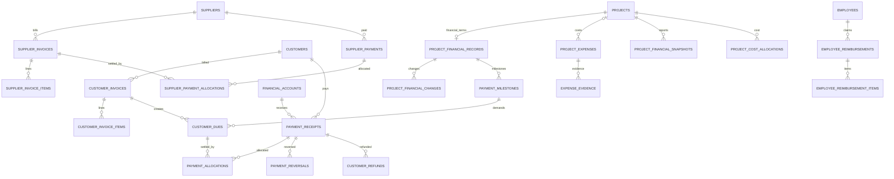

# Stage 2 — Finance, Payments, Receipts, Expenses & Project Profitability ER Design

Status: Proposed logical design for stakeholder review  
Date: 22 November 2026  
Dependencies: Customers/CRM, quotations, projects, procurement, inventory, installation/handover, employees, documents and audit domains.

## 1. Purpose and boundaries

This document defines the operational finance model for customer invoices/demand notes, payment milestones, receipts, allocations, refunds, adjustments, project expenses, supplier payments and project-level financial reporting.

This is an agency operations ledger design, not a complete statutory accounting/general-ledger specification. Confirm whether the platform must integrate with or replace an existing accounting package before implementation. GST treatment, tax rates, invoice numbering rules, retention periods and statutory documents must be confirmed by the agency's accountant/tax professional and current law.

No payment gateway is assumed. Payments can be recorded by authorized staff after independently confirming cash, bank transfer, UPI QR or other accepted receipt. A screenshot or customer-submitted claim alone is not proof that funds reached the agency account.

## 2. Core design principles

1. Quotation totals, project contract value, invoice/demand value, received money and recognized revenue are different concepts.
2. A payment receipt records money actually received and verified; an allocation applies that receipt to one or more customer dues.
3. Never edit or delete a posted receipt to correct an error. Use reversal, refund or adjustment records with reason and approval.
4. Support partial payments, multiple payment methods, split allocations, advance receipts and unallocated credits.
5. Every money movement is linked to a customer/project where applicable and to a cash/bank account.
6. Supplier bills and supplier payments are separate from purchase orders and goods receipts.
7. Expenses are recorded once and linked to a project, supplier/employee and supporting evidence where available.
8. Project profitability is a derived management view, not a manually editable total.
9. Currency, decimal precision, rounding and exchange handling are explicit. Do not use floating point for money.
10. Business master values are manually maintained through authorized application screens and stored in PostgreSQL. No hardcoded business lists or mock financial records.

## 3. Financial configuration and master data

### 3.1 Financial periods and currencies

**currencies**
- currency_id (PK)
- currency_code (unique, e.g. ISO code)
- currency_name
- minor_unit_digits
- is_active

**financial_periods**
- financial_period_id (PK)
- period_name
- starts_on
- ends_on
- period_status_id (FK → financial_period_statuses)
- closed_at (nullable)
- closed_by (nullable FK → employees)

**financial_period_statuses**
- financial_period_status_id (PK)
- code (unique)
- label
- is_active

A closed period must not accept backdated posting without an explicit authorized reopening/adjustment workflow. Currency codes are controlled reference data; actual business defaults are configured in the database.

### 3.2 Accounts and payment methods

**financial_accounts**
- financial_account_id (PK)
- account_name
- account_type_id (FK → financial_account_types)
- currency_id (FK → currencies)
- institution_name (nullable)
- account_reference_masked (nullable)
- upi_vpa (nullable, access-restricted)
- is_active
- created_at, created_by

Do not store internet banking passwords, UPI PINs, card security codes or other payment credentials. Bank account details and UPI identifiers require restricted access and appropriate masking.

**payment_methods**
- payment_method_id (PK)
- method_code (unique)
- method_name
- requires_reference
- is_active

**financial_account_types**, **payment_method_statuses** and related business configuration are database-managed master data. Payment methods may include cash, bank transfer, UPI, cheque or other methods only as enabled by the agency.

## 4. Customer dues, invoices and payment demands

### 4.1 Customer financial agreements

**project_financial_records**
- project_financial_record_id (PK)
- project_id (FK → projects, unique if one current summary per project)
- customer_id (FK → customers)
- accepted_quotation_version_id (nullable FK → quotation_versions)
- contract_currency_id (FK → currencies)
- agreed_contract_amount
- approved_change_amount
- current_contract_amount
- financial_status_id (FK → project_financial_statuses)
- effective_from
- created_at, created_by
- updated_at, updated_by

The accepted quotation version is an immutable commercial snapshot. Approved variations update the financial record through a separately audited change process; they do not rewrite the accepted quotation.

**project_financial_changes**
- project_financial_change_id (PK)
- project_financial_record_id (FK → project_financial_records)
- change_reference (unique)
- change_type_id (FK → financial_change_types)
- description
- amount_delta
- currency_id (FK → currencies)
- approval_status_id (FK → approval_statuses)
- requested_at, requested_by
- approved_at (nullable), approved_by (nullable FK → employees)
- supporting_document_id (nullable FK → documents)

Only approved changes affect current contract value.

### 4.2 Invoices / demand documents

**customer_invoices**
- customer_invoice_id (PK)
- invoice_number (unique within configured numbering scope)
- customer_id (FK → customers)
- project_id (nullable FK → projects)
- project_financial_record_id (nullable FK → project_financial_records)
- invoice_type_id (FK → invoice_types)
- invoice_status_id (FK → invoice_statuses)
- currency_id (FK → currencies)
- issue_date
- due_date (nullable)
- subtotal_amount
- discount_amount
- taxable_amount
- tax_amount
- total_amount
- notes (nullable)
- issued_document_id (nullable FK → documents)
- issued_at (nullable)
- issued_by (nullable FK → employees)
- created_at, created_by

**customer_invoice_items**
- customer_invoice_item_id (PK)
- customer_invoice_id (FK → customer_invoices)
- description
- item_type_id (FK → invoice_item_types)
- quantity
- unit_id (nullable FK → measurement_units)
- unit_price
- discount_amount
- tax_code_id (nullable FK → tax_codes)
- tax_rate_snapshot (nullable)
- taxable_amount
- tax_amount
- line_total
- source_quotation_item_id (nullable FK → quotation_items)

**invoice_status_history**
- invoice_status_history_id (PK)
- customer_invoice_id (FK → customer_invoices)
- previous_status_id (nullable FK → invoice_statuses)
- new_status_id (FK → invoice_statuses)
- changed_at
- changed_by (FK → employees)
- reason (nullable)

An invoice/demand document is issued only through an authorized workflow. Drafts may be edited; issued documents are immutable. Corrections use credit/debit notes or cancellation records as approved by the accountant and applicable rules.

### 4.3 Payment milestones and dues

**payment_milestones**
- payment_milestone_id (PK)
- project_financial_record_id (FK → project_financial_records)
- milestone_name
- sequence_number
- due_condition_description
- due_date (nullable)
- planned_amount
- currency_id (FK → currencies)
- milestone_status_id (FK → payment_milestone_statuses)
- source_quotation_milestone_id (nullable)
- created_at, created_by

**customer_dues**
- customer_due_id (PK)
- customer_id (FK → customers)
- project_id (nullable FK → projects)
- customer_invoice_id (nullable FK → customer_invoices)
- payment_milestone_id (nullable FK → payment_milestones)
- due_reference (unique)
- due_amount
- currency_id (FK → currencies)
- due_date (nullable)
- due_status_id (FK → customer_due_statuses)
- created_at, created_by

A due must have a clear source, such as an issued invoice or an approved milestone demand. Prevent duplicate dues for the same source. Do not create an invoice automatically merely because a milestone was reached unless the agency's approved billing workflow says so.

## 5. Receipts, verification and allocations

### 5.1 Receipt header

**payment_receipts**
- payment_receipt_id (PK)
- receipt_number (unique)
- customer_id (FK → customers)
- project_id (nullable FK → projects)
- financial_account_id (FK → financial_accounts)
- payment_method_id (FK → payment_methods)
- currency_id (FK → currencies)
- received_amount
- received_at
- external_reference (nullable)
- payer_name_snapshot (nullable)
- receipt_status_id (FK → receipt_statuses)
- verification_status_id (FK → payment_verification_statuses)
- verified_at (nullable)
- verified_by (nullable FK → employees)
- verification_notes (nullable)
- receipt_document_id (nullable FK → documents)
- recorded_at, recorded_by

**payment_receipt_evidence**
- payment_receipt_evidence_id (PK)
- payment_receipt_id (FK → payment_receipts)
- document_id (FK → documents)
- evidence_type_id (FK → payment_evidence_types)
- uploaded_at
- uploaded_by (FK → employees)
- review_status_id (FK → evidence_review_statuses)

A receipt is not treated as confirmed/posted until the required verification is completed. Cash handling should record who received and who verified it according to segregation-of-duties policy.

### 5.2 Receipt allocations

**payment_allocations**
- payment_allocation_id (PK)
- payment_receipt_id (FK → payment_receipts)
- customer_due_id (FK → customer_dues)
- allocated_amount
- currency_id (FK → currencies)
- allocation_status_id (FK → payment_allocation_statuses)
- allocated_at
- allocated_by (FK → employees)
- reversed_at (nullable)
- reversed_by (nullable FK → employees)
- reversal_reason (nullable)

A receipt may be allocated across multiple dues; a due may be paid by multiple receipts. Enforce that active allocations cannot exceed the verified receipt amount or the remaining due balance. Unallocated verified money remains customer credit/advance, not silently assigned.

**customer_account_credits**
- customer_account_credit_id (PK)
- customer_id (FK → customers)
- payment_receipt_id (FK → payment_receipts)
- original_amount
- available_amount
- currency_id (FK → currencies)
- credit_status_id (FK → customer_credit_statuses)
- created_at

Credit balance should be derived from immutable credit and allocation/reversal entries, or maintained as a transactionally updated projection with reconciliation. Avoid independently editing available_amount without a ledger trail.

### 5.3 Reversals, refunds and adjustments

**payment_reversals**
- payment_reversal_id (PK)
- payment_receipt_id (FK → payment_receipts)
- reversal_amount
- currency_id (FK → currencies)
- reversal_reason_id (FK → payment_reversal_reasons)
- explanation
- requested_at, requested_by
- approved_at (nullable), approved_by (nullable FK → employees)
- posted_at (nullable), posted_by (nullable FK → employees)
- reversal_status_id (FK → payment_reversal_statuses)
- evidence_document_id (nullable FK → documents)

**customer_refunds**
- customer_refund_id (PK)
- customer_id (FK → customers)
- payment_receipt_id (FK → payment_receipts)
- financial_account_id (FK → financial_accounts)
- refund_reference (unique)
- refund_amount
- currency_id (FK → currencies)
- refund_method_id (FK → payment_methods)
- requested_at, requested_by
- approved_at (nullable), approved_by (nullable FK → employees)
- paid_at (nullable)
- paid_reference (nullable)
- refund_status_id (FK → refund_statuses)
- evidence_document_id (nullable FK → documents)

**financial_adjustments**
- financial_adjustment_id (PK)
- customer_id (nullable FK → customers)
- project_id (nullable FK → projects)
- source_receipt_id (nullable FK → payment_receipts)
- source_due_id (nullable FK → customer_dues)
- adjustment_type_id (FK → financial_adjustment_types)
- amount
- currency_id (FK → currencies)
- reason
- approval_status_id (FK → approval_statuses)
- posted_at (nullable)
- posted_by (nullable FK → employees)
- evidence_document_id (nullable FK → documents)

Refunds and reversals must be approved and posted separately. A refund reduces customer credit/settlement but must not erase the original receipt. Enforce total refunds/reversals within the refundable/available amount.

## 6. Supplier bills and payments

Purchase orders and goods receipts prove ordering and receipt of goods; they do not prove that a supplier invoice was received or paid.

**supplier_invoices**
- supplier_invoice_id (PK)
- supplier_id (FK → suppliers)
- purchase_order_id (nullable FK → purchase_orders)
- goods_receipt_id (nullable FK → goods_receipts)
- supplier_invoice_number
- invoice_date
- due_date (nullable)
- currency_id (FK → currencies)
- subtotal_amount
- tax_amount
- total_amount
- invoice_status_id (FK → supplier_invoice_statuses)
- invoice_document_id (nullable FK → documents)
- received_at
- recorded_by (FK → employees)

**supplier_invoice_items**
- supplier_invoice_item_id (PK)
- supplier_invoice_id (FK → supplier_invoices)
- purchase_order_item_id (nullable FK → purchase_order_items)
- product_id (nullable FK → products)
- description
- quantity
- unit_id (nullable FK → measurement_units)
- unit_price
- tax_code_id (nullable FK → tax_codes)
- tax_rate_snapshot (nullable)
- line_total

**supplier_payments**
- supplier_payment_id (PK)
- supplier_id (FK → suppliers)
- financial_account_id (FK → financial_accounts)
- payment_method_id (FK → payment_methods)
- currency_id (FK → currencies)
- payment_reference (unique)
- paid_amount
- paid_at
- external_reference (nullable)
- payment_status_id (FK → supplier_payment_statuses)
- recorded_by (FK → employees)
- verified_by (nullable FK → employees)
- evidence_document_id (nullable FK → documents)

**supplier_payment_allocations**
- supplier_payment_allocation_id (PK)
- supplier_payment_id (FK → supplier_payments)
- supplier_invoice_id (FK → supplier_invoices)
- allocated_amount
- allocated_at
- allocated_by (FK → employees)

Support partial supplier payments and one payment settling multiple bills. Apply duplicate invoice checks using supplier + normalized invoice number + date/amount warning; do not silently merge records.

## 7. Project expenses and reimbursements

**expense_categories**
- expense_category_id (PK)
- category_name
- parent_category_id (nullable FK → expense_categories)
- requires_project
- requires_receipt_evidence
- is_active

**project_expenses**
- project_expense_id (PK)
- project_id (nullable FK → projects)
- customer_id (nullable FK → customers)
- expense_category_id (FK → expense_categories)
- supplier_id (nullable FK → suppliers)
- employee_id (nullable FK → employees)
- financial_account_id (nullable FK → financial_accounts)
- expense_reference (unique)
- expense_date
- description
- quantity (nullable)
- unit_id (nullable FK → measurement_units)
- net_amount
- tax_amount
- gross_amount
- currency_id (FK → currencies)
- expense_status_id (FK → expense_statuses)
- recorded_at, recorded_by
- approved_at (nullable), approved_by (nullable FK → employees)
- posted_at (nullable), posted_by (nullable FK → employees)

**expense_evidence**
- expense_evidence_id (PK)
- project_expense_id (FK → project_expenses)
- document_id (FK → documents)
- evidence_type_id (FK → expense_evidence_types)
- uploaded_at
- uploaded_by (FK → employees)

**employee_reimbursements**
- employee_reimbursement_id (PK)
- employee_id (FK → employees)
- project_id (nullable FK → projects)
- reimbursement_reference (unique)
- submitted_at
- approved_at (nullable)
- approved_by (nullable FK → employees)
- total_claimed_amount
- total_approved_amount
- currency_id (FK → currencies)
- reimbursement_status_id (FK → reimbursement_statuses)
- paid_at (nullable)
- paid_from_account_id (nullable FK → financial_accounts)
- payment_reference (nullable)

**employee_reimbursement_items**
- employee_reimbursement_item_id (PK)
- employee_reimbursement_id (FK → employee_reimbursements)
- expense_category_id (FK → expense_categories)
- expense_date
- description
- amount
- currency_id (FK → currencies)
- project_id (nullable FK → projects)
- evidence_document_id (nullable FK → documents)
- review_status_id (FK → expense_review_statuses)

Avoid double-counting an expense and reimbursement for the same cost. The accounting policy must define when an employee claim becomes an expense and how the payable is cleared on reimbursement.

## 8. Project profitability and financial snapshots

**project_financial_snapshots**
- project_financial_snapshot_id (PK)
- project_id (FK → projects)
- snapshot_at
- currency_id (FK → currencies)
- contract_value
- approved_variations
- invoiced_amount
- verified_receipts
- allocated_receipts
- outstanding_customer_dues
- customer_credits
- supplier_costs
- project_expenses
- payroll_or_labour_cost (nullable)
- estimated_remaining_cost (nullable)
- actual_cost_total
- estimated_final_cost (nullable)
- estimated_gross_margin (nullable)
- calculation_version
- generated_at
- generated_by (nullable FK → employees)

Snapshots are generated from source transactions and must be reproducible by calculation version. Do not allow users to edit calculated profitability fields. Clearly label cash collected, invoiced amount, actual cost, forecast cost and margin; do not call all of them revenue or profit interchangeably.

**project_cost_allocations**
- project_cost_allocation_id (PK)
- project_id (FK → projects)
- source_expense_id (nullable FK → project_expenses)
- source_supplier_invoice_item_id (nullable FK → supplier_invoice_items)
- source_stock_movement_id (nullable FK → stock_movements)
- source_reimbursement_item_id (nullable FK → employee_reimbursement_items)
- allocation_amount
- currency_id (FK → currencies)
- allocation_basis_id (FK → cost_allocation_bases)
- allocated_at
- allocated_by (FK → employees)

Each cost source must be allocated at most once to a project for a given allocation purpose. Inventory cost attribution must reconcile to the inventory valuation method; stock issue and installation material usage must not both create duplicate project costs.

## 9. Optional accounting integration boundary

If a formal accounting package is retained, add integration records rather than duplicating its ledger as an editable parallel system:

**accounting_integrations**
- accounting_integration_id (PK)
- provider_name
- connection_status_id (FK → integration_statuses)
- configuration_reference (secret reference only)
- created_at, created_by

**accounting_sync_records**
- accounting_sync_record_id (PK)
- accounting_integration_id (FK → accounting_integrations)
- source_entity_type
- source_entity_id
- external_record_reference
- sync_status_id (FK → accounting_sync_statuses)
- attempted_at
- completed_at (nullable)
- error_summary (nullable)

**accounting_sync_events**
- accounting_sync_event_id (PK)
- accounting_sync_record_id (FK → accounting_sync_records)
- event_type
- event_payload_reference
- occurred_at

Do not store credentials in ordinary configuration fields. Define the accounting system of record, mapping, retry, idempotency and reconciliation before enabling sync.

## 10. Mermaid ER overview

## 11. Posting and reconciliation workflows

### Customer receipt
1. Staff selects customer and optionally project/due.
2. Enter amount, currency, method, destination account, received date and reference.
3. Attach supporting evidence where required.
4. A verifier confirms funds in the relevant cash/bank account.
5. Post the receipt with an immutable receipt number and audit event.
6. Allocate all or part of the receipt to one or more open dues, or retain as customer advance.
7. Reconcile receipt, allocation and financial-account records.

### Correcting a receipt
1. Request reversal with reason and evidence.
2. Apply approval according to configured authority.
3. Post reversal as a separate transaction.
4. Reopen affected dues or restore customer credit as appropriate.
5. Refund separately if money is actually returned.
6. Retain the original receipt and complete history.

### Supplier payment
1. Record supplier invoice and validate it against PO/goods receipt where applicable.
2. Review duplicate invoice warning and amount/tax details.
3. Approve payable according to policy.
4. Record actual payment and destination account.
5. Allocate payment to one or more supplier invoices.
6. Reconcile unpaid balances and supplier statement.

### Project expense
1. Capture expense with category, date, project (if applicable), payer/payee and amount.
2. Attach invoice/receipt evidence as required.
3. Submit for review/approval.
4. Post only after required approval.
5. Allocate to project cost once and reconcile with inventory/payables/reimbursement sources.

## 12. Validation, precision and integrity

- Use PostgreSQL NUMERIC for monetary amounts; define precision/scale centrally and never use floating point.
- Store currency on every monetary transaction; do not sum across currencies without an explicit conversion record and rate source.
- Define rounding at line, tax and document levels with accountant approval.
- Enforce positive amounts for ordinary receipts/payments; use explicit reversal/refund transaction types for negative economic effects.
- Enforce allocations within receipt remaining balance and due remaining balance using transactional locking or equivalent concurrency-safe logic.
- Prevent duplicate receipt references within the configured account/method scope where relevant.
- Posted transactions are immutable; corrections use compensating records.
- Invoice numbering must be concurrency-safe and period-aware if required.
- Closed financial periods reject ordinary posting.
- Approval separation should prevent a user from approving their own transaction above configured thresholds.
- Every posted transaction records actor, timestamp, source, reason, approval and audit trail.
- Use idempotency keys for mobile/API submission retries to prevent duplicate receipts/expenses.
- Maintain reconciliation reports for bank/cash account, receipts, allocations, refunds, supplier payments and project costs.

## 13. Permissions and privacy

Suggested permission capabilities, to be configured against the organization access-control model:
- view customer/project financial summary
- create and edit draft invoices
- issue/cancel invoices
- record receipt
- verify/post receipt
- allocate/reverse payment allocation
- request/approve/post refund
- create/approve/post expense
- record supplier invoice/payment
- view bank/cash account details
- close/reopen financial period
- view profitability and cost breakdown
- export financial reports

Enforce permissions server-side at resource and amount scope. Staff who can record a receipt should not automatically be able to verify it or issue a refund. Mask account details and restrict financial exports. Customer users may view only their own authorized invoices, dues, receipts and statements.

## 14. API and reporting expectations

APIs should support:
- financial terms and approved contract variations
- invoice draft, issue, cancellation and credit/debit note workflow
- milestone dues and outstanding balance calculation
- receipt recording, verification, posting and allocation
- customer statement and advance-credit balance
- receipt reversal and refund workflow
- supplier invoices, payments and allocations
- expenses, evidence, approvals and reimbursements
- project cost allocation and profitability snapshots
- financial period close/reconciliation

Reports:
- customer ledger, invoices, dues and ageing
- verified receipts by method/account/date
- unallocated advances and customer credits
- receipt verification pending queue
- refunds/reversals and approvals
- supplier payable ageing and payment history
- project-wise material, supplier, labour and overhead costs
- contract value versus approved variations and billed amount
- project cash collected versus outstanding dues
- actual and forecast project margin
- account reconciliation exceptions and period close checklist

## 15. Open stakeholder and accountant decisions

1. Is this module an operational subledger or the primary accounting system?
2. Which accounting package, if any, is already used?
3. What invoice, receipt, credit note and debit note formats/numbering rules are required?
4. Which GST/tax categories and calculations apply to each sale/service type? Obtain professional confirmation.
5. Are advance receipts, milestone billing, retention and partial invoices required?
6. Which payment methods and bank/cash accounts are used?
7. Who records, verifies, approves and refunds receipts? What are the approval thresholds?
8. Is customer portal payment status informational or must it display verified bank reconciliation?
9. How are supplier bills matched to purchase orders and goods receipts?
10. How should labour, travel, vehicle, warranty and overhead costs be allocated?
11. Which inventory valuation/costing method is used?
12. Are employee advances and reimbursements required in the first release?
13. What financial period and month-end close process is followed?
14. Which currencies are actually used?
15. What reports and exports are needed by management and the accountant?

## 16. Acceptance checklist

- [ ] Contract value, invoices, dues, receipts, allocations and revenue are distinct.
- [ ] Partial payments and multiple allocations are supported.
- [ ] Unallocated verified advances remain visible.
- [ ] Receipt verification is separate from receipt entry.
- [ ] Posted receipts cannot be edited/deleted; reversal/refund is auditable.
- [ ] Supplier invoices are separate from purchase orders and supplier payments.
- [ ] Expenses include evidence, approval and project allocation.
- [ ] Inventory and expense cost sources cannot be double-counted.
- [ ] Project profitability is reproducibly calculated from source records.
- [ ] Monetary values use exact decimal arithmetic and explicit currency.
- [ ] Period close, reconciliation, role separation and audit are enforced.
- [ ] Master business values are manually maintained in PostgreSQL through authorized screens; no mock records or hardcoded business lists.

## 17. Implementation note

Build the operational receipt, allocation, invoice/due and expense flows only after the agency confirms its accounting system of record, invoice/tax requirements, approval hierarchy and reconciliation process. Have the accountant validate all tax, invoice, credit-note, period-close and reporting rules before production use. This document is a data-design proposal, not accounting or tax advice.
