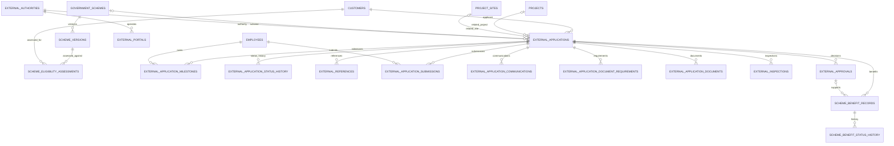

# Stage 2 — Government Applications, Subsidies, Approvals & External Portal Tracking ER Design

Status: Proposed logical design for stakeholder review  
Date: 22 November 2026  
Dependencies: Customer/CRM, survey/design/quotation, project management, documents and organization/access-control domains.

## 1. Purpose and boundaries

This document defines how the platform records government or utility-related applications, subsidy/scheme eligibility assessments, supporting documents, submission milestones, external reference numbers, approvals and status updates.

The platform is an operational tracking system. The relevant government department, distribution utility, portal or authorized agency remains the authoritative source for its application decision and official status. The design does not assume that any portal offers an API, permits automation, or authorizes the agency to submit on a customer's behalf. Integration must be separately verified and approved.

An application may be related to a customer, project, installation site, scheme and external authority. It may exist before project creation if the approved business process requires early eligibility or application work; the exact trigger is a stakeholder decision.

This is a logical design, not final SQL. No mock records are included.

## 2. Design principles

1. Keep the platform's internal workflow status separate from the external authority's reported status.
2. Preserve official application references, submission evidence, receipts, communications and status history.
3. Never represent an application as submitted or approved without appropriate evidence.
4. Scheme eligibility is an assessment, not a promise of subsidy or approval.
5. Government scheme names, authority types, application categories, statuses, checklist requirements and document types are database-managed master data.
6. No portal integration is assumed. Start with controlled manual recording; add an integration only after written/technical authorization and verification.
7. Do not store portal passwords, OTPs, Aadhaar credentials or other authentication secrets in ordinary application tables or repository files.
8. Personal and financial data must be minimized, permission-restricted and retained only under an approved policy.
9. Corrections to application details and external statuses must be auditable.
10. Government/utility decisions are not created or altered by the agency's internal workflow.

## 3. Core entities

### 3.1 External authorities and portals

**external_authorities**
- external_authority_id (PK)
- authority_name
- authority_type_id (FK → authority_types)
- jurisdiction_description (nullable)
- official_website_url (nullable)
- contact_information (nullable)
- is_active
- created_at, created_by
- updated_at, updated_by

**external_portals**
- external_portal_id (PK)
- external_authority_id (FK → external_authorities)
- portal_name
- official_portal_url
- portal_purpose (nullable)
- integration_capability_status_id (FK → integration_capability_statuses)
- verified_at (nullable)
- verification_notes (nullable)
- is_active
- created_at, created_by

A portal URL is reference information, not proof that automation is permitted. Store verification date and capability status. Do not store usernames, passwords, OTP seeds or session cookies here.

### 3.2 Scheme and program master data

**government_schemes**
- government_scheme_id (PK)
- external_authority_id (FK → external_authorities)
- scheme_name
- scheme_code (nullable, unique where supplied by authority)
- scheme_description (nullable)
- scheme_status_id (FK → scheme_statuses)
- effective_from (nullable)
- effective_to (nullable)
- official_information_url (nullable)
- terms_document_id (nullable FK → documents)
- last_verified_at (nullable)
- created_at, created_by
- updated_at, updated_by

**scheme_versions**
- scheme_version_id (PK)
- government_scheme_id (FK → government_schemes)
- version_number
- effective_from
- effective_to (nullable)
- eligibility_summary_snapshot
- benefit_rules_snapshot (structured data)
- required_document_rules_snapshot (structured data)
- terms_document_id (nullable FK → documents)
- verified_by (nullable FK → employees)
- verified_at (nullable)
- source_reference (nullable)
- created_at, created_by

Scheme terms and eligibility can change. Store versioned snapshots and the source/verification date used for an assessment. Do not encode assumed subsidy amounts, capacity limits, consumer categories or deadlines as permanent code constants. Confirm current scheme terms from authoritative sources before advising customers.

Scheme status and scheme category are database-managed master values. Authorized administrators maintain them through the application.

### 3.3 Application record

**external_applications**
- external_application_id (PK)
- application_reference_internal (unique, generated)
- customer_id (FK → customers)
- project_id (nullable FK → projects)
- project_site_id (nullable FK → project_sites)
- government_scheme_id (nullable FK → government_schemes)
- scheme_version_id (nullable FK → scheme_versions)
- external_authority_id (FK → external_authorities)
- external_portal_id (nullable FK → external_portals)
- application_type_id (FK → application_types)
- internal_application_status_id (FK → internal_application_statuses)
- external_status_id (nullable FK → external_statuses)
- official_application_number (nullable)
- applicant_name_snapshot
- applicant_contact_snapshot (nullable)
- installation_address_snapshot (nullable)
- submitted_at (nullable)
- last_external_status_at (nullable)
- last_checked_at (nullable)
- next_action_due_at (nullable)
- responsible_employee_id (nullable FK → employees)
- created_at, created_by
- updated_at, updated_by
- closed_at (nullable)

The official application number is unique within the relevant authority/portal where available; do not assume it is globally unique. Use a composite uniqueness rule scoped to authority and application identifier, accounting for null/unknown values.

Application snapshots preserve what was submitted. If the customer, contact or installation address later changes, the historical submission must remain intelligible.

### 3.4 Eligibility assessment

**scheme_eligibility_assessments**
- scheme_eligibility_assessment_id (PK)
- customer_id (FK → customers)
- project_id (nullable FK → projects)
- government_scheme_id (FK → government_schemes)
- scheme_version_id (FK → scheme_versions)
- assessment_status_id (FK → eligibility_assessment_statuses)
- assessed_at
- assessed_by (FK → employees)
- eligibility_result_id (FK → eligibility_results)
- assessment_inputs_snapshot (structured data)
- assumptions_and_limitations
- source_reference (nullable)
- reviewed_by (nullable FK → employees)
- reviewed_at (nullable)
- supersedes_assessment_id (nullable FK → scheme_eligibility_assessments)

An assessment is based on a particular scheme version and recorded input snapshot. Possible results may include eligible, potentially eligible, ineligible, or unable to determine, but exact labels are configurable. It is not an official government approval. Reassessment creates a new record and preserves the previous assessment.

### 3.5 Application milestones and history

**external_application_milestones**
- external_application_milestone_id (PK)
- external_application_id (FK → external_applications)
- milestone_type_id (FK → external_application_milestone_types)
- milestone_name_snapshot
- internal_milestone_status_id (FK → internal_milestone_statuses)
- external_status_snapshot (nullable)
- planned_due_at (nullable)
- completed_at (nullable)
- owner_employee_id (nullable FK → employees)
- notes (nullable)
- created_at, created_by
- updated_at, updated_by

**external_application_status_history**
- external_application_status_history_id (PK)
- external_application_id (FK → external_applications)
- status_source_id (FK → status_sources) 
- previous_internal_status_id (nullable FK → internal_application_statuses)
- new_internal_status_id (nullable FK → internal_application_statuses)
- previous_external_status_id (nullable FK → external_statuses)
- new_external_status_id (nullable FK → external_statuses)
- recorded_at
- effective_at (nullable)
- recorded_by (nullable FK → employees)
- source_reference (nullable)
- evidence_document_id (nullable FK → documents)
- notes (nullable)

The status source identifies whether a change was entered by an employee, imported through an approved integration, or received through another verified channel. Retain both the time the authority's status took effect (if known) and the time the platform recorded it.

**external_references**
- external_reference_id (PK)
- external_application_id (FK → external_applications)
- reference_type_id (FK → external_reference_types)
- reference_value
- issued_at (nullable)
- issuing_authority_id (nullable FK → external_authorities)
- evidence_document_id (nullable FK → documents)
- created_at, created_by

This supports multiple official references such as acknowledgement, application, inspection or sanction references without overloading one field.

### 3.6 Submission and communication events

**external_application_submissions**
- external_application_submission_id (PK)
- external_application_id (FK → external_applications)
- submission_channel_id (FK → submission_channels)
- submitted_at
- submitted_by (FK → employees)
- official_receipt_reference (nullable)
- receipt_document_id (nullable FK → documents)
- submitted_payload_snapshot (restricted structured data; store only what is necessary)
- submission_notes (nullable)

A manual portal submission is recorded only after the employee confirms the action and attaches or records the available acknowledgement. A planned submission or draft must not be marked submitted.

**external_application_communications**
- external_application_communication_id (PK)
- external_application_id (FK → external_applications)
- communication_direction_id (FK → communication_directions)
- communication_channel_id (FK → communication_channels)
- communicated_at
- external_contact_or_department (nullable)
- subject (nullable)
- summary
- reference_number (nullable)
- evidence_document_id (nullable FK → documents)
- recorded_by (FK → employees)

Record relevant notices, clarifications, requests for information, inspection scheduling and official correspondence. Do not store unnecessary personal information about public officials or unrelated parties.

### 3.7 Documents and checklist requirements

**external_application_document_requirements**
- external_application_document_requirement_id (PK)
- external_application_id (FK → external_applications)
- document_requirement_type_id (FK → document_requirement_types)
- requirement_name_snapshot
- is_mandatory
- requirement_status_id (FK → document_requirement_statuses)
- due_at (nullable)
- reviewed_by (nullable FK → employees)
- reviewed_at (nullable)
- review_notes (nullable)

**external_application_documents**
- external_application_document_id (PK)
- external_application_id (FK → external_applications)
- document_id (FK → documents)
- document_requirement_id (nullable FK → external_application_document_requirements)
- document_purpose_id (FK → document_purposes)
- document_version_label (nullable)
- issued_at (nullable)
- expires_at (nullable)
- submitted_to_authority_at (nullable)
- submitted_by (nullable FK → employees)
- verification_status_id (FK → document_verification_statuses)
- created_at, created_by

The document table stores references/metadata; bytes remain in private file storage. The requirement checklist is based on the scheme version and authority's current instructions. A missing document is not the same as an invalid document. Preserve replaced versions and submission evidence.

### 3.8 Inspections and approvals

**external_inspections**
- external_inspection_id (PK)
- external_application_id (FK → external_applications)
- inspection_type_id (FK → inspection_types)
- scheduled_at (nullable)
- conducted_at (nullable)
- inspection_status_id (FK → inspection_statuses)
- external_inspector_reference (nullable)
- result_status_id (nullable FK → inspection_result_statuses)
- findings_summary (nullable)
- evidence_document_id (nullable FK → documents)
- recorded_by (FK → employees)
- created_at

**external_approvals**
- external_approval_id (PK)
- external_application_id (FK → external_applications)
- approval_type_id (FK → external_approval_types)
- external_decision_status_id (FK → external_decision_statuses)
- official_order_or_reference (nullable)
- decision_date (nullable)
- effective_from (nullable)
- effective_to (nullable)
- approved_capacity_value (nullable)
- capacity_unit_id (nullable FK → measurement_units)
- approved_benefit_snapshot (nullable structured data)
- decision_document_id (nullable FK → documents)
- recorded_at
- recorded_by (FK → employees)
- verified_at (nullable)
- verified_by (nullable FK → employees)

An approval record represents an external decision as evidenced by an official source. It is not created merely because the internal team completed a milestone. Store benefit amounts/capacity only when stated in the official decision, including currency/unit and relevant conditions.

## 4. Subsidy and benefit tracking

Where a scheme includes a financial benefit, model the expected, approved, claimed and actually received amounts as distinct facts.

**scheme_benefit_records**
- scheme_benefit_record_id (PK)
- external_application_id (FK → external_applications)
- benefit_type_id (FK → benefit_types)
- benefit_stage_id (FK → benefit_stages)
- amount (nullable)
- currency_id (nullable FK → currencies)
- capacity_value (nullable)
- capacity_unit_id (nullable FK → measurement_units)
- source_approval_id (nullable FK → external_approvals)
- effective_date (nullable)
- evidence_document_id (nullable FK → documents)
- recorded_at, recorded_by

**scheme_benefit_status_history**
- scheme_benefit_status_history_id (PK)
- scheme_benefit_record_id (FK → scheme_benefit_records)
- from_status_id (nullable FK → benefit_statuses)
- to_status_id (FK → benefit_statuses)
- changed_at
- changed_by (nullable FK → employees)
- source_reference (nullable)
- evidence_document_id (nullable FK → documents)
- notes (nullable)

Use separate stages/statuses for estimated, eligibility-assessed, officially approved, claimed, disbursed, partially disbursed, rejected or reversed as applicable. Do not treat an estimate or approval as money received. If the business needs bank reconciliation, disbursement transactions and accounting entries belong to a separately defined finance domain.

## 5. Mermaid ER overview

## 6. Application lifecycle and operational workflow

1. **Identify applicable scheme/process:** authorized staff select the scheme and scheme version after checking current official information.
2. **Assess eligibility:** record the inputs, evidence, assessment date, assessor and limitations. Communicate that eligibility assessment is not an approval.
3. **Create application:** link customer, project/site where applicable, authority, portal, scheme version and responsible employee.
4. **Prepare documents:** create the required document checklist from the applicable scheme version; upload evidence to private storage and track review status.
5. **Internal review:** confirm required fields, document validity, customer authorization and any required internal approval.
6. **Submit externally:** staff submit through the official authorized channel. Record the time, channel, official reference and receipt evidence only after submission.
7. **Track milestones:** maintain internal actions separately from external authority milestones/status.
8. **Record external updates:** enter the exact reported status, source, date and evidence. Approved integrations may update only after their authorization and data mapping are verified.
9. **Inspection/clarification:** record requests, scheduled inspections, findings and responses with ownership and due dates.
10. **Record decision:** record approval/rejection/other official decision with reference and decision document.
11. **Track benefit:** distinguish estimated, approved, claimed and disbursed benefit stages; record evidence for each.
12. **Close and retain:** close internal work when its completion criteria are met, preserving the official status and audit history.

## 7. Master data policy

The following are business master/configuration records and must be created/maintained through authorized application screens and stored in PostgreSQL:
- authority_types
- integration_capability_statuses
- scheme_statuses and scheme categories
- application_types
- internal_application_statuses and permitted transitions
- external_statuses
- eligibility_assessment_statuses and eligibility_results
- external_application_milestone_types and internal_milestone_statuses
- status_sources
- external_reference_types
- submission_channels
- communication_directions
- communication channels
- document_requirement_types and document_requirement_statuses
- document_purposes and document_verification_statuses
- inspection_types, inspection_statuses and inspection_result_statuses
- external_approval_types and external_decision_statuses
- benefit_types, benefit_stages and benefit_statuses

No hardcoded business dropdown arrays, seed business lists or mock application records. Database migrations create schema and technical constraints only; master values are entered by authorized users. Scheme versions and requirement rules must be updated from verified current sources, with effective dates and audit trails.

## 8. Security, privacy and integration controls

- Enforce role and resource-scope checks for applicant identity, scheme documents, official references and benefit information.
- Separate internal notes from customer-visible status updates.
- Store documents privately with access-controlled download endpoints and document access logs.
- Encrypt sensitive data at rest and in transit; mask identifiers where full display is unnecessary.
- Do not store portal passwords, OTPs, session cookies, private keys or reusable authentication tokens in these tables.
- Do not automate CAPTCHA, bypass access controls or scrape restricted portals.
- Integrate only through an official documented API or approved channel with appropriate authorization, terms and security review.
- Maintain integration connection credentials in a dedicated secrets-management mechanism, not in ordinary records or Git.
- Log every manual external status entry and every integration event with source and evidence.
- Make status synchronization idempotent and retain raw event references where legally/contractually permitted.
- Apply retention, correction, deletion/anonymization and consent policies after privacy/legal review.

## 9. API and application expectations

- Scheme and authority catalogue management with effective-dated scheme versions.
- Eligibility assessment creation and review.
- Application create/update, internal assignment and milestone management.
- Document checklist, upload metadata, review and expiry handling.
- Submission recording and receipt attachment.
- External status update with source and evidence.
- Inspection and approval record management.
- Benefit stage tracking.
- Customer-facing progress endpoint that exposes only approved, understandable status and next-step information.
- Integration adapters must be isolated from core application logic and enabled only for verified providers.
- Every write validates authorization, related entity ownership, valid transitions, mandatory evidence and audit requirements server-side.

## 10. Open stakeholder decisions

1. Which government/utility schemes and application types are actually in scope?
2. Which authority/portal processes are performed by the agency, the customer or a third party?
3. What written authorization or customer consent is required for staff to submit or view applications?
4. Which application process starts before project creation, if any?
5. What official status values and milestone steps are encountered in the current process?
6. Which documents are required for each scheme/version and who verifies them?
7. Who can declare an application internally ready for submission?
8. Which inspections, clarifications and external approvals must be tracked?
9. Which benefit stages and evidence are required to distinguish approval from disbursement?
10. Are official APIs available and permitted? If yes, provide current official documentation and credentials through a secure secret-management process, never this repository.
11. What application progress can customers see?
12. What retention and privacy rules apply to identity, utility and financial documents?

## 11. Acceptance checklist

- [ ] Internal status and external authority status are separate.
- [ ] Scheme versions and eligibility assessment snapshots are preserved.
- [ ] Application can be linked to customer, project and site without conflating them.
- [ ] Submission requires an explicit recorded event and available receipt/reference evidence.
- [ ] External status changes retain source, timestamp, actor and evidence.
- [ ] Document requirements and uploaded versions are tracked separately.
- [ ] Inspection and official decision records preserve source documents.
- [ ] Estimated, approved, claimed and disbursed benefits are not conflated.
- [ ] No unsupported portal API or automation is assumed.
- [ ] Sensitive credentials are never stored in application records or Git.
- [ ] Master values are manually managed in PostgreSQL through authorized screens; no hardcoded business lists or mock records.
- [ ] Customer-facing progress is explicitly scoped and does not expose internal notes or sensitive documents.

## 12. Implementation note

Implement after customer/CRM, project, document and access-control foundations. First map the real schemes and authority workflow from current official documentation and stakeholder evidence. Keep manual tracking as the baseline until an authorized, documented integration is verified. This design does not guarantee eligibility, subsidy payment, government approval or portal access.
