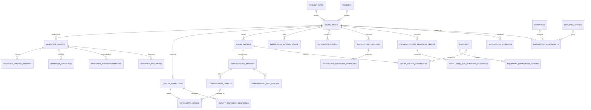

# Stage 2 — Installation, Commissioning, Quality Inspection & Customer Handover ER Design

Status: Proposed logical design for stakeholder review  
Date: 22 November 2026  
Dependencies: Project management, survey/design/quotation, product catalogue, procurement/inventory, documents and organization/access-control domains.

## 1. Purpose and scope

This document defines the operational data model for on-site installation execution, technician/team assignment, installation schedules, checklist completion, material consumption, evidence capture, commissioning tests, quality inspections, defect correction, handover documents and customer acknowledgement.

Installation is a project execution workstream. It is not the same as project status, material issue, commissioning, customer handover or monitoring activation. Each is recorded as a distinct event/entity so the platform can establish what was planned, what was installed, what was tested, what was accepted and what remains pending.

Technical procedures, electrical safety requirements, inspection thresholds and commissioning acceptance criteria must be supplied or approved by qualified personnel and current applicable standards. This schema does not prescribe electrical engineering values.

This is a logical design, not final SQL. No mock installation records, checklist answers, serial numbers or customer acknowledgements are included.

## 2. Design principles

1. Every installation is linked to a project and a specific project site.
2. Installation execution, installation schedule, checklist, material usage, commissioning, quality inspection and handover are separate records.
3. Installed equipment must be traceable to product/model, serial number where applicable, stock movement and project.
4. Material issued to a project is not automatically treated as installed or consumed.
5. Checklist templates and procedures are versioned; historical responses retain the exact template version used.
6. Evidence files are stored privately and referenced by document IDs.
7. Commissioning test results are structured, unit-aware and tied to a specific installed system/version.
8. Failed checks and defects must create actionable corrective work; a failed inspection cannot be silently marked passed.
9. Handover is a controlled milestone with required documents, training/acknowledgement and unresolved-item handling.
10. Installation, inspection, commissioning and handover statuses/master values are manually managed in PostgreSQL through authorized screens; no hardcoded business lists or mock data.

## 3. Installation execution

### 3.1 Installations

**installations**
- installation_id (PK)
- project_id (FK → projects)
- project_site_id (FK → project_sites)
- installation_reference (unique, generated)
- installation_type_id (FK → installation_types)
- installation_status_id (FK → installation_statuses)
- planned_start_at (nullable)
- planned_end_at (nullable)
- actual_start_at (nullable)
- actual_end_at (nullable)
- installation_lead_employee_id (nullable FK → employees)
- scope_snapshot (nullable)
- site_readiness_status_id (FK → site_readiness_statuses)
- site_readiness_notes (nullable)
- created_at, created_by
- updated_at, updated_by

One project may have multiple installations if there are multiple sites, phases or rework visits. Confirm the required cardinality. A single installation must belong to one project site.

### 3.2 Installation assignments

**installation_assignments**
- installation_assignment_id (PK)
- installation_id (FK → installations)
- employee_id (nullable FK → employees)
- employee_group_id (nullable FK → employee_groups)
- assignment_role_id (FK → installation_assignment_roles)
- assigned_at
- assigned_by (FK → employees)
- accepted_at (nullable)
- unassigned_at (nullable)
- unassigned_by (nullable FK → employees)
- assignment_notes (nullable)

Exactly one of employee_id or employee_group_id must be populated per assignment. Assignment to a group is an operational allocation and does not itself grant access; permissions and project scope remain enforced by the authorization service.

### 3.3 Installation schedule

**installation_schedules**
- installation_schedule_id (PK)
- installation_id (FK → installations)
- schedule_version
- schedule_status_id (FK → installation_schedule_statuses)
- planned_start_at
- planned_end_at
- approved_at (nullable)
- approved_by (nullable FK → employees)
- created_at, created_by
- revision_reason (nullable)

**installation_schedule_history**
- installation_schedule_history_id (PK)
- installation_id (FK → installations)
- previous_schedule_id (nullable FK → installation_schedules)
- new_schedule_id (FK → installation_schedules)
- changed_at
- changed_by (FK → employees)
- reason_id (FK → reschedule_reasons)
- explanation (nullable)
- customer_notification_required
- customer_notification_status_id (nullable FK → communication_statuses)

Schedule revisions preserve the previous plan and record the reason and actor. The current schedule pointer should be updated transactionally.

## 4. Site readiness and installation checklists

### 4.1 Site readiness assessment

**installation_site_readiness_checks**
- installation_site_readiness_check_id (PK)
- installation_id (FK → installations)
- checklist_template_version_id (FK → checklist_template_versions)
- readiness_status_id (FK → site_readiness_statuses)
- assessed_at
- assessed_by (FK → employees)
- notes (nullable)
- next_review_at (nullable)

**installation_site_readiness_responses**
- installation_site_readiness_response_id (PK)
- installation_site_readiness_check_id (FK → installation_site_readiness_checks)
- checklist_item_id (FK → checklist_items)
- response_value
- response_notes (nullable)
- evidence_document_id (nullable FK → documents)
- responded_at
- responded_by (FK → employees)

Readiness items and acceptance rules are defined by approved templates. Do not infer readiness from a single free-text note. A not-ready site should block or require explicit authorized override before installation scheduling/commencement.

### 4.2 Installation checklists

**installation_checklists**
- installation_checklist_id (PK)
- installation_id (FK → installations)
- checklist_template_version_id (FK → checklist_template_versions)
- checklist_stage_id (FK → installation_checklist_stages)
- completion_status_id (FK → checklist_completion_statuses)
- completed_at (nullable)
- completed_by (nullable FK → employees)
- reviewed_at (nullable)
- reviewed_by (nullable FK → employees)

**installation_checklist_responses**
- installation_checklist_response_id (PK)
- installation_checklist_id (FK → installation_checklists)
- checklist_item_id (FK → checklist_items)
- response_status_id (FK → checklist_response_statuses)
- response_value (nullable)
- response_notes (nullable)
- evidence_document_id (nullable FK → documents)
- responded_at
- responded_by (FK → employees)

Checklist templates, template versions, checklist stages and items are database-managed. An item can require a response, evidence, reviewer sign-off or corrective action according to its versioned configuration. Editing a template must not rewrite historical checklist responses.

### 4.3 Installation evidence

**installation_photos**
- installation_photo_id (PK)
- installation_id (FK → installations)
- document_id (FK → documents)
- photo_category_id (FK → installation_photo_categories)
- captured_at (nullable)
- captured_by (nullable FK → employees)
- caption (nullable)
- related_checklist_response_id (nullable FK → installation_checklist_responses)
- review_status_id (FK → evidence_review_statuses)

Store the file privately. Preserve document hash/metadata and access logs through the documents domain. Capture location metadata only where justified, disclosed and approved.

## 5. Material usage and traceability

### 5.1 Installation material usage

**installation_material_usage**
- installation_material_usage_id (PK)
- installation_id (FK → installations)
- project_material_issue_item_id (nullable FK → project_material_issue_items)
- project_material_allocation_id (nullable FK → project_material_allocations)
- product_id (FK → products)
- product_specification_id (nullable FK → product_specifications)
- quantity_used
- unit_id (FK → measurement_units)
- batch_or_lot_reference (nullable)
- serial_number (nullable)
- usage_status_id (FK → installation_material_usage_statuses)
- used_at
- used_by (FK → employees)
- notes (nullable)

Material usage references the issue/allocation where available. It must not create a second stock-out movement if the inventory issue already posted one. This record identifies what was actually used/installed; unused items are returned through the inventory return process.

**installation_material_returns**
- installation_material_return_id (PK)
- installation_id (FK → installations)
- stock_return_id (FK → stock_returns)
- return_reason
- recorded_at, recorded_by

The stock_returns domain owns the stock receipt and ledger movement. This link provides installation context without duplicating inventory transactions.

### 5.2 Installed equipment

**equipment**
- equipment_id (PK)
- product_id (FK → products)
- product_specification_id (nullable FK → product_specifications)
- equipment_model_id (nullable FK → equipment_models)
- manufacturer_id (nullable FK → manufacturers)
- serial_number (nullable)
- equipment_status_id (FK → equipment_statuses)
- manufacture_date (nullable)
- received_at (nullable)
- created_at, created_by

**equipment_installation_history**
- equipment_installation_history_id (PK)
- equipment_id (FK → equipment)
- installation_id (FK → installations)
- solar_system_id (nullable FK → solar_systems)
- installation_material_usage_id (nullable FK → installation_material_usage)
- installed_at
- installed_by (FK → employees)
- removed_at (nullable)
- removed_by (nullable FK → employees)
- removal_reason_id (nullable FK → equipment_removal_reasons)
- notes (nullable)

Equipment serial number uniqueness should be enforced within the manufacturer/product context when serials are supplied. If an item is not serial-tracked, retain the appropriate product, quantity, batch and location traceability.

## 6. Solar system registration and commissioning

### 6.1 Solar system

**solar_systems**
- solar_system_id (PK)
- project_id (FK → projects)
- project_site_id (FK → project_sites)
- installation_id (FK → installations)
- system_reference (unique, generated)
- system_status_id (FK → solar_system_statuses)
- installed_capacity_value (nullable)
- capacity_unit_id (nullable FK → measurement_units)
- commissioning_date (nullable)
- monitoring_activation_status_id (nullable FK → monitoring_activation_statuses)
- created_at, created_by
- updated_at, updated_by

A project may have one or more solar systems depending on confirmed business scope. Keep system identity separate from project and from individual equipment records. Monitoring activation is a distinct integration/monitoring event; commissioning does not prove that telemetry is connected.

### 6.2 Solar system components

**solar_system_components**
- solar_system_component_id (PK)
- solar_system_id (FK → solar_systems)
- equipment_id (FK → equipment)
- component_role_id (FK → component_roles)
- quantity
- unit_id (FK → measurement_units)
- active_from
- active_to (nullable)
- notes (nullable)

A system component links an actual equipment instance to a solar system. Component roles are configurable master data. Equipment replacement should close the previous active relationship and create a new history row rather than overwrite the old serial number.

### 6.3 Commissioning records

**commissioning_records**
- commissioning_record_id (PK)
- solar_system_id (FK → solar_systems)
- installation_id (FK → installations)
- commissioning_reference (unique, generated)
- commissioning_version
- commissioning_status_id (FK → commissioning_statuses)
- performed_at
- performed_by (FK → employees)
- reviewed_at (nullable)
- reviewed_by (nullable FK → employees)
- commissioning_procedure_version_id (FK → commissioning_procedure_versions)
- overall_result_id (FK → commissioning_result_statuses)
- failure_summary (nullable)
- commissioning_report_document_id (nullable FK → documents)
- created_at

**commissioning_test_results**
- commissioning_test_result_id (PK)
- commissioning_record_id (FK → commissioning_records)
- commissioning_test_definition_id (FK → commissioning_test_definitions)
- result_status_id (FK → commissioning_test_result_statuses)
- measured_value (nullable)
- unit_id (nullable FK → measurement_units)
- expected_range_snapshot (nullable)
- observation (nullable)
- evidence_document_id (nullable FK → documents)
- performed_at
- performed_by (FK → employees)
- reviewed_at (nullable)
- reviewed_by (nullable FK → employees)

Commissioning procedures and test definitions must be supplied and approved by qualified technical personnel. Store the exact procedure version and expected criteria snapshot used. Do not hardcode assumed electrical test limits or mark tests as passed when no valid measurement/evidence exists.

**commissioning_defects**
- commissioning_defect_id (PK)
- commissioning_record_id (FK → commissioning_records)
- commissioning_test_result_id (nullable FK → commissioning_test_results)
- defect_category_id (FK → defect_categories)
- severity_id (FK → severity_levels)
- description
- defect_status_id (FK → defect_statuses)
- raised_at
- raised_by (FK → employees)
- assigned_employee_id (nullable FK → employees)
- resolved_at (nullable)
- resolution_notes (nullable)
- resolution_evidence_document_id (nullable FK → documents)

A failed commissioning test or defect must remain visible until resolved and reverified. A new commissioning record/version can document retesting; do not erase the failed attempt.

## 7. Quality inspections and corrective actions

**quality_inspections**
- quality_inspection_id (PK)
- project_id (FK → projects)
- installation_id (FK → installations)
- solar_system_id (nullable FK → solar_systems)
- inspection_type_id (FK → inspection_types)
- inspection_status_id (FK → inspection_statuses)
- inspection_template_version_id (FK → checklist_template_versions)
- scheduled_at (nullable)
- conducted_at (nullable)
- inspector_employee_id (FK → employees)
- overall_result_id (FK → inspection_result_statuses)
- findings_summary (nullable)
- inspection_report_document_id (nullable FK → documents)
- created_at

**quality_inspection_responses**
- quality_inspection_response_id (PK)
- quality_inspection_id (FK → quality_inspections)
- checklist_item_id (FK → checklist_items)
- response_status_id (FK → checklist_response_statuses)
- measured_value (nullable)
- unit_id (nullable FK → measurement_units)
- response_notes (nullable)
- evidence_document_id (nullable FK → documents)

**corrective_actions**
- corrective_action_id (PK)
- project_id (FK → projects)
- installation_id (nullable FK → installations)
- commissioning_defect_id (nullable FK → commissioning_defects)
- quality_inspection_id (nullable FK → quality_inspections)
- corrective_action_reference (unique, generated)
- action_description
- severity_id (FK → severity_levels)
- action_status_id (FK → corrective_action_statuses)
- owner_employee_id (FK → employees)
- due_at (nullable)
- raised_at
- raised_by (FK → employees)
- completed_at (nullable)
- completion_notes (nullable)
- verified_at (nullable)
- verified_by (nullable FK → employees)
- verification_evidence_document_id (nullable FK → documents)

A corrective action must be linked to at least one source record (defect or inspection finding) and must have an owner and status. Completion and independent verification are distinct where policy requires. Unresolved critical findings block commissioning/handover according to approved technical policy.

## 8. Customer handover

### 8.1 Handover record

**handover_records**
- handover_record_id (PK)
- project_id (FK → projects)
- project_site_id (FK → project_sites)
- solar_system_id (nullable FK → solar_systems)
- installation_id (FK → installations)
- handover_reference (unique, generated)
- handover_status_id (FK → handover_statuses)
- prepared_at
- prepared_by (FK → employees)
- reviewed_at (nullable)
- reviewed_by (nullable FK → employees)
- offered_at (nullable)
- completed_at (nullable)
- customer_contact_id (nullable FK → customer_contacts)
- customer_contact_snapshot
- handover_notes (nullable)

Handover must not be completed merely because installation work is marked done. It is a separate controlled event with required prerequisites and customer acknowledgement evidence.

### 8.2 Handover documents

**handover_documents**
- handover_document_id (PK)
- handover_record_id (FK → handover_records)
- document_id (FK → documents)
- handover_document_type_id (FK → handover_document_types)
- version_label (nullable)
- issued_at (nullable)
- acknowledged_at (nullable)
- notes (nullable)

Document types may include approved system documentation, warranty information, user instructions and other items confirmed by the agency. This is not an exhaustive or legally mandated list; configure the required bundle by project/system type.

**customer_acknowledgements**
- customer_acknowledgement_id (PK)
- handover_record_id (FK → handover_records)
- customer_id (FK → customers)
- customer_contact_id (nullable FK → customer_contacts)
- acknowledgement_type_id (FK → acknowledgement_types)
- acknowledgement_status_id (FK → acknowledgement_statuses)
- acknowledged_at (nullable)
- acknowledgement_channel_id (FK → communication_channels)
- acknowledgement_evidence_document_id (nullable FK → documents)
- recorded_by (nullable FK → employees)
- witness_employee_id (nullable FK → employees)
- comments (nullable)

Acknowledgement evidence may be a signed record or another approved method. Do not claim legal validity for electronic signatures without verifying the applicable requirements and provider.

### 8.3 Handover checklist and training

**handover_checklists**
- handover_checklist_id (PK)
- handover_record_id (FK → handover_records)
- checklist_template_version_id (FK → checklist_template_versions)
- completion_status_id (FK → checklist_completion_statuses)
- completed_at (nullable)
- completed_by (nullable FK → employees)

**handover_checklist_responses**
- handover_checklist_response_id (PK)
- handover_checklist_id (FK → handover_checklists)
- checklist_item_id (FK → checklist_items)
- response_status_id (FK → checklist_response_statuses)
- response_notes (nullable)
- evidence_document_id (nullable FK → documents)
- responded_at
- responded_by (FK → employees)

**customer_training_records**
- customer_training_record_id (PK)
- handover_record_id (FK → handover_records)
- training_topic_id (FK → training_topics)
- delivered_at
- delivered_by (FK → employees)
- customer_contact_id (nullable FK → customer_contacts)
- completion_status_id (FK → training_completion_statuses)
- materials_document_id (nullable FK → documents)
- notes (nullable)

Record only training actually delivered. A checklist response or training record must not be fabricated to satisfy a workflow gate.

## 9. Mermaid ER overview

## 10. Operational lifecycle and gates

1. **Plan installation:** project/site is ready, required design/quotation/project approvals exist, materials are available or planned, and an installation lead/team is assigned.
2. **Verify site readiness:** complete the approved readiness checklist and record blockers/evidence.
3. **Schedule:** create an installation schedule version and notify relevant participants through the notification domain.
4. **Execute:** record start/end, assignments, checklist responses, photos and actual material usage.
5. **Register installed equipment:** record equipment identity, serial/batch data and system component relationship.
6. **Commission:** execute the approved commissioning procedure and record each test result, unit, performer and evidence.
7. **Inspect quality:** record inspection findings, defects and corrective actions; failed items remain open until resolved and verified.
8. **Re-test:** create new commissioning/inspection evidence; preserve prior failed results.
9. **Prepare handover:** verify mandatory checklist items, commissioning/quality gates, required documents and training.
10. **Offer handover:** issue the approved document bundle and record when/how it was offered.
11. **Acknowledge:** capture customer acknowledgement evidence and any exceptions or pending items.
12. **Complete handover:** mark complete only when configured mandatory conditions are satisfied or an authorized exception is recorded.
13. **Activate monitoring separately:** the monitoring domain records integration/device activation and first valid telemetry; installation completion must not be treated as proof of online monitoring.

## 11. Master data policy

Proposed database-managed master values include:
- installation types/statuses and assignment roles
- installation schedule statuses
- site readiness statuses
- installation checklist stages, checklist statuses and response statuses
- photo categories and evidence review statuses
- installation material usage statuses
- equipment statuses, models, manufacturers, component roles and removal reasons
- solar system statuses and monitoring activation statuses
- commissioning statuses/results, procedure versions, test definitions and test result statuses
- defect categories/statuses and severity levels
- inspection types/statuses/results
- corrective action statuses
- handover statuses and document types
- acknowledgement types/statuses
- training topics/completion statuses
- shared units, employees, groups, documents and communication channels

All business master data is manually entered and managed by authorized users through application screens and stored in PostgreSQL. Migrations create schema, indexes and constraints only. Do not hardcode checklist items, technical limits, equipment categories or handover bundles in frontend code. Template versions must be retained for historical records.

## 12. Integrity, security and audit

- Enforce same-project consistency among installation, project site, system and project-linked records.
- Use transactions for equipment registration, system component changes, commissioning completion, inspection decisions and handover completion.
- Prevent duplicate active equipment assignment to incompatible systems.
- Enforce serial-number uniqueness where manufacturer/product policy requires it.
- Do not duplicate stock movements when recording actual material usage; inventory ledger owns physical stock movement.
- Preserve checklist, procedure and template version snapshots.
- A failed test/inspection cannot be overwritten by a later pass; create a new test/inspection record and link corrective action.
- Require evidence and actor/timestamp for required checklist items and sign-offs.
- Restrict customer identity, site access instructions, equipment serials, technical test data and private evidence by permission and resource scope.
- Store evidence privately; expose only authorized document endpoints.
- Audit every status change, assignment, checklist override, commissioning result, corrective action, handover and acknowledgement.
- Never cascade-delete completed installation, equipment history, inspection, commissioning or handover records.

## 13. API and application expectations

- Installation creation, scheduling, team assignment and site-readiness APIs.
- Checklist template retrieval and versioned response submission.
- Private evidence upload metadata and review endpoints.
- Material usage capture linked to stock issue/allocation.
- Equipment registration, serial capture and solar-system component history.
- Commissioning procedure/test execution, result submission and review.
- Quality inspection, defect and corrective-action lifecycle.
- Handover preparation, document bundle, training and acknowledgement.
- Server-side validations enforce project/site relationships, required gates, unit consistency, status transitions, access scope and audit.
- All dropdown/master values are fetched from PostgreSQL APIs; no hardcoded business lists.
- Mobile technician workflows should support reliable draft capture and safe retry/idempotency for uploads and submissions; define offline synchronization separately before implementation.

## 14. Reporting requirements

The model should support:
- Installations planned, in progress, delayed and completed by project/site/team.
- Site readiness failures and unresolved prerequisites.
- Installation schedule changes and delay reasons.
- Checklist completion and missing evidence.
- Materials issued versus actually used, returned and outstanding.
- Equipment installed by system, model, manufacturer and serial number.
- Commissioning tests passed, failed, pending and retested.
- Quality defects by severity, age, owner and resolution.
- Handover readiness, pending documents, training and customer acknowledgement.
- Projects installed but not commissioned, commissioned but not handed over, and handed over but monitoring not activated.

Do not report a system as monitored/online solely because it was installed or commissioned.

## 15. Open stakeholder decisions

1. Can one project have multiple installation sites, installations or phases?
2. Which site-readiness checklist and prerequisites apply?
3. Which installation checklist stages and evidence are mandatory?
4. Who can lead, perform, review and sign off installation work?
5. Which materials are tracked by serial number, batch/lot or quantity only?
6. What commissioning procedures, test definitions and acceptance limits are approved by qualified personnel?
7. Which inspection types and independent quality reviews are required?
8. Which defects block commissioning or handover, and who may authorize exceptions?
9. What exact document bundle and customer training are required at handover?
10. Which acknowledgement methods are accepted and what evidence must be retained?
11. What constitutes installation completion versus commissioning completion versus handover completion?
12. What monitoring activation event and first-valid-telemetry condition define monitoring readiness?

## 16. Acceptance checklist

- [ ] Installation is linked to a project and site and supports schedule/assignment history.
- [ ] Site readiness and installation checklists use versioned templates.
- [ ] Photos/evidence are private and linked to the relevant installation/version.
- [ ] Material usage is separate from stock issue and does not duplicate stock movements.
- [ ] Installed equipment and serial numbers are traceable to system components.
- [ ] Commissioning stores structured test results and approved procedure versions.
- [ ] Failed commissioning/inspection records remain in history and require corrective action/retest.
- [ ] Handover is distinct from installation and commissioning completion.
- [ ] Handover documents, customer training and acknowledgement are recorded.
- [ ] Monitoring activation is a separate monitoring-domain event.
- [ ] Master values are manually managed in PostgreSQL through authorized screens; no hardcoded lists or mock records.
- [ ] Server-side permission, evidence, workflow gate and audit controls are tested.

## 17. Implementation note

Implement after project, product/BOM, inventory and document foundations. Obtain approved installation checklists, safety procedures, commissioning test definitions, inspection criteria and handover policy from qualified stakeholders before building production workflows. This design does not replace engineering sign-off, statutory inspection or manufacturer instructions.
