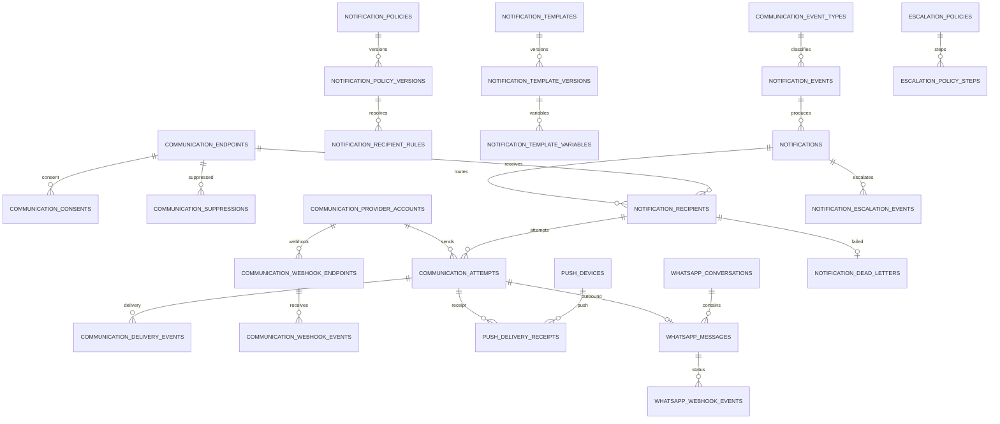

# Stage 2 — Notifications, Communication Channels, WhatsApp, Email, SMS & Push Delivery ER Design

Status: Proposed logical design for stakeholder review  
Date: 22 November 2026  
Dependencies: Organization/access control, customers/contacts, CRM, projects, service, monitoring/alerts, finance, documents and integration platform.

## 1. Purpose and scope

This document defines a centralized communication and notification subsystem for internal staff, customers and other authorized recipients. It covers in-app notifications, push notifications, email, SMS, WhatsApp and future approved channels; templates; recipient preferences; consent and suppression; delivery attempts; provider webhooks; inbound messages; communication history; escalation and operational monitoring.

The notification subsystem is responsible for preparing, routing, delivering and recording communication. Business domains remain responsible for deciding when an event should be raised and what it means. For example, monitoring owns alert state, service owns case state, finance owns receipt verification, and the notification subsystem delivers messages about those events.

No specific WhatsApp/SMS/email provider, API entitlement, template approval, pricing, delivery guarantee or customer consent is assumed. Provider capabilities and applicable messaging rules must be verified before activation.

This is a logical design, not final SQL. No sample customer phone numbers, email addresses, messages, provider credentials or mock notification events are included.

## 2. Core design principles

1. A business event is not the same thing as a notification, a delivery attempt or proof that a person read a message.
2. One event may produce multiple notifications to different recipients and channels.
3. One notification may require multiple delivery attempts due to retries or fallback.
4. Channel preferences, consent, suppression and legal/provider restrictions are checked before dispatch.
5. Templates are versioned; already queued notifications retain the exact rendered content/template version used.
6. Sensitive content is minimized in message bodies; use authenticated app links for detailed personal, financial or technical information.
7. Provider credentials and webhook secrets are held in a secure secret manager, not plaintext application tables or source control.
8. Delivery is asynchronous and retryable, with idempotency, dead-letter handling and provider rate limits.
9. Webhook callbacks are authenticated, replay-protected, deduplicated and treated as untrusted input.
10. A notification marked delivered is not necessarily read, understood or acted upon.
11. Business master values and templates are managed through authorized screens and stored in PostgreSQL; no hardcoded business recipient lists, templates or mock records.

## 3. Event intake and notification orchestration

### 3.1 Domain event catalogue

**communication_event_types**
- communication_event_type_id (PK)
- event_code (unique)
- event_name
- owning_domain
- description
- default_priority_id (FK → notification_priorities)
- is_active

Examples of domain event codes may include enquiry assigned, appointment scheduled, quotation ready, payment receipt verified, project milestone changed, installation scheduled, handover completed, monitoring alert created/recovered, service case updated, technician visit scheduled and warranty claim updated. The catalogue must reflect approved business workflows, not speculative events.

**notification_events**
- notification_event_id (PK)
- communication_event_type_id (FK → communication_event_types)
- source_entity_type
- source_entity_id
- event_reference (nullable)
- occurred_at
- received_at
- actor_type_id (FK → actor_types)
- actor_employee_id (nullable FK → employees)
- customer_id (nullable FK → customers)
- project_id (nullable FK → projects)
- site_id (nullable FK → project_sites)
- event_payload_reference (nullable)
- event_payload_hash
- idempotency_key (unique within defined producer scope)
- processing_status_id (FK → notification_event_processing_statuses)
- processed_at (nullable)

The event payload should contain only the information needed for recipient resolution and template rendering. Prefer references to source entities over copying full customer, financial or technical records into the queue.

### 3.2 Notification policies and recipient resolution

**notification_policies**
- notification_policy_id (PK)
- policy_name
- communication_event_type_id (FK → communication_event_types)
- policy_status_id (FK → notification_policy_statuses)
- priority_id (FK → notification_priorities)
- effective_from
- effective_to (nullable)
- created_at, created_by

**notification_policy_versions**
- notification_policy_version_id (PK)
- notification_policy_id (FK → notification_policies)
- version_number
- recipient_rule_reference
- channel_rule_reference
- quiet_hours_policy_id (nullable FK → quiet_hours_policies)
- escalation_policy_id (nullable FK → escalation_policies)
- retry_policy_id (FK → retry_policies)
- approval_status_id (FK → approval_statuses)
- approved_by (nullable FK → employees)
- effective_from
- effective_to (nullable)

**notification_recipient_rules**
- notification_recipient_rule_id (PK)
- notification_policy_version_id (FK → notification_policy_versions)
- recipient_type_id (FK → notification_recipient_types)
- recipient_reference_rule
- required_permission_key (nullable)
- is_mandatory
- sequence_number

Recipient resolution may select customer contacts, assigned employees, responsible groups, project stakeholders or escalation recipients. The rule engine must enforce customer consent, employee authorization, resource scope and data minimization. Do not use hardcoded email/phone recipient arrays.

## 4. Templates, localization and content rendering

### 4.1 Template catalogue

**notification_templates**
- notification_template_id (PK)
- template_code (unique)
- template_name
- owning_domain
- template_status_id (FK → notification_template_statuses)
- purpose_id (FK → communication_purposes)
- sensitivity_level_id (FK → data_sensitivity_levels)
- created_at, created_by

**notification_template_versions**
- notification_template_version_id (PK)
- notification_template_id (FK → notification_templates)
- version_number
- channel_id (FK → communication_channels)
- locale_id (FK → locales)
- subject_template (nullable)
- body_template
- provider_template_reference (nullable)
- provider_approval_status_id (nullable FK → provider_template_statuses)
- effective_from
- effective_to (nullable)
- approval_status_id (FK → approval_statuses)
- approved_by (nullable FK → employees)
- created_at, created_by

**notification_template_variables**
- notification_template_variable_id (PK)
- notification_template_version_id (FK → notification_template_versions)
- variable_code
- variable_description
- data_type_id (FK → template_variable_data_types)
- required
- source_field_reference
- sensitivity_level_id (FK → data_sensitivity_levels)

Templates must be escaped and rendered by a safe template engine; no arbitrary code execution or SQL expressions. Variable references are allowlisted. Store the exact rendered version or an encrypted immutable content snapshot according to retention policy. Avoid rendering secrets, full bank details or unnecessary personal information.

### 4.2 Localization

**locales**
- locale_id (PK)
- locale_code (unique)
- locale_name
- is_active

Support Malayalam and English if confirmed as required. Do not assume a translation is legally or technically approved without review. A notification records the locale chosen at send time.

## 5. Recipient identities, preferences, consent and suppression

### 5.1 Recipient endpoints

**communication_endpoints**
- communication_endpoint_id (PK)
- owner_type_id (FK → communication_owner_types)
- customer_id (nullable FK → customers)
- customer_contact_id (nullable FK → customer_contacts)
- employee_id (nullable FK → employees)
- channel_id (FK → communication_channels)
- endpoint_value_encrypted
- endpoint_value_normalized_hash
- verification_status_id (FK → endpoint_verification_statuses)
- verified_at (nullable)
- is_primary
- is_active
- created_at, created_by

Store email/phone endpoint values encrypted where appropriate; use normalized hashes for matching where possible. Access to endpoint values is restricted and logged. Do not duplicate contact details into every notification.

### 5.2 Preferences

**notification_preferences**
- notification_preference_id (PK)
- owner_type_id (FK → communication_owner_types)
- customer_id (nullable FK → customers)
- customer_contact_id (nullable FK → customer_contacts)
- employee_id (nullable FK → employees)
- communication_purpose_id (FK → communication_purposes)
- channel_id (FK → communication_channels)
- preference_status_id (FK → notification_preference_statuses)
- locale_id (nullable FK → locales)
- quiet_hours_policy_id (nullable FK → quiet_hours_policies)
- updated_at
- updated_by_type_id (FK → actor_types)
- updated_by_employee_id (nullable FK → employees)

**quiet_hours_policies**
- quiet_hours_policy_id (PK)
- policy_name
- timezone_strategy_id (FK → timezone_strategies)
- start_local_time
- end_local_time
- allowed_priority_rule_id (FK → quiet_hours_priority_rules)
- is_active

Preferences cannot override mandatory legal/provider suppression or emergency communication policy. Define which operational notifications are essential and which are optional; do not label marketing as operational.

### 5.3 Consent and opt-out history

**communication_consents**
- communication_consent_id (PK)
- owner_type_id (FK → communication_owner_types)
- customer_id (nullable FK → customers)
- customer_contact_id (nullable FK → customer_contacts)
- endpoint_id (nullable FK → communication_endpoints)
- communication_purpose_id (FK → communication_purposes)
- channel_id (FK → communication_channels)
- consent_status_id (FK → communication_consent_statuses)
- captured_at
- captured_by_type_id (FK → actor_types)
- source_id (FK → consent_sources)
- consent_text_version
- evidence_document_id (nullable FK → documents)
- withdrawn_at (nullable)
- withdrawal_source_id (nullable FK → consent_sources)

**communication_suppressions**
- communication_suppression_id (PK)
- endpoint_id (nullable FK → communication_endpoints)
- endpoint_value_hash
- channel_id (FK → communication_channels)
- suppression_reason_id (FK → communication_suppression_reasons)
- source_id (FK → suppression_sources)
- starts_at
- ends_at (nullable)
- created_at
- created_by_type_id (FK → actor_types)

Maintain immutable consent/withdrawal history. A recipient's opt-out must be applied before sending future messages for the affected purpose/channel. Operational/service messages and promotional communications require separate purpose classification and policy review. Do not infer consent from possession of a phone number.

## 6. Notification records and recipients

**notifications**
- notification_id (PK)
- notification_event_id (FK → notification_events)
- notification_policy_version_id (nullable FK → notification_policy_versions)
- notification_template_version_id (nullable FK → notification_template_versions)
- notification_reference (unique)
- priority_id (FK → notification_priorities)
- notification_status_id (FK → notification_statuses)
- purpose_id (FK → communication_purposes)
- rendered_subject_encrypted (nullable)
- rendered_body_encrypted (nullable)
- source_entity_type
- source_entity_id
- scheduled_at (nullable)
- queued_at
- sent_at (nullable)
- completed_at (nullable)
- expires_at (nullable)
- created_at

**notification_recipients**
- notification_recipient_id (PK)
- notification_id (FK → notifications)
- recipient_owner_type_id (FK → communication_owner_types)
- customer_id (nullable FK → customers)
- customer_contact_id (nullable FK → customer_contacts)
- employee_id (nullable FK → employees)
- communication_endpoint_id (nullable FK → communication_endpoints)
- channel_id (FK → communication_channels)
- locale_id (nullable FK → locales)
- recipient_status_id (FK → notification_recipient_statuses)
- consent_check_result_id (FK → consent_check_results)
- resolved_at
- delivered_at (nullable)
- read_at (nullable)
- actioned_at (nullable)
- failure_reason (nullable)

A notification can have multiple recipients/channels. Each recipient/channel route is independently tracked. Read/actioned timestamps are populated only when supported by authenticated app activity or reliable provider callbacks; do not assume email/WhatsApp read receipts are always available.

## 7. Delivery attempts and provider integration

### 7.1 Provider accounts

**communication_providers**
- communication_provider_id (PK)
- provider_name
- channel_id (FK → communication_channels)
- provider_status_id (FK → communication_provider_statuses)
- capability_reference (nullable)
- created_at, created_by

**communication_provider_accounts**
- communication_provider_account_id (PK)
- communication_provider_id (FK → communication_providers)
- account_name
- environment_id (FK → integration_environments)
- sender_identity_reference (nullable)
- secret_reference
- secret_version
- account_status_id (FK → communication_provider_account_statuses)
- configured_at
- configured_by (FK → employees)
- last_verified_at (nullable)

**communication_attempts**
- communication_attempt_id (PK)
- notification_recipient_id (FK → notification_recipients)
- communication_provider_account_id (FK → communication_provider_accounts)
- attempt_number
- attempt_status_id (FK → communication_attempt_statuses)
- provider_message_reference (nullable)
- requested_at
- submitted_at (nullable)
- accepted_at (nullable)
- delivered_at (nullable)
- failed_at (nullable)
- error_code (nullable)
- error_summary (nullable)
- retry_after (nullable)
- idempotency_key
- request_payload_reference (nullable)
- response_payload_reference (nullable)

**communication_delivery_events**
- communication_delivery_event_id (PK)
- communication_attempt_id (FK → communication_attempts)
- provider_event_reference (nullable)
- delivery_event_type_id (FK → delivery_event_types)
- provider_occurred_at (nullable)
- received_at
- signature_verified
- event_payload_reference (nullable)
- deduplication_key (unique)

A provider's API acceptance is not the same as carrier delivery. Keep queued, submitted, accepted, delivered, failed, expired and unknown states distinct. Retries must use idempotency where provider supports it and must not create duplicate customer messages.

### 7.2 Provider webhooks

**communication_webhook_endpoints**
- communication_webhook_endpoint_id (PK)
- communication_provider_account_id (FK → communication_provider_accounts)
- endpoint_reference
- secret_reference
- endpoint_status_id (FK → webhook_endpoint_statuses)
- configured_at
- last_received_at (nullable)

**communication_webhook_events**
- communication_webhook_event_id (PK)
- communication_webhook_endpoint_id (FK → communication_webhook_endpoints)
- provider_event_reference (nullable)
- received_at
- signature_valid
- replay_check_status_id (FK → webhook_replay_statuses)
- processing_status_id (FK → webhook_processing_statuses)
- payload_reference
- payload_hash
- processed_at (nullable)
- error_summary (nullable)

Reject invalid signatures, replayed events and oversized/malformed payloads. Store minimal encrypted payload evidence with retention limits. Never log authentication tokens or full message bodies in general application logs.

## 8. In-app and push notifications

**push_devices**
- push_device_id (PK)
- owner_type_id (FK → communication_owner_types)
- customer_id (nullable FK → customers)
- employee_id (nullable FK → employees)
- platform_id (FK → mobile_platforms)
- push_provider_id (FK → push_providers)
- device_token_encrypted
- token_hash
- app_installation_reference
- device_status_id (FK → push_device_statuses)
- registered_at
- last_seen_at (nullable)
- revoked_at (nullable)

**in_app_notification_states**
- in_app_notification_state_id (PK)
- notification_recipient_id (FK → notification_recipients)
- displayed_at (nullable)
- read_at (nullable)
- dismissed_at (nullable)
- actioned_at (nullable)

**push_delivery_receipts**
- push_delivery_receipt_id (PK)
- communication_attempt_id (FK → communication_attempts)
- push_device_id (FK → push_devices)
- provider_receipt_reference (nullable)
- receipt_status_id (FK → push_receipt_statuses)
- received_at (nullable)
- error_code (nullable)

Push tokens are sensitive and must be revoked on logout/device removal where appropriate. Push payloads should contain minimal content; open the authenticated app for full details.

## 9. WhatsApp and inbound/outbound messaging

**whatsapp_conversations**
- whatsapp_conversation_id (PK)
- customer_id (nullable FK → customers)
- customer_contact_id (nullable FK → customer_contacts)
- endpoint_id (FK → communication_endpoints)
- provider_account_id (FK → communication_provider_accounts)
- conversation_status_id (FK → messaging_conversation_statuses)
- opened_at
- last_message_at (nullable)
- closed_at (nullable)

**whatsapp_messages**
- whatsapp_message_id (PK)
- whatsapp_conversation_id (FK → whatsapp_conversations)
- direction_id (FK → communication_directions)
- communication_attempt_id (nullable FK → communication_attempts)
- provider_message_reference (nullable)
- message_type_id (FK → message_types)
- template_version_id (nullable FK → notification_template_versions)
- body_encrypted_or_reference
- media_document_id (nullable FK → documents)
- sent_or_received_at
- message_status_id (FK → message_statuses)
- recorded_at

**whatsapp_webhook_events**
- whatsapp_webhook_event_id (PK)
- communication_webhook_event_id (FK → communication_webhook_events)
- whatsapp_message_id (nullable FK → whatsapp_messages)
- event_type_id (FK → messaging_event_types)
- provider_occurred_at (nullable)
- processed_at (nullable)

**inbound_communication_messages**
- inbound_communication_message_id (PK)
- communication_provider_account_id (FK → communication_provider_accounts)
- endpoint_id (nullable FK → communication_endpoints)
- channel_id (FK → communication_channels)
- provider_message_reference (nullable)
- received_at
- message_type_id (FK → message_types)
- body_encrypted_or_reference
- media_document_id (nullable FK → documents)
- processing_status_id (FK → inbound_message_processing_statuses)
- linked_customer_id (nullable FK → customers)
- linked_service_case_id (nullable FK → service_cases)
- reviewed_by (nullable FK → employees)
- reviewed_at (nullable)

Inbound messages should not automatically mutate customer, finance or project records. Route unknown senders and ambiguous requests to a staff review queue. If a message is classified as a service complaint, create a draft/candidate case and require validation according to policy.

WhatsApp provider business rules, template approvals, conversation windows and message categories can change. Confirm the current provider contract and platform policies before implementing automated outbound/inbound workflows.

## 10. Escalation, retries and delivery operations

**retry_policies**
- retry_policy_id (PK)
- policy_name
- max_attempts
- initial_delay_seconds
- backoff_strategy_id (FK → backoff_strategies)
- maximum_delay_seconds
- retryable_error_rule_reference
- is_active

**escalation_policies**
- escalation_policy_id (PK)
- policy_name
- escalation_status_id (FK → escalation_policy_statuses)
- created_at, created_by

**escalation_policy_steps**
- escalation_policy_step_id (PK)
- escalation_policy_id (FK → escalation_policies)
- step_sequence
- delay_seconds
- recipient_rule_reference
- channel_rule_reference
- priority_change_id (nullable FK → notification_priorities)
- stop_condition_reference

**notification_escalation_events**
- notification_escalation_event_id (PK)
- notification_id (FK → notifications)
- escalation_policy_step_id (FK → escalation_policy_steps)
- triggered_at
- execution_status_id (FK → escalation_execution_statuses)
- completed_at (nullable)
- error_summary (nullable)

**notification_dead_letters**
- notification_dead_letter_id (PK)
- notification_recipient_id (FK → notification_recipients)
- final_attempt_id (nullable FK → communication_attempts)
- dead_letter_reason_id (FK → dead_letter_reasons)
- moved_at
- reviewed_at (nullable)
- reviewed_by (nullable FK → employees)
- resolution_action_id (nullable FK → dead_letter_resolution_actions)

Retry only transient errors. Permanent errors, opt-outs, invalid endpoints, rejected templates and policy blocks should not be blindly retried. Operational dashboards should expose backlog, failure rate, provider health and dead-letter counts.

## 11. Mermaid ER overview

## 12. Master data and configuration policy

Proposed database-managed master values include:
- communication channels, purposes, priorities and event types
- notification and recipient statuses
- recipient types and owner types
- template statuses, provider approval statuses, locales and variable data types
- endpoint verification and preference statuses
- consent statuses/sources, suppression reasons and suppression sources
- provider/channel/account statuses and integration environments
- delivery attempt/event statuses and webhook/replay processing states
- mobile platforms, push providers and push token statuses
- message types, conversation statuses and inbound processing statuses
- retry/backoff policies, escalation statuses/steps and dead-letter reasons/actions

Authorized users manage business-selectable values, templates, recipient rules and policies through the application. Provider-specific technical constants may be code-controlled only where they are protocol requirements and documented as such. Migrations create schema and constraints only. No hardcoded recipient lists, business templates, fake messages or test customer data in production seeds.

## 13. Security, privacy and compliance controls

- Separate transactional/service notifications from marketing/promotional communications by purpose.
- Capture consent source, exact consent text/version, timestamp, channel and withdrawal.
- Check opt-out and suppression at dispatch time, not only when the notification is created.
- Apply least-privilege access to message bodies, endpoints, provider accounts and delivery logs.
- Encrypt endpoint values, message content, push tokens and sensitive webhook payloads.
- Use secure secret references and rotate provider/webhook secrets.
- Authenticate webhooks, validate signatures, enforce replay protection and deduplicate events.
- Minimize personal and financial data in SMS, push and WhatsApp previews.
- Use short-lived, authenticated links for sensitive customer portal content.
- Define retention/deletion schedules for message bodies, delivery metadata, consent evidence and provider payloads.
- Respect applicable Indian privacy, consumer, telecom and platform requirements; have counsel/compliance stakeholders confirm lawful basis, notices, opt-out and recordkeeping.
- Provide access/export/deletion workflows while preserving legally required records and audit evidence.
- Do not expose employee/customer group membership or internal operational notes to external recipients.

## 14. API and application expectations

APIs should support:
- domain event intake with producer authentication and idempotency
- recipient resolution and eligibility/consent check
- template preview, approval, version publication and localization
- notification creation, scheduling, cancellation and status
- preference, endpoint verification, consent and withdrawal
- channel provider configuration using secret references
- asynchronous dispatch, retry, delivery event ingestion and webhook processing
- in-app unread/read/actioned state
- push token registration and revocation
- WhatsApp inbound/outbound message handling where approved
- escalation policy execution and dead-letter review
- communication history scoped to customer/project/case

Customer and staff clients should receive only notifications within their authorized scope. A customer must not discover another customer's project, payment, alert or service information from message content or links.

## 15. Reporting and operational monitoring

- Notifications created, queued, submitted, delivered, failed and expired by channel.
- Delivery latency and success rate by provider/template/channel.
- Retry count, permanent failures and dead-letter backlog.
- Provider account health, rate limits and webhook processing errors.
- Consent and suppression blocks by purpose/channel.
- Customer and staff unread notification counts.
- Template approval status and template version usage.
- WhatsApp inbound volumes, unassigned messages and case conversion.
- Escalation execution and acknowledgement metrics.
- Duplicate event and idempotency conflict counts.

Delivery metrics must define provider-specific meanings; do not compare unlike channel statuses as if they were identical.

## 16. Open stakeholder and provider decisions

1. Which channels are required in the first release: in-app, push, email, SMS, WhatsApp?
2. Which provider accounts already exist and are approved for business use?
3. Who owns provider contracts, sender IDs, domain verification and template approvals?
4. Which languages are required for customers and staff?
5. Which event types are customer-facing versus internal-only?
6. Which events are critical, and what are their escalation targets?
7. What are quiet-hour rules and emergency exceptions?
8. What consent evidence and opt-out flows are currently collected?
9. Are marketing/promotional campaigns in scope, or only transactional/service communication?
10. Can customers reply to WhatsApp messages, and who handles inbound conversations?
11. What message retention and attachment storage policies apply?
12. Which provider delivery/read callbacks are available and contractually supported?
13. Which customer/staff notification preferences can be changed?
14. What should happen when a recipient has no verified endpoint or all channels fail?
15. What are provider rate limits, retry windows, costs and operational support arrangements?

## 17. Acceptance checklist

- [ ] Domain events, notifications, recipients and delivery attempts are separate.
- [ ] Events and delivery requests are idempotent.
- [ ] Templates are versioned, reviewed and safely rendered.
- [ ] Recipient resolution enforces access, purpose and consent.
- [ ] Preferences, opt-outs and suppressions are checked at dispatch.
- [ ] Provider credentials and webhook secrets are held in secure references.
- [ ] Delivery statuses distinguish submitted, accepted, delivered, failed and read where supported.
- [ ] Retries are bounded and permanent failures are not blindly retried.
- [ ] Webhooks validate signatures, replay protection and duplicate events.
- [ ] In-app and push notifications use minimal sensitive payloads.
- [ ] Inbound messages are reviewed before they alter business records.
- [ ] Customer-facing messages cannot leak another customer's information.
- [ ] Retention, audit, export and deletion policies are defined.
- [ ] Master business values/templates are database-managed; no hardcoded business lists or mock records.

## 18. Implementation note

Begin with in-app notifications and a durable event/outbox pipeline, then add one verified external provider at a time. Implement consent, purpose separation, endpoint verification, idempotency and audit before enabling outbound WhatsApp/SMS campaigns. Provider selection and legal/platform requirements must be confirmed before production messaging.
