# Stage 2 — Platform Settings, Integrations, Background Jobs, Error Logging & Administration ER Design

Status: Proposed logical design for stakeholder review  
Date: 22 November 2026  
Dependencies: All business domains, organization/access control, notification, document storage, monitoring and deployment architecture.

## 1. Purpose and scope

This document defines the operational control plane for the GreenGrid platform: configurable system settings, integration registry, credentials references, API/webhook connections, background job scheduling and execution, queues, retry and dead-letter handling, platform health, application error records, feature controls, maintenance windows, administrative audit and operational dashboards.

It complements domain-specific designs. It does not replace finance, inventory, notification, monitoring or service records. It provides common infrastructure for safely executing work and connecting to external systems.

The design assumes a PostgreSQL-backed application with API services, workers and a queue/cache layer. Specific providers, APIs, infrastructure products, service-level targets and hosting guarantees must be verified before implementation.

## 2. Core design principles

1. Business operations remain owned by their domains; platform jobs orchestrate execution but do not become the source of business truth.
2. Configuration is typed, scoped, versioned and audited. Secrets are stored only in a secret manager and referenced by identifier/version.
3. No environment-specific credentials, API keys, private keys, passwords or tokens are committed to Git or stored as plaintext in PostgreSQL.
4. Background jobs are durable, idempotent where possible, observable and safe to retry.
5. A job being queued, started or accepted does not mean the business operation succeeded.
6. Workers must enforce the same authorization, tenant/company and data-scope rules as synchronous APIs.
7. Integration failures must not silently corrupt business state or create duplicate payments, stock movements, notifications or external submissions.
8. Webhooks are authenticated, replay-protected, deduplicated and validated.
9. Platform logs avoid secrets and unnecessary personal or customer data.
10. All business-selectable configuration is managed through authorized application screens and stored in PostgreSQL; no mock business configuration or hardcoded dropdown lists.

## 3. System settings and configuration management

### 3.1 Setting catalogue

**system_settings**
- system_setting_id (PK)
- setting_key (unique)
- setting_name
- description
- setting_type_id (FK → setting_types)
- setting_scope_type_id (FK → setting_scope_types)
- is_sensitive
- validation_rule_reference (nullable)
- default_value_reference (nullable)
- is_editable
- setting_status_id (FK → setting_statuses)
- created_at, created_by

**system_setting_values**
- system_setting_value_id (PK)
- system_setting_id (FK → system_settings)
- scope_type_id (FK → setting_scope_types)
- scope_entity_id (nullable)
- value_reference
- version_number
- effective_from
- effective_to (nullable)
- updated_at
- updated_by (FK → employees)
- approval_status_id (FK → approval_statuses)

**system_setting_change_logs**
- system_setting_change_log_id (PK)
- system_setting_value_id (FK → system_setting_values)
- previous_value_hash (nullable)
- new_value_hash
- changed_at
- changed_by (FK → employees)
- change_reason
- approval_reference (nullable)
- request_correlation_id

Setting values may be global, company/branch scoped, or module scoped only where approved. Use explicit precedence rules and reject ambiguous overrides. Sensitive settings should contain a secret reference, not the secret itself. Avoid storing arbitrary executable code or unrestricted JSON configuration.

### 3.2 Feature flags and maintenance windows

**feature_flags**
- feature_flag_id (PK)
- flag_key (unique)
- flag_name
- description
- flag_status_id (FK → feature_flag_statuses)
- rollout_strategy_id (FK → rollout_strategies)
- created_at, created_by

**feature_flag_rules**
- feature_flag_rule_id (PK)
- feature_flag_id (FK → feature_flags)
- scope_type_id (FK → setting_scope_types)
- scope_entity_id (nullable)
- rule_configuration_reference
- effective_from
- effective_to (nullable)
- priority_order

**maintenance_windows**
- maintenance_window_id (PK)
- window_name
- start_at
- end_at
- timezone_id (nullable FK → timezones)
- affected_service_reference
- maintenance_status_id (FK → maintenance_window_statuses)
- customer_notice_required
- created_by (FK → employees)
- created_at

Feature flags are release controls, not authorization. They must never grant access that the permission system denies.

## 4. Integration registry and credentials

### 4.1 Integration catalogue

**system_integrations**
- system_integration_id (PK)
- integration_code (unique)
- integration_name
- integration_category_id (FK → integration_categories)
- integration_status_id (FK → integration_statuses)
- owning_module
- description
- capability_reference (nullable)
- created_at, created_by

**integration_instances**
- integration_instance_id (PK)
- system_integration_id (FK → system_integrations)
- instance_name
- environment_id (FK → integration_environments)
- base_endpoint_reference (nullable)
- authentication_method_id (FK → integration_authentication_methods)
- secret_reference (nullable)
- secret_version (nullable)
- configuration_reference
- instance_status_id (FK → integration_instance_statuses)
- configured_at
- configured_by (FK → employees)
- last_health_check_at (nullable)

**integration_capabilities**
- integration_capability_id (PK)
- system_integration_id (FK → system_integrations)
- capability_code
- capability_name
- capability_status_id (FK → integration_capability_statuses)
- verified_at (nullable)
- verification_evidence_reference (nullable)
- limitations_reference (nullable)

**integration_health_checks**
- integration_health_check_id (PK)
- integration_instance_id (FK → integration_instances)
- checked_at
- health_status_id (FK → integration_health_statuses)
- latency_ms (nullable)
- response_code (nullable)
- error_code (nullable)
- error_summary (nullable)
- correlation_id

**integration_change_logs**
- integration_change_log_id (PK)
- integration_instance_id (FK → integration_instances)
- change_type_id (FK → integration_change_types)
- changed_at
- changed_by (FK → employees)
- previous_configuration_hash (nullable)
- new_configuration_hash
- change_reason
- approval_reference (nullable)

Integration capability must be verified rather than inferred from a provider name. An integration may support read-only status checks but not updates, webhook subscriptions or file upload. Track each capability and evidence independently.

### 4.2 API credentials and rotation metadata

**integration_secret_bindings**
- integration_secret_binding_id (PK)
- integration_instance_id (FK → integration_instances)
- secret_purpose_id (FK → secret_purposes)
- secret_reference
- secret_version
- valid_from
- valid_to (nullable)
- secret_status_id (FK → secret_statuses)
- last_rotated_at (nullable)
- next_rotation_due_at (nullable)

Secret values must never be returned to the frontend after creation. Application roles should retrieve them only through the secret manager with least privilege. Secret rotation must support overlapping versions where a provider requires it. Never log secret values or include them in job payloads.

## 5. API clients, credentials and rate limits

**api_clients**
- api_client_id (PK)
- client_name
- client_type_id (FK → api_client_types)
- client_status_id (FK → api_client_statuses)
- owner_employee_id (nullable FK → employees)
- created_at
- expires_at (nullable)
- last_used_at (nullable)

**api_client_credentials**
- api_client_credential_id (PK)
- api_client_id (FK → api_clients)
- credential_hash
- secret_reference (nullable)
- credential_status_id (FK → api_credential_statuses)
- issued_at
- expires_at (nullable)
- revoked_at (nullable)
- last_used_at (nullable)

**api_client_scopes**
- api_client_scope_id (PK)
- api_client_id (FK → api_clients)
- permission_key
- resource_scope_rule_reference
- granted_at
- granted_by (FK → employees)
- revoked_at (nullable)

**api_rate_limit_policies**
- api_rate_limit_policy_id (PK)
- policy_name
- scope_type_id (FK → rate_limit_scope_types)
- limit_count
- window_seconds
- burst_limit (nullable)
- policy_status_id (FK → rate_limit_policy_statuses)

**api_rate_limit_assignments**
- api_rate_limit_assignment_id (PK)
- api_client_id (nullable FK → api_clients)
- integration_instance_id (nullable FK → integration_instances)
- api_rate_limit_policy_id (FK → api_rate_limit_policies)
- effective_from
- effective_to (nullable)

Rate limits should be enforced in the API/queue infrastructure and measured by client, user, integration and endpoint as appropriate. Never treat a client key as a substitute for user authentication or resource authorization.

## 6. Webhook subscriptions and inbound events

**webhook_subscriptions**
- webhook_subscription_id (PK)
- integration_instance_id (FK → integration_instances)
- event_code
- endpoint_reference
- secret_reference
- subscription_status_id (FK → webhook_subscription_statuses)
- created_at
- created_by (FK → employees)
- last_verified_at (nullable)

**webhook_events**
- webhook_event_id (PK)
- webhook_subscription_id (nullable FK → webhook_subscriptions)
- integration_instance_id (FK → integration_instances)
- provider_event_reference (nullable)
- event_type
- received_at
- signature_valid
- replay_check_status_id (FK → webhook_replay_statuses)
- processing_status_id (FK → webhook_processing_statuses)
- payload_reference
- payload_hash
- correlation_id
- processed_at (nullable)
- error_summary (nullable)

**webhook_delivery_attempts**
- webhook_delivery_attempt_id (PK)
- webhook_event_id (FK → webhook_events)
- attempt_number
- attempted_at
- response_code (nullable)
- attempt_status_id (FK → webhook_delivery_statuses)
- retry_after (nullable)
- error_summary (nullable)

Validate signatures, timestamps, replay windows, payload size and schema. Deduplicate on stable provider event identifiers or a verified payload identity. If a provider does not offer signed webhooks, use an approved alternative verification mechanism and mark the reduced assurance.

## 7. Background jobs and queue processing

### 7.1 Job catalogue and definitions

**background_job_types**
- background_job_type_id (PK)
- job_code (unique)
- job_name
- owning_module
- description
- job_status_id (FK → job_type_statuses)
- default_queue_id (FK → job_queues)
- default_retry_policy_id (FK → retry_policies)
- timeout_seconds
- idempotency_required
- is_active

**background_jobs**
- background_job_id (PK)
- background_job_type_id (FK → background_job_types)
- job_reference (unique)
- source_entity_type (nullable)
- source_entity_id (nullable)
- queue_id (FK → job_queues)
- job_status_id (FK → background_job_statuses)
- priority_id (FK → job_priorities)
- payload_reference
- payload_hash
- idempotency_key (nullable)
- scheduled_at
- queued_at
- started_at (nullable)
- completed_at (nullable)
- cancelled_at (nullable)
- timeout_at (nullable)
- attempt_count
- max_attempts
- requested_by_type_id (FK → actor_types)
- requested_by_employee_id (nullable FK → employees)
- correlation_id
- parent_job_id (nullable FK → background_jobs)

**job_queues**
- job_queue_id (PK)
- queue_code (unique)
- queue_name
- queue_status_id (FK → job_queue_statuses)
- concurrency_limit
- rate_limit_policy_id (nullable FK → api_rate_limit_policies)
- description

**background_job_attempts**
- background_job_attempt_id (PK)
- background_job_id (FK → background_jobs)
- attempt_number
- worker_reference
- started_at
- finished_at (nullable)
- attempt_status_id (FK → job_attempt_statuses)
- error_code (nullable)
- error_summary (nullable)
- execution_duration_ms (nullable)
- result_reference (nullable)

**background_job_dependencies**
- background_job_dependency_id (PK)
- background_job_id (FK → background_jobs)
- depends_on_job_id (FK → background_jobs)
- dependency_type_id (FK → job_dependency_types)

**background_job_cancellations**
- background_job_cancellation_id (PK)
- background_job_id (FK → background_jobs)
- cancellation_reason
- cancelled_by_type_id (FK → actor_types)
- cancelled_by_employee_id (nullable FK → employees)
- cancelled_at

Job payloads should contain identifiers and minimal execution context, not copied customer records or secrets. Sensitive payloads should be encrypted or stored as protected references. Workers must reload current business records and re-check permissions, status and preconditions before acting.

### 7.2 Retry, schedule and dead-letter handling

**job_retry_policies**
- job_retry_policy_id (PK)
- policy_name
- max_attempts
- initial_delay_seconds
- backoff_strategy_id (FK → backoff_strategies)
- max_delay_seconds
- retryable_error_rule_reference
- policy_status_id (FK → retry_policy_statuses)

**job_dead_letters**
- job_dead_letter_id (PK)
- background_job_id (FK → background_jobs)
- final_attempt_id (nullable FK → background_job_attempts)
- dead_letter_reason_id (FK → job_dead_letter_reasons)
- moved_at
- reviewed_at (nullable)
- reviewed_by (nullable FK → employees)
- resolution_action_id (nullable FK → job_dead_letter_actions)
- resolution_notes_reference (nullable)

**job_schedules**
- job_schedule_id (PK)
- background_job_type_id (FK → background_job_types)
- schedule_name
- schedule_expression
- timezone_id (FK → timezones)
- schedule_status_id (FK → job_schedule_statuses)
- next_run_at (nullable)
- last_run_at (nullable)
- created_at, created_by

**job_schedule_runs**
- job_schedule_run_id (PK)
- job_schedule_id (FK → job_schedules)
- background_job_id (FK → background_jobs)
- scheduled_for
- triggered_at
- run_status_id (FK → schedule_run_statuses)

Use bounded exponential backoff with jitter where appropriate. Permanent validation/authentication errors must not be retried blindly. Scheduled jobs need timezone-aware execution and protection against duplicate runs during worker restarts or overlapping scheduler instances.

## 8. Outbox and reliable event publishing

**domain_event_outbox**
- domain_event_outbox_id (PK)
- owning_module
- aggregate_type
- aggregate_id
- event_code
- event_version
- payload_reference
- payload_hash
- occurred_at
- recorded_at
- publish_status_id (FK → outbox_publish_statuses)
- published_at (nullable)
- correlation_id
- idempotency_key (unique)

**domain_event_publications**
- domain_event_publication_id (PK)
- domain_event_outbox_id (FK → domain_event_outbox)
- destination_type_id (FK → event_destination_types)
- destination_reference
- publication_status_id (FK → event_publication_statuses)
- attempt_count
- last_attempt_at (nullable)
- published_at (nullable)
- error_summary (nullable)

Write business changes and outbox records in the same database transaction. A publisher asynchronously forwards outbox events to queues or domain consumers. Consumers must be idempotent. This avoids losing events between a committed business transaction and message publication.

## 9. Application logs, errors and incidents

### 9.1 Error and log records

**system_error_logs**
- system_error_log_id (PK)
- occurred_at
- application_component_id (FK → application_components)
- environment_id (FK → integration_environments)
- severity_id (FK → log_severities)
- error_code
- error_category_id (FK → error_categories)
- sanitized_message
- stack_trace_reference (nullable)
- request_correlation_id
- background_job_id (nullable FK → background_jobs)
- integration_instance_id (nullable FK → integration_instances)
- actor_employee_id (nullable FK → employees)
- source_entity_type (nullable)
- source_entity_id (nullable)
- fingerprint
- resolved_at (nullable)

**application_log_events**
- application_log_event_id (PK)
- occurred_at
- application_component_id (FK → application_components)
- environment_id (FK → integration_environments)
- log_level_id (FK → log_levels)
- event_code
- sanitized_message
- correlation_id
- trace_reference (nullable)
- related_job_id (nullable FK → background_jobs)

High-volume technical logs should generally be sent to a dedicated log/observability platform rather than retained indefinitely in PostgreSQL. PostgreSQL should retain structured error records, operational references and metadata needed for administration and reporting.

### 9.2 Incident management

**platform_incidents**
- platform_incident_id (PK)
- incident_reference (unique)
- incident_title
- incident_description_reference
- severity_id (FK → incident_severities)
- incident_status_id (FK → incident_statuses)
- affected_component_id (FK → application_components)
- detected_at
- acknowledged_at (nullable)
- resolved_at (nullable)
- incident_owner_employee_id (nullable FK → employees)
- external_status_reference (nullable)

**platform_incident_events**
- platform_incident_event_id (PK)
- platform_incident_id (FK → platform_incidents)
- event_type_id (FK → incident_event_types)
- event_at
- actor_employee_id (nullable FK → employees)
- event_description_reference
- related_error_id (nullable FK → system_error_logs)

**platform_incident_actions**
- platform_incident_action_id (PK)
- platform_incident_id (FK → platform_incidents)
- action_description
- action_owner_employee_id (nullable FK → employees)
- action_status_id (FK → incident_action_statuses)
- due_at (nullable)
- completed_at (nullable)

A technical incident is not the same as a customer service case. If customers are affected, the platform may create or link service cases through the service domain rather than treating an incident record as a customer ticket.

## 10. Monitoring, health and operational metrics

**application_components**
- application_component_id (PK)
- component_code (unique)
- component_name
- component_type_id (FK → application_component_types)
- component_status_id (FK → application_component_statuses)
- owning_team_reference
- criticality_id (FK → component_criticalities)

**service_health_checks**
- service_health_check_id (PK)
- application_component_id (FK → application_components)
- checked_at
- health_status_id (FK → service_health_statuses)
- latency_ms (nullable)
- dependency_reference (nullable)
- error_code (nullable)
- details_reference (nullable)

**platform_metric_definitions**
- platform_metric_definition_id (PK)
- metric_code (unique)
- metric_name
- unit_id (FK → metric_units)
- description
- aggregation_type_id (FK → metric_aggregation_types)
- metric_status_id (FK → metric_definition_statuses)

**platform_metric_snapshots**
- platform_metric_snapshot_id (PK)
- platform_metric_definition_id (FK → platform_metric_definitions)
- component_id (nullable FK → application_components)
- captured_at
- metric_value
- dimensions_reference (nullable)

Examples include API latency, error rate, queue depth, oldest queued job age, worker availability, database connection saturation, integration health, webhook lag, storage consumption and notification backlog. Metric collection should use a dedicated time-series/observability store if volume or retention makes PostgreSQL unsuitable.

## 11. Administrative access and operational actions

**administrative_action_requests**
- administrative_action_request_id (PK)
- action_type_id (FK → administrative_action_types)
- target_type_id (FK → administrative_target_types)
- target_reference
- requested_by (FK → employees)
- requested_at
- request_reason
- approval_status_id (FK → approval_statuses)
- approved_by (nullable FK → employees)
- approved_at (nullable)
- executed_at (nullable)
- execution_status_id (FK → administrative_execution_statuses)
- result_reference (nullable)

High-risk actions such as rotating credentials, changing provider endpoints, replaying failed jobs, bulk exports, disabling integrations, deleting data or changing global settings should require explicit permissions, reason capture and, where configured, dual approval. Emergency access must be time-limited and reviewed.

## 12. Mermaid ER overview

```mermaid
erDiagram
    SYSTEM_SETTINGS ||--o{ SYSTEM_SETTING_VALUES : values
    SYSTEM_SETTING_VALUES ||--o{ SYSTEM_SETTING_CHANGE_LOGS : changes
    FEATURE_FLAGS ||--o{ FEATURE_FLAG_RULES : rules
    SYSTEM_INTEGRATIONS ||--o{ INTEGRATION_INSTANCES : instances
    SYSTEM_INTEGRATIONS ||--o{ INTEGRATION_CAPABILITIES : capabilities
    INTEGRATION_INSTANCES ||--o{ INTEGRATION_HEALTH_CHECKS : health
    INTEGRATION_INSTANCES ||--o{ INTEGRATION_SECRET_BINDINGS : secrets
    INTEGRATION_INSTANCES ||--o{ WEBHOOK_SUBSCRIPTIONS : subscribes
    WEBHOOK_SUBSCRIPTIONS ||--o{ WEBHOOK_EVENTS : receives
    WEBHOOK_EVENTS ||--o{ WEBHOOK_DELIVERY_ATTEMPTS : attempts
    BACKGROUND_JOB_TYPES ||--o{ BACKGROUND_JOBS : defines
    JOB_QUEUES ||--o{ BACKGROUND_JOBS : queues
    BACKGROUND_JOBS ||--o{ BACKGROUND_JOB_ATTEMPTS : attempts
    BACKGROUND_JOBS ||--o{ BACKGROUND_JOB_DEPENDENCIES : dependencies
    BACKGROUND_JOBS ||--o| JOB_DEAD_LETTERS : deadletter
    JOB_SCHEDULES ||--o{ JOB_SCHEDULE_RUNS : runs
    BACKGROUND_JOBS ||--o{ JOB_SCHEDULE_RUNS : creates
    DOMAIN_EVENT_OUTBOX ||--o{ DOMAIN_EVENT_PUBLICATIONS : publishes
    APPLICATION_COMPONENTS ||--o{ SYSTEM_ERROR_LOGS : errors
    APPLICATION_COMPONENTS ||--o{ SERVICE_HEALTH_CHECKS : health
    PLATFORM_INCIDENTS ||--o{ PLATFORM_INCIDENT_EVENTS : events
    PLATFORM_INCIDENTS ||--o{ PLATFORM_INCIDENT_ACTIONS : actions
    PLATFORM_METRIC_DEFINITIONS ||--o{ PLATFORM_METRIC_SNAPSHOTS : measures
    ADMINISTRATIVE_ACTION_REQUESTS }o--|| EMPLOYEES : requested_by
```

## 13. Master data and configuration policy

Proposed database-managed values include:
- setting types, scopes, statuses and approval statuses
- feature flag statuses and rollout strategies
- maintenance window statuses
- integration categories, statuses, environments, authentication methods and capabilities
- secret purposes and secret statuses
- API client types/statuses, credential statuses, permission scopes and rate-limit policies
- webhook subscription, replay, processing and delivery statuses
- background job types/statuses, queues, priorities, attempt statuses and dependency types
- retry/backoff policies, schedule statuses and dead-letter reasons/actions
- outbox publish and event publication statuses
- application components, component types, criticality and health statuses
- log levels/severities, error categories and incident severities/statuses/actions
- metric units, aggregation types and metric definition statuses
- administrative action types, targets and execution statuses

Authorized administrators manage business-selectable settings and integration configuration through the application. Protocol-required constants may be code-controlled where documented. Migrations create schema and constraints only; they must not insert mock integration accounts, credentials, customer data, fabricated incidents or sample jobs.

## 14. Security, privacy and resilience requirements

- Enforce role/group permissions and resource scope for every administrative API.
- Keep secrets in a dedicated secret manager with least-privilege service identities and rotation.
- Use separate credentials and endpoints for development, staging and production.
- Encrypt sensitive job payloads and integration data; use references instead of duplicating business records.
- Redact tokens, passwords, personal data and payment information from logs and traces.
- Apply request signing or OAuth/mTLS where supported and appropriate.
- Validate webhook signatures, replay windows, payload schemas and idempotency.
- Use transactional outbox patterns for reliable event publication.
- Use bounded retries, backoff, jitter, timeouts, circuit breakers and dead-letter queues.
- Define queue priorities and concurrency to prevent bulk jobs starving critical operations.
- Require explicit approval for high-risk administration and bulk operations.
- Maintain database backups, tested restores, worker recovery and queue replay procedures.
- Define retention and access controls for logs, traces, error records and incident evidence.
- Monitor clock synchronization, certificate expiry, storage capacity and database connection saturation.
- Do not expose internal stack traces, hostnames, queue details or secrets to customer-facing clients.

## 15. API and application expectations

Administrative APIs should support:
- view and update typed system settings with scope and validation
- manage feature flags and maintenance windows
- register integrations, capabilities, instances and secret references
- verify integration health without exposing credentials
- manage API clients, scopes, credential expiry and revocation
- manage webhook subscriptions and inspect verified event processing
- inspect, cancel, retry or replay eligible background jobs with audit
- manage job schedules, queues, retry policies and dead-letter review
- inspect outbox publication lag and consumer processing
- search sanitized errors, logs and incident timelines
- view component health and platform metrics
- request/approve/execute privileged administrative actions

Only authorized platform administrators should access these operations. Customer and technician apps must never expose platform configuration, integration secrets, raw error logs, job payloads or administrative controls.

## 16. Reporting and operational monitoring

- Queue depth and oldest queued job age by queue.
- Job success, failure, retry and dead-letter rates by job type.
- Worker concurrency, execution duration and timeout counts.
- Outbox publication lag and consumer idempotency conflicts.
- Integration availability, latency and failure trend.
- Webhook signature failures, replay attempts and processing backlog.
- API latency, error rate and rate-limit events.
- Database connection saturation, storage capacity and backup/restore status.
- Credential rotation due dates and certificate expiry.
- Platform incident severity, acknowledgement and resolution time.
- Administrative action requests, approvals and emergency access reviews.
- Configuration changes by actor, scope and environment.

Operational metrics must define their aggregation windows and alert thresholds. Do not invent service-level objectives before stakeholders approve them.

## 17. Open stakeholder and technical decisions

1. Which settings may be changed by administrators, and which require engineering deployment?
2. Which integration systems are required for the first release?
3. Which provider APIs and webhook capabilities are verified and contractually available?
4. Which secret manager and credential rotation process will be used?
5. Which job queue technology and worker deployment model will be selected?
6. What are the expected job volumes, concurrency, maximum execution times and retry windows?
7. Which jobs are critical and must receive priority over bulk processing?
8. What are the platform availability, recovery time and recovery point objectives?
9. Which logs/metrics/traces platform will be used and what are the retention periods?
10. Who can inspect customer-linked technical errors and incident evidence?
11. Which administrative actions require dual approval?
12. What are the maintenance notice and downtime communication rules?
13. How will webhook subscriptions and provider credentials be tested safely?
14. Which data regions, backup locations and third-party subprocessors are acceptable?
15. What operational dashboards and on-call/escalation responsibilities are required?

## 18. Acceptance checklist

- [ ] Settings are typed, scoped, versioned and audited.
- [ ] Feature flags do not grant permissions.
- [ ] Integration capabilities are individually verified and tracked.
- [ ] Secrets are references to secure storage, never plaintext database/Git values.
- [ ] API clients have limited scopes, expiry and revocation.
- [ ] Webhooks are authenticated, replay-protected and deduplicated.
- [ ] Background jobs have durable status, attempts, idempotency and correlation IDs.
- [ ] Transactional outbox prevents lost domain events.
- [ ] Retry and dead-letter processes distinguish transient from permanent errors.
- [ ] Workers re-check current business state and authorization.
- [ ] Logs are sanitized and sensitive data is not exposed to customers.
- [ ] Incidents are distinct from customer service cases.
- [ ] High-risk administrative actions are approved and audited.
- [ ] Monitoring covers queue, worker, API, database and integration health.
- [ ] No mock credentials, integration accounts or business records are seeded.

## 19. Implementation note

Start with environment configuration and secret management, then the integration registry, health checks, durable job execution, transactional outbox, retry/dead-letter controls and sanitized error reporting. Add advanced feature-flag administration, incident workflows and privileged operational actions after access controls and audit are tested. Provider integrations must be enabled one at a time after capabilities and security requirements are verified.
