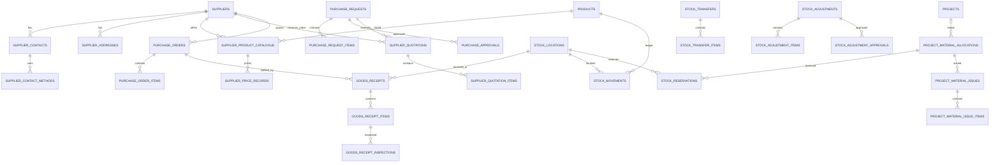

# Stage 2 — Procurement, Suppliers, Purchase Orders & Inventory ER Design

Status: Proposed logical design for stakeholder review  
Date: 22 November 2026  
Dependencies: Product catalogue/BOM, project management, organization/access control, documents and finance domains.

## 1. Purpose and scope

This document defines the procurement and stock-control model: supplier records, purchase requests, approvals, supplier quotations, purchase orders, goods receipt, stock locations, stock movements, reservations, project allocations, returns and controlled adjustments.

Procurement is linked to project demand and approved BOMs where applicable. Inventory quantities must be derived from auditable movements, not edited directly as an unexplained balance. A purchase order is not proof that goods were received, and a goods receipt is not proof that a supplier invoice was paid.

This is a logical design, not final SQL. No mock suppliers, products, stock balances, purchase orders or other records are included.

## 2. Core design principles

1. Separate supplier, supplier contact, purchase request, supplier quotation, purchase order, goods receipt, stock movement and supplier payment.
2. Maintain an auditable stock ledger; do not allow ordinary users to directly overwrite on-hand quantity.
3. Distinguish ordered, received, accepted, rejected, reserved, allocated, issued, returned and available quantities.
4. Keep units of measure explicit and validate compatible units during purchasing and stock operations.
5. Link project demand to approved BOM items when applicable; allow authorized non-BOM procurement with a reason.
6. A purchase order must be approved before it is issued to a supplier, according to configurable approval policy.
7. Partial deliveries, over-deliveries, shortages, damaged goods and rejected goods must be representable.
8. Separate physical stock ownership/location from project allocation and reservation.
9. Use database transactions and idempotency controls for receipts, issues, transfers and adjustments.
10. Supplier, procurement, stock, approval and reason master data are manually managed in PostgreSQL through authorized application screens. Never hardcode business dropdowns or seed mock records.

## 3. Supplier management

### 3.1 Suppliers

**suppliers**
- supplier_id (PK)
- supplier_code (unique, generated)
- supplier_type_id (FK → supplier_types)
- legal_name
- display_name
- supplier_status_id (FK → supplier_statuses)
- tax_registration_reference (nullable; restricted access)
- website (nullable)
- payment_terms_id (nullable FK → payment_terms)
- default_currency_id (nullable FK → currencies)
- notes (nullable)
- created_at, created_by
- updated_at, updated_by
- archived_at (nullable)

Supplier status changes should be auditable. Do not delete a supplier that is referenced by purchase orders, receipts or payments; deactivate or archive it.

**supplier_contacts**
- supplier_contact_id (PK)
- supplier_id (FK → suppliers)
- full_name
- designation (nullable)
- is_primary
- created_at, created_by
- archived_at (nullable)

**supplier_contact_methods**
- supplier_contact_method_id (PK)
- supplier_contact_id (FK → supplier_contacts)
- contact_type_id (FK → contact_types)
- display_value
- normalized_value
- country_calling_code (nullable)
- is_primary
- is_whatsapp_enabled
- created_at, created_by
- archived_at (nullable)

**supplier_addresses**
- supplier_address_id (PK)
- supplier_id (FK → suppliers)
- address_type_id (FK → address_types)
- address snapshot fields and optional geography foreign keys
- pincode_snapshot (VARCHAR(6))
- is_primary_for_type
- created_at, created_by
- archived_at (nullable)

Supplier contact methods and addresses follow the same principles as customer data: multiple methods, explicit country code, separate WhatsApp capability and consent where communication consent is required, and preserved address snapshots.

### 3.2 Supplier catalogue and commercial terms

**supplier_product_catalogue**
- supplier_product_catalogue_id (PK)
- supplier_id (FK → suppliers)
- product_id (FK → products)
- supplier_sku (nullable)
- supplier_description_snapshot
- supplier_unit_id (FK → measurement_units)
- conversion_factor_to_product_unit (nullable)
- last_verified_at (nullable)
- is_active
- created_at, created_by

**supplier_price_records**
- supplier_price_record_id (PK)
- supplier_product_catalogue_id (FK → supplier_product_catalogue)
- currency_id (FK → currencies)
- unit_price
- minimum_order_quantity (nullable)
- effective_from
- effective_to (nullable)
- source_document_id (nullable FK → documents)
- recorded_at, recorded_by

Supplier prices are time-bound references, not automatic authority to purchase. A purchase order stores the agreed price snapshot used for that order.

## 4. Purchase requests and approvals

### 4.1 Purchase request

**purchase_requests**
- purchase_request_id (PK)
- purchase_request_reference (unique, generated)
- requesting_project_id (nullable FK → projects)
- requesting_employee_id (FK → employees)
- request_status_id (FK → purchase_request_statuses)
- request_reason
- required_by_date (nullable)
- delivery_stock_location_id (nullable FK → stock_locations)
- requested_at
- submitted_at (nullable)
- approved_at (nullable)
- closed_at (nullable)
- created_at, created_by
- updated_at, updated_by

A request may be project-linked or for general replenishment. The reason and destination location must be clear. A project-linked request should not imply that stock has already been reserved.

**purchase_request_items**
- purchase_request_item_id (PK)
- purchase_request_id (FK → purchase_requests)
- product_id (FK → products)
- product_specification_id (nullable FK → product_specifications)
- bom_item_id (nullable FK → bom_items)
- requested_quantity
- unit_id (FK → measurement_units)
- required_by_date (nullable)
- estimated_unit_cost (nullable)
- item_notes (nullable)

Requested quantity must be positive. If linked to a BOM item, validate that the BOM belongs to the relevant project design and that units are compatible.

**purchase_request_status_history**
- purchase_request_status_history_id (PK)
- purchase_request_id (FK → purchase_requests)
- from_status_id (nullable FK → purchase_request_statuses)
- to_status_id (FK → purchase_request_statuses)
- changed_at
- changed_by (nullable FK → employees)
- reason (nullable)

### 4.2 Purchase request approvals

**purchase_approvals**
- purchase_approval_id (PK)
- purchase_request_id (nullable FK → purchase_requests)
- purchase_order_id (nullable FK → purchase_orders)
- approval_stage_id (FK → approval_stages)
- approver_employee_id (FK → employees)
- decision_status_id (FK → approval_decision_statuses)
- requested_at
- decided_at (nullable)
- comments (nullable)
- delegated_from_employee_id (nullable FK → employees)

Exactly one of purchase_request_id or purchase_order_id must be populated. Preserve every decision and approver. Approval thresholds, stages and segregation-of-duties requirements must be confirmed by management; do not invent amounts or approval hierarchy.

## 5. Supplier quotations and purchase orders

### 5.1 Supplier quotations

**supplier_quotations**
- supplier_quotation_id (PK)
- supplier_id (FK → suppliers)
- purchase_request_id (nullable FK → purchase_requests)
- supplier_quote_reference (nullable)
- quote_received_at
- valid_until (nullable)
- currency_id (FK → currencies)
- quote_status_id (FK → supplier_quote_statuses)
- quotation_document_id (nullable FK → documents)
- notes (nullable)
- recorded_at, recorded_by

**supplier_quotation_items**
- supplier_quotation_item_id (PK)
- supplier_quotation_id (FK → supplier_quotations)
- purchase_request_item_id (nullable FK → purchase_request_items)
- product_id (FK → products)
- supplier_description_snapshot
- quoted_quantity
- unit_id (FK → measurement_units)
- unit_price
- discount_amount
- tax_amount (nullable)
- line_total
- expected_delivery_date (nullable)

Supplier quotations are received offers, not purchase commitments. Compare supplier quotations against the same requested item/unit where possible. Store the document and exact price/tax/validity snapshot.

### 5.2 Purchase orders

**purchase_orders**
- purchase_order_id (PK)
- purchase_order_reference (unique, generated)
- supplier_id (FK → suppliers)
- purchase_request_id (nullable FK → purchase_requests)
- supplier_quotation_id (nullable FK → supplier_quotations)
- project_id (nullable FK → projects)
- delivery_stock_location_id (FK → stock_locations)
- purchase_order_status_id (FK → purchase_order_statuses)
- currency_id (FK → currencies)
- order_date
- expected_delivery_date (nullable)
- subtotal_amount
- discount_amount
- tax_amount
- freight_amount
- total_amount
- payment_terms_snapshot (nullable)
- delivery_terms_snapshot (nullable)
- supplier_address_snapshot
- approved_at (nullable)
- issued_at (nullable)
- created_at, created_by
- updated_at, updated_by
- cancelled_at (nullable)
- cancellation_reason (nullable)

**purchase_order_items**
- purchase_order_item_id (PK)
- purchase_order_id (FK → purchase_orders)
- purchase_request_item_id (nullable FK → purchase_request_items)
- supplier_quotation_item_id (nullable FK → supplier_quotation_items)
- product_id (FK → products)
- product_specification_id (nullable FK → product_specifications)
- item_description_snapshot
- ordered_quantity
- unit_id (FK → measurement_units)
- unit_price
- discount_amount
- tax_category_id (nullable FK → tax_categories)
- tax_rate_snapshot (nullable)
- line_total
- expected_delivery_date (nullable)
- received_quantity_snapshot (optional cache; ledger/receipt records remain authoritative)

An order may contain multiple items and may be partially fulfilled by multiple receipts. Use fixed-precision decimal types for quantities and money. Snapshot supplier details, item descriptions, units, prices, currency and applicable commercial terms at issue time.

**purchase_order_status_history**
- purchase_order_status_history_id (PK)
- purchase_order_id (FK → purchase_orders)
- from_status_id (nullable FK → purchase_order_statuses)
- to_status_id (FK → purchase_order_statuses)
- changed_at
- changed_by (nullable FK → employees)
- reason (nullable)

An issued purchase order is not edited in place for material commercial changes. Use a controlled amendment/version workflow or cancel and replace with audit history. Confirm the preferred amendment policy before implementation.

## 6. Goods receipt and quality inspection

### 6.1 Goods receipt

**goods_receipts**
- goods_receipt_id (PK)
- goods_receipt_reference (unique, generated)
- purchase_order_id (FK → purchase_orders)
- stock_location_id (FK → stock_locations)
- supplier_delivery_note_reference (nullable)
- received_at
- received_by (FK → employees)
- receipt_status_id (FK → goods_receipt_statuses)
- received_document_id (nullable FK → documents)
- notes (nullable)
- posted_at (nullable)
- posted_by (nullable FK → employees)

**goods_receipt_items**
- goods_receipt_item_id (PK)
- goods_receipt_id (FK → goods_receipts)
- purchase_order_item_id (FK → purchase_order_items)
- received_quantity
- accepted_quantity
- rejected_quantity
- unit_id (FK → measurement_units)
- batch_or_lot_reference (nullable)
- serial_tracking_required
- inspection_status_id (FK → inspection_statuses)
- rejection_reason_id (nullable FK → stock_rejection_reasons)
- notes (nullable)

Enforce received_quantity = accepted_quantity + rejected_quantity unless the approved receiving process explicitly models another disposition such as pending inspection. Accepted quantity must not exceed received quantity. Validate aggregate accepted/rejected quantities against ordered quantities and configured over-delivery tolerances.

**goods_receipt_item_serials**
- goods_receipt_item_serial_id (PK)
- goods_receipt_item_id (FK → goods_receipt_items)
- serial_number
- serial_status_id (FK → serial_statuses)
- product_id (FK → products)
- received_at

For serial-tracked products, require serial records for the accepted quantity. Serial numbers should be unique within the relevant manufacturer/product scope where applicable. Batch/lot and serial tracking policy is product-category configurable.

### 6.2 Quality inspection

**goods_receipt_inspections**
- goods_receipt_inspection_id (PK)
- goods_receipt_item_id (FK → goods_receipt_items)
- inspection_type_id (FK → inspection_types)
- inspection_result_id (FK → inspection_results)
- inspected_at
- inspected_by (FK → employees)
- findings
- evidence_document_id (nullable FK → documents)

Rejected or quarantined stock must not be counted as available for reservation or issue. The disposition may be return to supplier, replacement, rework or controlled write-off, depending on policy.

## 7. Inventory model

### 7.1 Stock locations

**stock_locations**
- stock_location_id (PK)
- location_code (unique)
- location_name
- location_type_id (FK → stock_location_types)
- parent_stock_location_id (nullable self-FK)
- address snapshot/geography references (nullable)
- location_status_id (FK → stock_location_statuses)
- is_virtual
- created_at, created_by
- archived_at (nullable)

Locations may represent a warehouse, store room, project site, quarantine area or other configured location. Virtual locations may represent goods in transit or a controlled stock state; define exact use before implementation.

### 7.2 Stock ledger

**stock_movements**
- stock_movement_id (PK)
- movement_reference (unique, generated)
- product_id (FK → products)
- product_specification_id (nullable FK → product_specifications)
- stock_location_id (FK → stock_locations)
- movement_type_id (FK → stock_movement_types)
- quantity_delta
- unit_id (FK → measurement_units)
- unit_cost_snapshot (nullable)
- currency_id (nullable FK → currencies)
- source_entity_type
- source_entity_id
- source_line_id (nullable)
- batch_or_lot_reference (nullable)
- serial_number (nullable)
- occurred_at
- posted_at
- posted_by (FK → employees)
- idempotency_key (unique)
- reversal_of_movement_id (nullable FK → stock_movements)
- notes (nullable)

The stock ledger is append-only after posting. Corrections use reversal movements and replacement entries, never direct mutation or deletion of posted movements. quantity_delta is positive for stock-in and negative for stock-out according to movement type. Validate movement type and source consistency server-side.

**stock_balances** (optional materialized/cache table)
- stock_balance_id (PK)
- product_id (FK → products)
- stock_location_id (FK → stock_locations)
- batch_or_lot_reference (nullable)
- quantity_on_hand
- quantity_reserved
- quantity_quarantined
- quantity_available
- last_movement_id (FK → stock_movements)
- updated_at

If used, stock_balances is a transactionally maintained projection of the ledger and reservation records, not an independent source of truth. Reconciliation jobs must compare projections with posted movements and raise discrepancies.

### 7.3 Transfers and stock reservations

**stock_transfers**
- stock_transfer_id (PK)
- transfer_reference (unique, generated)
- from_stock_location_id (FK → stock_locations)
- to_stock_location_id (FK → stock_locations)
- transfer_status_id (FK → stock_transfer_statuses)
- requested_at
- requested_by (FK → employees)
- dispatched_at (nullable)
- received_at (nullable)
- dispatched_by (nullable FK → employees)
- received_by (nullable FK → employees)
- notes (nullable)

**stock_transfer_items**
- stock_transfer_item_id (PK)
- stock_transfer_id (FK → stock_transfers)
- product_id (FK → products)
- quantity_dispatched
- quantity_received (nullable)
- unit_id (FK → measurement_units)
- batch_or_lot_reference (nullable)
- serial_number (nullable)
- discrepancy_reason_id (nullable FK → stock_discrepancy_reasons)

Transfer movements are posted at dispatch and receipt using a consistent in-transit model. A transfer must not increase total owned stock; it changes location/state. Differences are recorded and investigated.

**stock_reservations**
- stock_reservation_id (PK)
- product_id (FK → products)
- stock_location_id (FK → stock_locations)
- project_id (nullable FK → projects)
- project_material_allocation_id (nullable FK → project_material_allocations)
- reserved_quantity
- unit_id (FK → measurement_units)
- reservation_status_id (FK → stock_reservation_statuses)
- reserved_at
- reserved_by (FK → employees)
- expires_at (nullable)
- released_at (nullable)
- release_reason (nullable)

A reservation reduces available quantity but does not reduce physical on-hand quantity. Enforce that active reservations cannot exceed eligible available stock, with row locking/transaction isolation to prevent concurrent over-reservation.

### 7.4 Project material allocation and issue

**project_material_allocations**
- project_material_allocation_id (PK)
- project_id (FK → projects)
- project_site_id (nullable FK → project_sites)
- bom_item_id (nullable FK → bom_items)
- product_id (FK → products)
- required_quantity
- allocated_quantity
- issued_quantity
- returned_quantity
- unit_id (FK → measurement_units)
- allocation_status_id (FK → project_material_allocation_statuses)
- created_at, created_by
- updated_at, updated_by

**project_material_issues**
- project_material_issue_id (PK)
- project_material_issue_reference (unique, generated)
- project_id (FK → projects)
- project_site_id (nullable FK → project_sites)
- issued_to_employee_id (FK → employees)
- issued_at
- issued_by (FK → employees)
- issue_status_id (FK → stock_issue_statuses)
- acknowledgement_document_id (nullable FK → documents)

**project_material_issue_items**
- project_material_issue_item_id (PK)
- project_material_issue_id (FK → project_material_issues)
- project_material_allocation_id (nullable FK → project_material_allocations)
- product_id (FK → products)
- stock_location_id (FK → stock_locations)
- quantity_issued
- unit_id (FK → measurement_units)
- batch_or_lot_reference (nullable)
- serial_number (nullable)

Issuing material creates stock-out movements and updates allocation/issue state in one transaction. Material consumed at site, unused material returned, and material transferred to another project must be separate transactions.

**stock_returns**
- stock_return_id (PK)
- stock_return_reference (unique, generated)
- project_id (nullable FK → projects)
- stock_location_id (FK → stock_locations)
- return_reason_id (FK → stock_return_reasons)
- returned_at
- returned_by (FK → employees)
- received_by (FK → employees)
- return_status_id (FK → stock_return_statuses)
- notes (nullable)

**stock_return_items**
- stock_return_item_id (PK)
- stock_return_id (FK → stock_returns)
- project_material_issue_item_id (nullable FK → project_material_issue_items)
- product_id (FK → products)
- quantity_returned
- accepted_quantity
- rejected_quantity
- unit_id (FK → measurement_units)
- inspection_status_id (FK → inspection_statuses)

Returned goods do not automatically become available stock. They must be inspected and posted to an appropriate location/status.

## 8. Stock adjustments and cycle counts

**stock_adjustments**
- stock_adjustment_id (PK)
- adjustment_reference (unique, generated)
- stock_location_id (FK → stock_locations)
- adjustment_reason_id (FK → stock_adjustment_reasons)
- adjustment_status_id (FK → stock_adjustment_statuses)
- explanation
- requested_at
- requested_by (FK → employees)
- approved_at (nullable)
- approved_by (nullable FK → employees)
- posted_at (nullable)
- posted_by (nullable FK → employees)

**stock_adjustment_items**
- stock_adjustment_item_id (PK)
- stock_adjustment_id (FK → stock_adjustments)
- product_id (FK → products)
- expected_quantity
- counted_quantity
- adjustment_quantity
- unit_id (FK → measurement_units)
- batch_or_lot_reference (nullable)
- serial_number (nullable)
- evidence_document_id (nullable FK → documents)

**stock_adjustment_approvals**
- stock_adjustment_approval_id (PK)
- stock_adjustment_id (FK → stock_adjustments)
- approver_employee_id (FK → employees)
- decision_status_id (FK → approval_decision_statuses)
- decided_at (nullable)
- comments (nullable)

Adjustments require a reason, evidence where appropriate and independent approval based on configured policy. The person who counted/requested an adjustment should not approve it where segregation-of-duties policy requires separation.

Cycle-count sessions may be added as a separate entity if periodic stock counting is in scope. Do not treat a count as a posted adjustment until discrepancies are reviewed and approved.

## 9. Mermaid ER overview

## 10. Transactional workflows

### Purchase-to-receipt
1. Employee raises a purchase request with product, quantity, unit, reason and required date.
2. Authorized approvers review it and record decisions.
3. Procurement obtains and records supplier quotations where required.
4. Authorized user creates a purchase order with supplier, destination, item snapshots, currency and commercial terms.
5. Required approval is completed before order issue.
6. Supplier delivery is recorded as a goods receipt against the purchase order.
7. Each item is counted, inspected and classified as accepted, rejected or pending inspection.
8. Posting a receipt creates stock-in movements only for accepted goods in the correct location/status.
9. Partial receipts remain open for remaining quantity; over-delivery requires configured tolerance or explicit approval.
10. Supplier invoice and payment are handled by the finance domain, linked to the purchase order/receipt as required.

### Reservation and issue to project
1. Project/BOM demand creates or updates project material allocation.
2. Authorized store staff reserve available eligible stock.
3. Reservation is transactionally checked against current available balance.
4. Store staff issue goods to an identified employee/site against the project allocation.
5. Posting the issue creates stock-out movements and records batch/serial details.
6. Unused materials are returned through inspection and stock-return workflow.
7. Actual consumption/installation usage is recorded by the installation domain, not inferred merely from issue.

### Adjustment
1. Staff record physical count and discrepancy.
2. Adjustment request includes reason, count, expected quantity and evidence.
3. Independent approver reviews the request.
4. Approved posting creates ledger adjustment movement(s).
5. Reconciliation confirms the balance projection matches the ledger.

## 11. Master data policy

Proposed business master tables include:
- supplier_types and supplier_statuses
- payment_terms
- supplier/product catalogue status and supplier quote statuses
- purchase request, purchase order and goods receipt statuses
- approval stages and decision statuses
- stock location types/statuses
- stock movement types
- stock reservation, transfer, issue and return statuses
- stock rejection, discrepancy, return and adjustment reasons
- inspection types/results/statuses
- serial statuses
- project material allocation statuses
- currencies, measurement units, tax categories and contact/address types (shared masters)

All business values must be manually created and maintained through authorized application screens and stored in PostgreSQL. Do not hardcode business dropdowns, seed example suppliers/products/locations or insert mock inventory. Migrations create schema, indexes and constraints only. Referenced master records should be deactivated rather than deleted.

## 12. Constraints, accounting and audit

- Use fixed-precision decimal values for quantity, unit price, tax and money; define allowed precision per unit/category.
- Enforce compatible unit conversions and preserve conversion factors used in each transaction.
- Use database transactions for posting receipts, stock issues, transfers, returns, reservations and adjustments.
- Apply row-level locking or equivalent concurrency controls to prevent overselling/over-reserving.
- Require unique idempotency keys for external/retried stock-posting requests.
- Posted ledger movements are immutable; correct them with reversal and replacement movements.
- Reconcile cached stock balances against the ledger.
- Prevent negative stock unless an explicitly approved policy permits it; never allow it silently.
- Keep rejected/quarantined/in-transit stock separate from available stock.
- Preserve PO, receipt, invoice/payment references and document snapshots.
- Restrict supplier tax data, pricing, purchase approvals, inventory valuation and stock adjustment operations by permission and resource scope.
- Audit actor, time, reason, source and before/after values for every sensitive operation.
- Do not cascade-delete purchase, receipt, movement, allocation or approval history.

## 13. API and application expectations

- Supplier profile, contacts, addresses and catalogue management.
- Purchase request creation, review, approval and status history.
- Supplier quotation capture and comparison.
- Purchase order creation, approval, issue and amendment workflow.
- Goods receipt, line inspection, serial/batch capture and posting.
- Stock location, balance, ledger search and reconciliation.
- Stock transfer, reservation, allocation, issue and return.
- Stock count and adjustment approval/posting.
- Project material availability and shortage reporting.
- All operations require server-side permission, ownership, state-transition, quantity and concurrency validation.
- Clients must never write stock balances directly; all changes go through controlled backend transactions.
- Master data is fetched from PostgreSQL APIs. No hardcoded supplier, product, unit, location, status or reason lists.

## 14. Reporting requirements

The model should support:
- Purchase requests pending approval and overdue.
- Supplier quotation comparison and price history.
- Purchase orders open, partially received, overdue and closed.
- Ordered versus received/accepted/rejected quantities.
- Stock on hand, reserved, quarantined, in transit and available by product/location.
- Stock ageing and slow-moving inventory where cost/receipt data supports it.
- Project material demand, allocation, shortage and issue/return.
- Serial/batch traceability.
- Stock adjustments, count variances and ledger reconciliation exceptions.
- Supplier delivery performance, subject to reliable delivery-date capture.

## 15. Open stakeholder decisions

1. Which supplier types and onboarding/verification requirements are needed?
2. Does procurement require multiple quotations for every purchase or only above approved thresholds?
3. Who can raise, approve, amend and issue purchase orders?
4. What approval hierarchy and monetary thresholds are approved?
5. Which stock locations exist, and are project-site stores required?
6. Which products require serial numbers, batch/lot tracking or warranty capture?
7. Are partial deliveries and over-deliveries allowed, and what tolerances apply?
8. Is negative stock ever permitted? Recommended default is no.
9. Which costing method is required for inventory valuation, and who approves it?
10. Are stock transfers, returns, cycle counts and quarantine required in the first release?
11. How should material be issued to technicians and acknowledged?
12. Which accounting/finance records must link to purchase orders and goods receipts?

## 16. Acceptance checklist

- [ ] Supplier profile supports multiple contacts and addresses.
- [ ] Purchase request, supplier quotation and purchase order are distinct.
- [ ] Purchase approval is recorded before order issue.
- [ ] Partial goods receipts and item-level inspection are supported.
- [ ] Rejected/quarantined stock is excluded from available quantity.
- [ ] Posted stock movements are immutable and traceable.
- [ ] Stock balance is derived from ledger and reservation state.
- [ ] Concurrent reservations cannot exceed eligible available stock.
- [ ] Project allocation, stock issue, actual consumption and return are separate.
- [ ] Transfers preserve total stock and capture discrepancies.
- [ ] Adjustments require reason, evidence as applicable and approval.
- [ ] Master values are manually managed in PostgreSQL through authorized screens; no hardcoded lists or mock records.
- [ ] All stock postings are transactional, idempotent and auditable.

## 17. Implementation note

Implement after product/BOM, project, employee/access-control and document foundations. Agree on units, inventory costing, serial/batch policy, location model, approval hierarchy and negative-stock policy before writing migrations. Supplier invoices, accounts payable and payment settlement remain finance-domain responsibilities; this model records procurement and physical stock events without conflating them with cash settlement.
