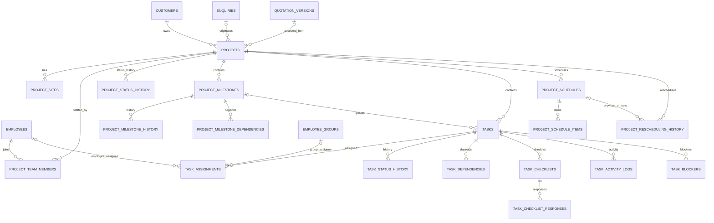

# Stage 2 — Project Management, Tasks, Milestones & Scheduling ER Design

Status: Proposed logical design for stakeholder review  
Date: 22 November 2026  
Dependencies: Customer/CRM, survey/design/quotation, organization/access-control and geography domains.

## 1. Purpose and scope

This document defines how an accepted commercial opportunity becomes an operational project, and how the agency plans, assigns, tracks and audits work through milestones, tasks, dependencies and schedules.

A project is not the same as an enquiry, quotation, installation, solar system or service case. One customer can have multiple projects and installation sites. A project should be created only at the business-approved conversion point, normally after the required quotation acceptance and internal checks. Exact conversion conditions remain a stakeholder decision.

The design covers project identity, ownership, status history, milestones, tasks, assignments, dependencies, checklists, activity, schedules and rescheduling history. It does not define procurement, installation execution, finance or service-case internals; those domains link to the project through stable foreign keys.

This is a logical design, not final SQL. No mock records are included.

## 2. Design principles

1. Every project has a stable reference and an auditable lifecycle.
2. A customer may have multiple projects; each project belongs to one customer when created.
3. A project can originate from an enquiry and an accepted quotation version; preserve both references.
4. Project location/site is distinct from the customer's billing or correspondence address.
5. Project milestones represent meaningful business outcomes; tasks represent actionable work.
6. A task can be assigned to multiple employees or groups, subject to access-control rules.
7. Dependencies must be explicit and must not create cycles.
8. Due dates, planned dates, actual dates, owners, blockers and completion evidence must be independently represented.
9. Schedule changes must preserve prior plans, reason, actor and timestamp.
10. Statuses, milestone templates, task types, priorities, blocker reasons and project types are database-managed master data, not hardcoded lists.
11. No mock projects, staff, tasks or master records are inserted as part of schema creation.

## 3. Project core

### 3.1 Projects

**projects**
- project_id (PK)
- project_reference (unique, generated by platform)
- customer_id (FK → customers)
- originating_enquiry_id (nullable FK → enquiries)
- accepted_quotation_version_id (nullable FK → quotation_versions)
- project_type_id (FK → project_types)
- project_status_id (FK → project_statuses)
- project_name
- project_summary (nullable)
- project_manager_employee_id (nullable FK → employees)
- primary_site_id (nullable FK → project_sites)
- planned_start_date (nullable)
- planned_completion_date (nullable)
- actual_start_at (nullable)
- actual_completion_at (nullable)
- priority_id (FK → priority_levels)
- created_at, created_by
- updated_at, updated_by
- archived_at (nullable)

A project must be linked to a customer. The enquiry and accepted quotation references preserve its commercial origin. If project creation can occur without a quotation in an approved exception path, that exception must be recorded with a reason and actor.

**project_status_history**
- project_status_history_id (PK)
- project_id (FK → projects)
- from_status_id (nullable FK → project_statuses)
- to_status_id (FK → project_statuses)
- changed_at
- changed_by (nullable FK → employees; system actor supported)
- reason (nullable)
- notes (nullable)

Project status history is append-preserving. Current status on projects is a query-efficient pointer and must be updated in the same transaction as the history event.

### 3.2 Project sites

**project_sites**
- project_site_id (PK)
- project_id (FK → projects)
- site_reference (unique within project)
- site_name (nullable)
- address_line_1
- address_line_2 (nullable)
- landmark (nullable)
- place
- post_office (nullable)
- pincode_snapshot (VARCHAR(6))
- postal_code_id (nullable FK → postal_codes)
- local_body_id (nullable FK → local_bodies)
- district_id (nullable FK → districts)
- state_id (nullable FK → states)
- country_id (nullable FK → countries)
- latitude (nullable)
- longitude (nullable)
- site_contact_name (nullable)
- site_contact_phone (nullable)
- access_instructions (nullable)
- is_primary_site
- created_at, created_by
- updated_at, updated_by
- archived_at (nullable)

Project site is the operational work location and may differ from the customer's billing, correspondence or residential address. Preserve a text snapshot even when geography master references are used. PIN is text, not numeric. A project may have more than one site only if the business process supports it; confirm this requirement.

### 3.3 Project ownership and team

**project_team_members**
- project_team_member_id (PK)
- project_id (FK → projects)
- employee_id (FK → employees)
- project_team_role_id (FK → project_team_roles)
- assigned_at
- assigned_by (FK → employees)
- removed_at (nullable)
- removed_by (nullable FK → employees)
- assignment_reason (nullable)

This table represents project participation, not a replacement for permission checks. Membership does not automatically grant access beyond the configured resource scope. The project manager field is the current accountable owner; the team table preserves team history.

## 4. Milestones

**project_milestones**
- project_milestone_id (PK)
- project_id (FK → projects)
- milestone_type_id (FK → milestone_types)
- milestone_name_snapshot
- display_order
- milestone_status_id (FK → milestone_statuses)
- owner_employee_id (nullable FK → employees)
- planned_start_date (nullable)
- planned_due_date (nullable)
- actual_start_at (nullable)
- actual_completion_at (nullable)
- blocked_at (nullable)
- blocker_reason_id (nullable FK → blocker_reasons)
- completion_notes (nullable)
- created_at, created_by
- updated_at, updated_by

**project_milestone_history**
- project_milestone_history_id (PK)
- project_milestone_id (FK → project_milestones)
- from_status_id (nullable FK → milestone_statuses)
- to_status_id (FK → milestone_statuses)
- changed_at
- changed_by (nullable FK → employees)
- reason (nullable)
- evidence_document_id (nullable FK → documents)

Milestone types can be configured from an approved workflow template. The milestone name snapshot ensures historical projects remain readable if the template label changes. A milestone completion may require evidence or approval depending on its configured rules.

**project_milestone_dependencies**
- project_milestone_dependency_id (PK)
- predecessor_milestone_id (FK → project_milestones)
- successor_milestone_id (FK → project_milestones)
- dependency_type_id (FK → dependency_types)
- lag_value (nullable)
- lag_unit_id (nullable FK → time_units)

Do not allow a milestone to depend on itself or create dependency cycles. Validate that both milestones belong to the same project unless cross-project dependencies are explicitly approved.

## 5. Tasks and assignments

### 5.1 Tasks

**tasks**
- task_id (PK)
- project_id (FK → projects)
- project_milestone_id (nullable FK → project_milestones)
- parent_task_id (nullable self-FK)
- task_reference (unique within project)
- task_title
- task_description (nullable)
- task_type_id (FK → task_types)
- task_status_id (FK → task_statuses)
- priority_id (FK → priority_levels)
- created_by (FK → employees)
- created_at
- updated_at, updated_by
- started_at (nullable)
- completed_at (nullable)
- cancelled_at (nullable)
- cancellation_reason (nullable)

Tasks may be nested where required, but hierarchy depth should be limited by application policy. A task linked to a milestone must reference a milestone belonging to the same project.

### 5.2 Task assignments

**task_assignments**
- task_assignment_id (PK)
- task_id (FK → tasks)
- employee_id (nullable FK → employees)
- employee_group_id (nullable FK → employee_groups)
- assignment_role_id (FK → task_assignment_roles)
- assigned_at
- assigned_by (FK → employees)
- accepted_at (nullable)
- unassigned_at (nullable)
- unassigned_by (nullable FK → employees)
- assignment_notes (nullable)

Exactly one of employee_id or employee_group_id must be populated per assignment row. Multiple employees and/or groups may be assigned to one task. Group assignment is a work allocation mechanism; it does not itself grant access. The authorization service still evaluates the employee's permissions and resource scope.

**task_status_history**
- task_status_history_id (PK)
- task_id (FK → tasks)
- from_status_id (nullable FK → task_statuses)
- to_status_id (FK → task_statuses)
- changed_at
- changed_by (nullable FK → employees)
- reason (nullable)

### 5.3 Task dependencies

**task_dependencies**
- task_dependency_id (PK)
- predecessor_task_id (FK → tasks)
- successor_task_id (FK → tasks)
- dependency_type_id (FK → dependency_types)
- lag_value (nullable)
- lag_unit_id (nullable FK → time_units)

Dependencies must not create cycles. For the initial release, dependencies should be constrained to tasks in the same project unless cross-project scheduling is explicitly required. A task cannot be marked complete while required predecessor tasks remain incomplete unless an authorized override with a reason is recorded.

### 5.4 Task checklists and evidence

**task_checklists**
- task_checklist_id (PK)
- task_id (FK → tasks)
- checklist_template_version_id (FK → checklist_template_versions)
- completion_status_id (FK → checklist_completion_statuses)
- completed_at (nullable)
- completed_by (nullable FK → employees)

**task_checklist_responses**
- task_checklist_response_id (PK)
- task_checklist_id (FK → task_checklists)
- checklist_item_id (FK → checklist_items)
- response_value
- response_notes (nullable)
- evidence_document_id (nullable FK → documents)
- responded_at
- responded_by (FK → employees)

Checklist templates and versions are configurable records. Template edits must not change the requirements recorded against historical tasks.

### 5.5 Task activity and blockers

**task_activity_logs**
- task_activity_log_id (PK)
- task_id (FK → tasks)
- activity_type_id (FK → task_activity_types)
- activity_text (nullable)
- previous_value_snapshot (nullable)
- new_value_snapshot (nullable)
- created_at
- created_by (nullable FK → employees)
- visibility_scope_id (FK → note_visibility_scopes)

**task_blockers**
- task_blocker_id (PK)
- task_id (FK → tasks)
- blocker_reason_id (FK → blocker_reasons)
- description
- raised_at
- raised_by (FK → employees)
- resolved_at (nullable)
- resolved_by (nullable FK → employees)
- resolution_notes (nullable)

A blocker is not the same as a task status. A task may be in progress and blocked; retain blocker history and resolution separately.

## 6. Scheduling and rescheduling

**project_schedules**
- project_schedule_id (PK)
- project_id (FK → projects)
- schedule_version
- schedule_status_id (FK → schedule_statuses)
- planned_start_date
- planned_completion_date
- baseline_flag
- created_at, created_by
- approved_at (nullable)
- approved_by (nullable FK → employees)
- schedule_reason (nullable)

**project_schedule_items**
- project_schedule_item_id (PK)
- project_schedule_id (FK → project_schedules)
- project_milestone_id (nullable FK → project_milestones)
- task_id (nullable FK → tasks)
- planned_start_at (nullable)
- planned_end_at (nullable)
- planned_duration_value (nullable)
- duration_unit_id (nullable FK → time_units)
- assigned_employee_id (nullable FK → employees)
- assigned_group_id (nullable FK → employee_groups)

Exactly one of project_milestone_id or task_id must be populated per schedule item. An item must belong to the same project as the schedule. Schedule snapshots preserve the plan at the time it was approved.

**project_rescheduling_history**
- project_rescheduling_history_id (PK)
- project_id (FK → projects)
- previous_schedule_id (nullable FK → project_schedules)
- new_schedule_id (FK → project_schedules)
- rescheduled_at
- rescheduled_by (FK → employees)
- reason_id (FK → reschedule_reasons)
- explanation
- customer_communication_required
- customer_communication_status_id (nullable FK → communication_statuses)

A reschedule creates a new schedule version and records the previous/new versions, actor and reason. Do not silently overwrite a baseline or approved plan.

## 7. Workflow templates and master data

Proposed configurable masters:
- project_types
- project_statuses and project_status_transitions
- project_team_roles
- milestone_types and milestone_statuses
- task_types and task_statuses
- task_assignment_roles
- priority_levels
- dependency_types
- time_units
- blocker_reasons
- reschedule_reasons
- schedule_statuses
- task_activity_types
- checklist templates, checklist template versions and checklist items
- checklist completion statuses
- note visibility scopes
- communication statuses

All business master values must be manually created, edited, activated or deactivated by authorized users through the application and stored in PostgreSQL. No frontend constants, hardcoded business lists, seed data or mock records. Schema migrations may create tables and technical constraints only; they must not insert business master records.

Where a workflow template is introduced, project-specific milestone/task snapshots should preserve the template version used when the project was created. Template changes should affect future projects unless an explicit controlled migration is approved.

## 8. Mermaid ER overview

## 9. Business workflows

### Project creation
1. Confirm the enquiry and accepted quotation version meet the configured conversion conditions.
2. Verify or select the customer record; do not create duplicate customers.
3. Create a project with a generated reference, project type, initial status, accountable owner and site snapshot.
4. Preserve originating enquiry and accepted quotation version.
5. Create project milestones/tasks from the selected approved workflow template, if configured.
6. Record project creation and initial status history in one transaction.

### Milestone and task execution
1. Assign milestone/task owners or groups.
2. Set planned dates and dependencies.
3. Record status transitions and activity.
4. Capture blockers with reason, owner and resolution.
5. Complete required checklists and evidence.
6. Mark milestones complete only when their configured prerequisites are satisfied.
7. Preserve who completed the work and when.

### Schedule changes
1. Authorized user proposes a schedule revision.
2. Record the reason and affected items.
3. Validate dependencies and project dates.
4. Approve/publish the new schedule version according to configured policy.
5. Preserve the prior baseline and rescheduling event.
6. Trigger customer/team notifications where policy requires them; notification delivery is handled by the notification domain.

## 10. Constraints, integrity and authorization

- Generate project and task references server-side and enforce unique constraints.
- Enforce same-project ownership for milestone-task, task dependencies, schedule items and site relationships.
- Exactly one assignee target (employee or group) per task assignment.
- Exactly one schedule target (milestone or task) per schedule item.
- Prevent self-dependencies and detect dependency cycles transactionally.
- Prevent completion when required dependencies, checklists or approvals remain open, except through an audited override permitted by policy.
- Use transactions for project creation, status changes, task assignment, schedule publication and rescheduling.
- Preserve status and schedule history; do not cascade-delete project work records.
- Restrict task notes, customer details, schedules and evidence by permission and resource scope. Project membership does not automatically override access-control policy.
- API endpoints should cover project creation/conversion, project profile, site, team, milestones, tasks, assignment, dependency validation, checklist completion, blockers, schedule versions and rescheduling.
- All master values are served from PostgreSQL through authorized APIs; no hardcoded dropdowns.
- Audit actor, timestamp, reason and before/after state for sensitive changes.

## 11. Reporting requirements

The model should support:
- Projects by status, type, manager, customer and location.
- Milestones overdue, due soon, blocked and completed.
- Task workload by employee/group, status and priority.
- Tasks without owners and projects without active managers.
- Planned versus actual milestone dates.
- Schedule changes by reason, project and responsible actor.
- Dependency bottlenecks and blocked-work aging.
- Customer communication required after schedule changes.

Reports must use explicit status and date semantics. A missing completion timestamp is not a completion date, and a blocked task must not be counted as completed.

## 12. Open stakeholder decisions

1. What exact event permits project creation: customer acceptance, internal approval, advance payment, or a combination?
2. Can one project cover multiple physical installation sites?
3. Which project types and lifecycle statuses are needed at launch?
4. Which milestone templates apply to each project type?
5. Who is accountable project manager, and can that role change during delivery?
6. Can tasks be assigned to multiple groups and individual employees simultaneously?
7. Which groups need visibility versus execution rights?
8. Which tasks/milestones require checklists, photos, customer sign-off or internal approval?
9. Which dependency types and scheduling rules are required?
10. Who can baseline, approve and reschedule a project?
11. Which schedule changes require customer notification and what evidence is retained?
12. Which reporting views and export permissions are required?

## 13. Acceptance checklist

- [ ] Project creation links customer, originating enquiry and accepted quotation version where applicable.
- [ ] Project site is distinct from customer billing/correspondence address.
- [ ] Project manager and team membership are auditable.
- [ ] Project status and milestone status histories are preserved.
- [ ] Tasks support employee and group assignment with explicit assignment history.
- [ ] Task/milestone dependencies prevent cycles.
- [ ] Checklists and evidence are version-aware.
- [ ] Blockers are tracked independently from task status.
- [ ] Schedule versions preserve baselines and prior plans.
- [ ] Rescheduling captures actor, reason and previous/new schedule references.
- [ ] Master values are manually managed in PostgreSQL through authorized screens; no hardcoded business lists or mock records.
- [ ] Server-side permission checks and audit logs protect all project operations.

## 14. Implementation note

Implement after the customer/CRM and survey/design/quotation domains. Confirm project conversion conditions, site cardinality, milestone templates, task assignment policy and schedule approval hierarchy before generating migrations. Procurement, installation, finance, monitoring and service remain separate domains linked to project_id rather than being collapsed into project task tables.
