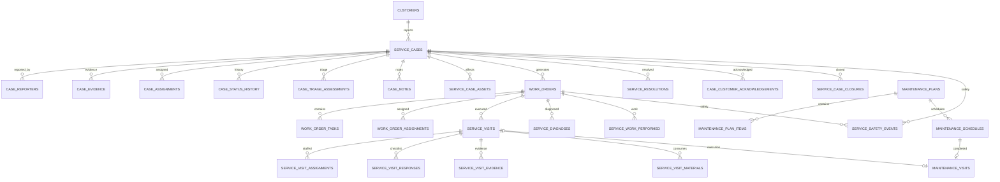

# Stage 2 — Service Management, Customer Complaints, Work Orders, Field Visits & Maintenance ER Design

Status: Proposed logical design for stakeholder review  
Date: 22 November 2026  
Dependencies: Customers/CRM, projects/sites, asset registry, monitoring/alerts, installation/handover, inventory, finance, documents, notifications and organization/access-control domains.

## 1. Purpose and boundaries

This document defines the operational service lifecycle from a customer complaint, technician report, monitoring alert or internal inspection through triage, diagnosis, assignment, work order, field visit, parts usage, resolution, customer confirmation and closure. It also defines planned preventive maintenance.

A service case is the customer-facing/problem-tracking record. A work order is an authorized unit of work. A visit is a dated field execution event. A maintenance plan is a recurring or condition-based future activity. These are related but must not be represented as one status field or one record.

The service domain does not own inventory balances, financial receipts, asset identity, telemetry or notification delivery. It references those domains as appropriate.

This is a logical design, not final SQL. No mock complaints, cases, visits, work orders, service outcomes or customer data are included.

## 2. Core principles

1. Cases can originate from customer reports, employees, technicians, monitoring alerts, inspections, warranty claims or maintenance findings.
2. A case may relate to a customer, project, site, solar system, asset and one or more equipment components.
3. One case may have multiple work orders and visits; one visit may address more than one related task only where scope is explicit.
4. Case status, work order status, visit status, alert status and warranty claim status are independent lifecycles.
5. Assignment records preserve ownership and reassignment history.
6. Duplicate reports can be linked or merged with human review; preserve the original report and reporter.
7. A work order must have an authorized scope, assigned owner/team and required approvals before execution.
8. Material usage is linked to inventory issue/return records and must not create duplicate stock movements.
9. A technician's completion submission is not automatically a customer-confirmed or quality-approved resolution.
10. Preventive maintenance schedules generate planned work; they do not fabricate completed visits.
11. Master data and service templates are managed through authorized screens and stored in PostgreSQL. No hardcoded business lists or mock records.

## 3. Service intake and customer reporting

### 3.1 Service cases

**service_cases**
- service_case_id (PK)
- case_reference (unique, generated)
- customer_id (nullable FK → customers)
- project_id (nullable FK → projects)
- project_site_id (nullable FK → project_sites)
- solar_system_id (nullable FK → solar_systems)
- asset_id (nullable FK → assets)
- case_category_id (FK → service_case_categories)
- case_type_id (FK → service_case_types)
- priority_id (FK → service_priorities)
- severity_id (FK → severity_levels)
- case_status_id (FK → service_case_statuses)
- subject
- description
- reported_at
- source_channel_id (FK → service_source_channels)
- target_response_at (nullable)
- target_resolution_at (nullable)
- first_response_at (nullable)
- resolved_at (nullable)
- closed_at (nullable)
- created_at, created_by
- updated_at, updated_by

A case may be created before the customer account is fully resolved, for example from an incoming phone call. Preserve reporter details and link the customer later after verification. A case must have enough site/system context for safe triage; unresolved context should be explicitly flagged.

### 3.2 Reporters and affected assets

**case_reporters**
- case_reporter_id (PK)
- service_case_id (FK → service_cases)
- customer_contact_id (nullable FK → customer_contacts)
- employee_id (nullable FK → employees)
- reporter_type_id (FK → reporter_types)
- reporter_name_snapshot
- phone_snapshot (nullable)
- email_snapshot (nullable)
- preferred_contact_method_id (nullable FK → communication_channels)
- is_primary
- consent_reference (nullable)

**service_case_assets**
- service_case_asset_id (PK)
- service_case_id (FK → service_cases)
- asset_id (nullable FK → assets)
- equipment_id (nullable FK → equipment)
- solar_system_id (nullable FK → solar_systems)
- impact_role_id (FK → case_asset_impact_roles)
- notes (nullable)

At least one affected asset/system or a documented pending-identification reason should be present before dispatch where the work requires asset context. Do not store lists of IDs in comma-separated fields.

### 3.3 Case evidence and communication

**case_evidence**
- case_evidence_id (PK)
- service_case_id (FK → service_cases)
- document_id (FK → documents)
- evidence_type_id (FK → service_evidence_types)
- captured_at (nullable)
- uploaded_at
- uploaded_by_type_id (FK → actor_types)
- uploaded_by_employee_id (nullable FK → employees)
- uploaded_by_customer_id (nullable FK → customers)
- review_status_id (FK → evidence_review_statuses)
- notes (nullable)

**case_customer_communications**
- case_customer_communication_id (PK)
- service_case_id (FK → service_cases)
- communication_channel_id (FK → communication_channels)
- communication_direction_id (FK → communication_directions)
- communication_reference (nullable)
- subject (nullable)
- message_summary
- occurred_at
- recorded_by (nullable FK → employees)
- notification_id (nullable FK → notifications)
- evidence_document_id (nullable FK → documents)

The notification domain owns delivery attempts and delivery status. This table records case context and communication history; it must not duplicate the entire message provider log.

## 4. Triage, classification and case lifecycle

### 4.1 Case assignments

**case_assignments**
- case_assignment_id (PK)
- service_case_id (FK → service_cases)
- assigned_employee_id (nullable FK → employees)
- assigned_group_id (nullable FK → employee_groups)
- assignment_role_id (FK → service_assignment_roles)
- assigned_at
- assigned_by (FK → employees)
- accepted_at (nullable)
- unassigned_at (nullable)
- unassigned_by (nullable FK → employees)
- assignment_reason (nullable)

Exactly one of assigned_employee_id or assigned_group_id must be populated. Assignment to a group does not grant access; permissions and resource scope remain enforced separately.

### 4.2 Case history and triage

**case_status_history**
- case_status_history_id (PK)
- service_case_id (FK → service_cases)
- previous_status_id (nullable FK → service_case_statuses)
- new_status_id (FK → service_case_statuses)
- changed_at
- changed_by (nullable FK → employees)
- reason (nullable)
- source_event_type_id (FK → service_event_source_types)

**case_triage_assessments**
- case_triage_assessment_id (PK)
- service_case_id (FK → service_cases)
- assessment_version
- assessed_at
- assessed_by (FK → employees)
- confirmed_category_id (FK → service_case_categories)
- confirmed_priority_id (FK → service_priorities)
- confirmed_severity_id (FK → severity_levels)
- safety_risk_status_id (FK → safety_risk_statuses)
- warranty_candidate_status_id (FK → warranty_assessment_statuses)
- monitoring_context_summary (nullable)
- triage_decision_id (FK → triage_decisions)
- notes (nullable)

Triage must distinguish urgency, customer impact, safety concern, equipment fault and data/monitoring issue. A monitoring alert may create or enrich a case, but it must not be assumed to be a confirmed physical fault.

### 4.3 Case notes, activity and duplicate handling

**case_notes**
- case_note_id (PK)
- service_case_id (FK → service_cases)
- note_type_id (FK → case_note_types)
- note_text
- visibility_id (FK → note_visibility_types)
- created_at
- created_by (FK → employees)

**case_activity_logs**
- case_activity_log_id (PK)
- service_case_id (FK → service_cases)
- activity_type_id (FK → service_activity_types)
- occurred_at
- actor_employee_id (nullable FK → employees)
- activity_summary
- related_entity_type (nullable)
- related_entity_id (nullable)

**case_duplicate_reports**
- case_duplicate_report_id (PK)
- primary_case_id (FK → service_cases)
- duplicate_case_id (FK → service_cases)
- match_reason_id (FK → duplicate_match_reasons)
- reviewed_at
- reviewed_by (FK → employees)
- decision_id (FK → duplicate_review_decisions)
- notes (nullable)

**case_links**
- case_link_id (PK)
- source_case_id (FK → service_cases)
- related_case_id (FK → service_cases)
- link_type_id (FK → case_link_types)
- created_at, created_by

Duplicate/related case decisions are human-reviewed. Merging must preserve reporter, evidence, communication and status history. Do not hard-delete the duplicate case.

## 5. Work orders and controlled execution

### 5.1 Work orders

**work_orders**
- work_order_id (PK)
- work_order_reference (unique, generated)
- service_case_id (nullable FK → service_cases)
- project_id (nullable FK → projects)
- project_site_id (nullable FK → project_sites)
- solar_system_id (nullable FK → solar_systems)
- work_order_type_id (FK → work_order_types)
- work_order_status_id (FK → work_order_statuses)
- priority_id (FK → service_priorities)
- scope_description
- planned_start_at (nullable)
- planned_end_at (nullable)
- actual_start_at (nullable)
- actual_end_at (nullable)
- approval_status_id (FK → approval_statuses)
- approved_at (nullable)
- approved_by (nullable FK → employees)
- created_at, created_by

A work order can be created from a case or planned maintenance. A case may require multiple work orders for diagnosis, parts procurement, repair and follow-up. Work without a case must retain its originating reason.

**work_order_assignments**
- work_order_assignment_id (PK)
- work_order_id (FK → work_orders)
- employee_id (nullable FK → employees)
- employee_group_id (nullable FK → employee_groups)
- assignment_role_id (FK → work_order_assignment_roles)
- assigned_at
- assigned_by (FK → employees)
- accepted_at (nullable)
- released_at (nullable)

Exactly one employee or group target is populated per assignment.

**work_order_status_history**
- work_order_status_history_id (PK)
- work_order_id (FK → work_orders)
- previous_status_id (nullable FK → work_order_statuses)
- new_status_id (FK → work_order_statuses)
- changed_at
- changed_by (FK → employees)
- reason (nullable)

### 5.2 Work scope and checklists

**work_order_tasks**
- work_order_task_id (PK)
- work_order_id (FK → work_orders)
- task_sequence
- task_description
- task_status_id (FK → work_task_statuses)
- required_skill_id (nullable FK → employee_skills)
- estimated_duration_minutes (nullable)
- completed_at (nullable)
- completed_by (nullable FK → employees)

**work_order_checklists**
- work_order_checklist_id (PK)
- work_order_id (FK → work_orders)
- checklist_template_version_id (FK → checklist_template_versions)
- checklist_stage_id (FK → work_order_checklist_stages)
- completion_status_id (FK → checklist_completion_statuses)
- completed_at (nullable)
- completed_by (nullable FK → employees)
- reviewed_at (nullable)
- reviewed_by (nullable FK → employees)

**work_order_checklist_responses**
- work_order_checklist_response_id (PK)
- work_order_checklist_id (FK → work_order_checklists)
- checklist_item_id (FK → checklist_items)
- response_status_id (FK → checklist_response_statuses)
- response_value (nullable)
- response_notes (nullable)
- evidence_document_id (nullable FK → documents)
- responded_at
- responded_by (FK → employees)

Checklist templates are versioned and approved. Safety-critical checklist items and required evidence must be configured by qualified stakeholders; the application must not invent technical procedures.

## 6. Field visits and technician execution

### 6.1 Visit scheduling

**service_visits**
- service_visit_id (PK)
- work_order_id (FK → work_orders)
- service_case_id (nullable FK → service_cases)
- visit_reference (unique, generated)
- visit_status_id (FK → service_visit_statuses)
- visit_type_id (FK → service_visit_types)
- scheduled_start_at
- scheduled_end_at
- actual_arrival_at (nullable)
- actual_departure_at (nullable)
- site_contact_id (nullable FK → customer_contacts)
- site_contact_snapshot (nullable)
- visit_outcome_id (nullable FK → service_visit_outcomes)
- visit_summary (nullable)
- created_at, created_by

**service_visit_assignments**
- service_visit_assignment_id (PK)
- service_visit_id (FK → service_visits)
- employee_id (FK → employees)
- assignment_role_id (FK → visit_assignment_roles)
- assigned_at
- accepted_at (nullable)
- released_at (nullable)

**service_visit_schedule_history**
- service_visit_schedule_history_id (PK)
- service_visit_id (FK → service_visits)
- previous_start_at (nullable)
- previous_end_at (nullable)
- new_start_at
- new_end_at
- changed_at
- changed_by (FK → employees)
- reschedule_reason_id (FK → reschedule_reasons)
- customer_notification_status_id (nullable FK → communication_statuses)

### 6.2 Visit execution and evidence

**service_visit_checklists**
- service_visit_checklist_id (PK)
- service_visit_id (FK → service_visits)
- checklist_template_version_id (FK → checklist_template_versions)
- completion_status_id (FK → checklist_completion_statuses)
- completed_at (nullable)
- completed_by (nullable FK → employees)

**service_visit_responses**
- service_visit_response_id (PK)
- service_visit_checklist_id (FK → service_visit_checklists)
- checklist_item_id (FK → checklist_items)
- response_status_id (FK → checklist_response_statuses)
- response_value (nullable)
- response_notes (nullable)
- evidence_document_id (nullable FK → documents)
- responded_at
- responded_by (FK → employees)

**service_visit_evidence**
- service_visit_evidence_id (PK)
- service_visit_id (FK → service_visits)
- document_id (FK → documents)
- evidence_type_id (FK → service_evidence_types)
- captured_at (nullable)
- captured_by (nullable FK → employees)
- review_status_id (FK → evidence_review_statuses)
- notes (nullable)

Technician location tracking, if required, must be separately justified, disclosed and governed. A visit record should not require continuous background tracking by default.

### 6.3 Diagnosis and work performed

**service_diagnoses**
- service_diagnosis_id (PK)
- service_case_id (nullable FK → service_cases)
- work_order_id (FK → work_orders)
- service_visit_id (nullable FK → service_visits)
- asset_id (nullable FK → assets)
- equipment_id (nullable FK → equipment)
- fault_category_id (FK → fault_categories)
- diagnosis_status_id (FK → diagnosis_statuses)
- diagnosis_summary
- diagnosed_at
- diagnosed_by (FK → employees)
- evidence_document_id (nullable FK → documents)

**service_work_performed**
- service_work_performed_id (PK)
- work_order_id (FK → work_orders)
- service_visit_id (nullable FK → service_visits)
- work_activity_type_id (FK → service_work_activity_types)
- description
- performed_at
- performed_by (FK → employees)
- duration_minutes (nullable)
- outcome_notes (nullable)
- evidence_document_id (nullable FK → documents)

Diagnosis is a technical conclusion recorded by the responsible person. Preserve uncertainty and pending investigation instead of forcing a premature root-cause selection.

## 7. Parts, material usage and returns

**service_visit_materials**
- service_visit_material_id (PK)
- service_visit_id (FK → service_visits)
- work_order_id (FK → work_orders)
- product_id (FK → products)
- product_specification_id (nullable FK → product_specifications)
- project_material_issue_item_id (nullable FK → project_material_issue_items)
- stock_reservation_id (nullable FK → stock_reservations)
- quantity_used
- unit_id (FK → measurement_units)
- serial_number (nullable)
- batch_or_lot_reference (nullable)
- usage_status_id (FK → installation_material_usage_statuses)
- recorded_at
- recorded_by (FK → employees)

**service_material_returns**
- service_material_return_id (PK)
- service_visit_id (FK → service_visits)
- stock_return_id (FK → stock_returns)
- return_reason
- recorded_at, recorded_by

Inventory remains the system of record for stock issues, returns and balances. Recording consumption against a service visit must not post a second stock-out if the issue transaction already reduced inventory. Returned unused items must use the inventory return workflow.

If a removed component is retained for diagnosis, repair or supplier warranty return, record its custody and link it to the asset/equipment replacement or warranty claim workflow.

## 8. Resolution, customer confirmation and closure

### 8.1 Resolution

**service_resolutions**
- service_resolution_id (PK)
- service_case_id (FK → service_cases)
- resolution_type_id (FK → service_resolution_types)
- resolution_summary
- root_cause_category_id (nullable FK → fault_categories)
- resolved_at
- resolved_by (FK → employees)
- verification_status_id (FK → resolution_verification_statuses)
- verified_at (nullable)
- verified_by (nullable FK → employees)
- evidence_document_id (nullable FK → documents)
- follow_up_required
- follow_up_due_at (nullable)

A case can have more than one resolution attempt or partial resolution. Preserve each resolution record and link superseding/follow-up activity rather than overwriting the earlier attempt.

### 8.2 Customer acknowledgement

**case_customer_acknowledgements**
- case_customer_acknowledgement_id (PK)
- service_case_id (FK → service_cases)
- service_resolution_id (FK → service_resolutions)
- customer_id (FK → customers)
- customer_contact_id (nullable FK → customer_contacts)
- acknowledgement_status_id (FK → acknowledgement_statuses)
- acknowledgement_channel_id (FK → communication_channels)
- acknowledged_at (nullable)
- evidence_document_id (nullable FK → documents)
- recorded_by (nullable FK → employees)
- comments (nullable)

Customer acknowledgement is distinct from technician completion and internal verification. If a customer is unreachable or disputes the outcome, record that explicitly and follow the configured escalation/closure policy.

### 8.3 Service closure

**service_case_closures**
- service_case_closure_id (PK)
- service_case_id (FK → service_cases)
- closure_reason_id (FK → case_closure_reasons)
- closure_status_id (FK → case_closure_statuses)
- closure_summary
- closed_at
- closed_by (FK → employees)
- customer_acknowledgement_id (nullable FK → case_customer_acknowledgements)
- approved_by (nullable FK → employees)

A closure policy must define which case categories require customer acknowledgement, internal verification, quality review or outstanding-work exception. Do not automatically close a case merely because the alert recovered or technician submitted a visit.

## 9. Preventive and condition-based maintenance

### 9.1 Maintenance plans

**maintenance_plans**
- maintenance_plan_id (PK)
- plan_reference (unique)
- customer_id (FK → customers)
- project_id (nullable FK → projects)
- project_site_id (nullable FK → project_sites)
- solar_system_id (nullable FK → solar_systems)
- asset_id (nullable FK → assets)
- maintenance_plan_type_id (FK → maintenance_plan_types)
- plan_status_id (FK → maintenance_plan_statuses)
- start_date
- end_date (nullable)
- schedule_rule_id (FK → maintenance_schedule_rules)
- next_due_at (nullable)
- owner_group_id (nullable FK → employee_groups)
- created_at, created_by

**maintenance_plan_items**
- maintenance_plan_item_id (PK)
- maintenance_plan_id (FK → maintenance_plans)
- maintenance_activity_type_id (FK → maintenance_activity_types)
- checklist_template_version_id (nullable FK → checklist_template_versions)
- interval_value (nullable)
- interval_unit_id (nullable FK → duration_units)
- condition_rule_reference (nullable)
- required_skill_id (nullable FK → employee_skills)
- is_mandatory

**maintenance_schedules**
- maintenance_schedule_id (PK)
- maintenance_plan_id (FK → maintenance_plans)
- maintenance_plan_item_id (FK → maintenance_plan_items)
- due_at
- schedule_status_id (FK → maintenance_schedule_statuses)
- generated_at
- linked_work_order_id (nullable FK → work_orders)
- completed_visit_id (nullable FK → maintenance_visits)
- rescheduled_at (nullable)
- rescheduled_by (nullable FK → employees)
- reschedule_reason_id (nullable FK → reschedule_reasons)

### 9.2 Maintenance execution

**maintenance_visits**
- maintenance_visit_id (PK)
- maintenance_schedule_id (FK → maintenance_schedules)
- service_visit_id (nullable FK → service_visits)
- asset_id (nullable FK → assets)
- solar_system_id (nullable FK → solar_systems)
- maintenance_visit_status_id (FK → maintenance_visit_statuses)
- performed_at (nullable)
- performed_by (nullable FK → employees)
- outcome_summary (nullable)
- next_recommended_due_at (nullable)
- report_document_id (nullable FK → documents)

**maintenance_visit_reports**
- maintenance_visit_report_id (PK)
- maintenance_visit_id (FK → maintenance_visits)
- checklist_template_version_id (FK → checklist_template_versions)
- report_status_id (FK → maintenance_report_statuses)
- observations
- recommendations (nullable)
- evidence_document_id (nullable FK → documents)
- submitted_at
- submitted_by (FK → employees)
- reviewed_at (nullable)
- reviewed_by (nullable FK → employees)

Maintenance can be calendar-based or condition-based only where approved source data and rules exist. A generated schedule is a due item, not proof the work occurred. Missed maintenance remains visible and can generate a case/task according to policy.

## 10. Safety events and escalation

**service_safety_events**
- service_safety_event_id (PK)
- service_case_id (nullable FK → service_cases)
- work_order_id (nullable FK → work_orders)
- service_visit_id (nullable FK → service_visits)
- project_id (nullable FK → projects)
- event_type_id (FK → safety_event_types)
- severity_id (FK → severity_levels)
- occurred_at
- reported_at
- reported_by (FK → employees)
- description
- immediate_action_taken
- event_status_id (FK → safety_event_statuses)
- investigation_owner_id (nullable FK → employees)
- closed_at (nullable)
- closure_summary (nullable)

**service_safety_event_evidence**
- service_safety_event_evidence_id (PK)
- service_safety_event_id (FK → service_safety_events)
- document_id (FK → documents)
- evidence_type_id (FK → safety_evidence_types)
- uploaded_at
- uploaded_by (FK → employees)

Safety reporting and escalation must follow the agency's approved occupational safety procedures and applicable requirements. This data model does not replace incident reporting obligations or professional safety controls.

## 11. Mermaid ER overview

## 12. Master data and template policy

Proposed database-managed master values include:
- service case categories, types, priorities, statuses and source channels
- reporter types, affected-asset roles and communication channels/directions
- service evidence types and evidence review statuses
- assignment roles, triage decisions and safety risk statuses
- case note/activity types, visibility and duplicate/link decisions
- work order types/statuses, work task statuses and assignment roles
- service visit types/statuses/outcomes and visit assignment roles
- fault categories, diagnosis statuses and work activity types
- service resolution types and verification statuses
- acknowledgement and case closure statuses/reasons
- maintenance plan types/statuses, schedule rules/statuses, activities and report statuses
- safety event types/statuses and evidence types
- checklist templates, versions, items and approved procedures

Authorized users maintain business values and templates in PostgreSQL through application screens. Templates are versioned; existing records retain the version used. Migrations create schema and constraints only. No hardcoded service categories, fault lists, checklist items, SLA promises or fake service cases.

## 13. Workflow, validation and audit controls

- A case must have a valid intake source, reporter snapshot and sufficient problem description.
- Require customer/site/system context or a documented pending-identification reason before dispatch.
- Priority/severity and response targets are configured by policy; do not invent SLA durations.
- Assignment and reassignment history is immutable and records who made the change.
- Work orders require approved scope and authorization before dispatch where configured.
- Visit scheduling changes preserve previous dates and reason.
- Mandatory checklist items and evidence must be complete before work order/visit completion.
- Technician completion, internal verification, customer acknowledgement and case closure are separate gates.
- Material issue/usage/return links reconcile to inventory without double deduction.
- Warranty eligibility is an assessment based on asset warranty records and source evidence, not a guaranteed claim outcome.
- Alert recovery does not close a service case automatically.
- Reopened cases preserve prior closure and resolution events.
- Safety events have restricted access and escalation.
- Audit every status, assignment, approval, override, checklist response, diagnosis, resolution, acknowledgement and closure.
- Do not cascade-delete case, work order, visit, evidence, safety or maintenance history.

## 14. API and application expectations

APIs should support:
- customer/employee/alert/maintenance case intake
- case triage, duplicate review, assignment, status and communication history
- case-to-asset and alert-to-case linking
- work order creation, approval, tasking and assignment
- visit scheduling, rescheduling and technician execution
- mobile checklist/evidence capture with idempotent retry
- diagnosis, parts usage and stock return integration
- warranty assessment and claim handoff
- resolution, verification, customer acknowledgement and closure
- maintenance plan creation, schedule generation and visit reporting
- safety event reporting and escalation

The mobile app should support safe draft capture and retry for intermittent connectivity. Define offline conflict resolution and evidence upload recovery before implementation. Enforce permissions, site scope, required workflow gates and audit on the server, not only in the UI.

## 15. Reporting requirements

- Open cases by priority, severity, category, age and owner.
- First response and resolution time against configured targets.
- Cases by source, customer, district, system, asset and equipment model.
- Repeat faults, reopened cases and duplicate reports.
- Work orders awaiting approval, parts, assignment or scheduling.
- Technician workload, visit completion and reschedule reasons.
- First-time fix rate where measurement rules are agreed.
- Parts consumed, returned and pending reconciliation.
- Warranty candidates, claims submitted and provider decisions.
- Customer acknowledgement pending/disputed.
- Maintenance due, overdue, completed and skipped.
- Safety events and corrective actions by status.
- Alert-to-case conversion, alert recovery versus case closure.
- Case backlog and unresolved cases by project/site.

Do not calculate service performance metrics without defining the exact numerator, denominator, exclusions and time window.

## 16. Open stakeholder decisions

1. Which customer channels can create a service case (app, phone, WhatsApp, email, website, staff)?
2. Can customers create cases without login, and what identity verification is required?
3. Which categories, priorities and severity definitions are used?
4. What response/resolution targets apply by category and contract?
5. Who can triage, assign, approve, dispatch, verify and close cases?
6. Can one case cover multiple sites/systems/assets?
7. Which work order types and approval gates are required?
8. What technician scheduling, skills and service-area constraints apply?
9. Which field checklists, evidence and customer sign-offs are mandatory?
10. How are removed parts retained, repaired, returned to supplier or disposed?
11. Which service visits are chargeable, warranty-covered or goodwill?
12. How is labour, travel and parts cost linked to the finance domain?
13. What customer acknowledgement methods are accepted?
14. Which maintenance plans are offered, and are they contractual or advisory?
15. What safety incident escalation and restricted access process is required?
16. Which alerts should create cases automatically versus require human review?

## 17. Acceptance checklist

- [ ] Cases, work orders, visits and maintenance schedules are distinct entities.
- [ ] Intake supports customer, staff, alert and maintenance origins.
- [ ] Reporters, affected assets, evidence and communication history are preserved.
- [ ] Triage, assignment, status and duplicate review are auditable.
- [ ] Work orders have scope, approval, tasks and assignment history.
- [ ] Visits preserve schedule changes, checklists, diagnosis and evidence.
- [ ] Material use and returns integrate with inventory without duplicate stock movement.
- [ ] Resolution, verification, customer acknowledgement and closure are separate.
- [ ] Warranty and monitoring context are linked without duplicating their source records.
- [ ] Preventive maintenance schedules do not imply completed work.
- [ ] Safety events are recorded with restricted access and escalation.
- [ ] Master values/templates are database-managed; no hardcoded business lists or mock records.
- [ ] Mobile retry, authorization, audit and workflow gate tests are defined.

## 18. Implementation note

Implement the service case backbone first, then work orders, visits, evidence and customer acknowledgement. Add maintenance scheduling after the agency confirms its service offerings and approved maintenance procedures. Integrate inventory, warranty, monitoring and notification domains through explicit references/events rather than duplicating their data.
