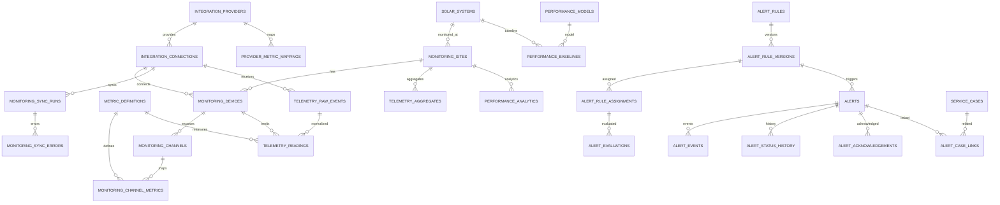

# Stage 2 — Solar Monitoring, IoT Devices, Telemetry, Performance Analytics & Alerts ER Design

Status: Proposed logical design for stakeholder review  
Date: 22 November 2026  
Dependencies: Customer/site, project, asset registry, solar system/components, installation/commissioning, service cases, notification, integration credentials, documents and audit domains.

## 1. Purpose and scope

This document defines the monitoring data model for solar plant/device onboarding, vendor integrations, telemetry ingestion, raw and normalized readings, aggregation, system health, performance analytics, alert evaluation, alert lifecycle and service-case linkage.

The monitoring platform must support multiple inverter/device manufacturers and integration methods without assuming that every vendor exposes an API, that every site has continuous connectivity, or that all telemetry fields are comparable. Integration capability and commercial/technical access must be verified per provider.

Monitoring is distinct from installation, commissioning and customer handover. A commissioned system may not yet be connected to monitoring. A missing reading is not a zero reading and must not be interpreted as zero generation or a confirmed outage without an explicit rule and sufficient evidence.

This is a logical ER design, not final SQL. No mock devices, API credentials, telemetry readings or alert events are included.

## 2. Core principles

1. Solar system and physical equipment identity come from the asset registry; monitoring devices and telemetry endpoints are separate integration concepts.
2. One solar system may have multiple monitoring devices, meters or data sources.
3. One physical device may expose multiple logical channels; one channel can produce multiple metrics over time.
4. Preserve raw provider payloads securely and separately from normalized telemetry.
5. Normalize units, timestamps, time zones and quality flags before analytics.
6. Store source timestamps and ingestion timestamps; account for delayed, duplicated and out-of-order messages.
7. Missing, stale, invalid and zero readings are different states.
8. Alert evaluation must be versioned, explainable and idempotent.
9. Alert recovery and service-case resolution are separate lifecycles.
10. Integration secrets are stored in a secure secret manager or encrypted vault reference, never in ordinary rows or source control.
11. Master values, mappings and alert rules are managed through authorized application screens and PostgreSQL; no hardcoded business lists or mock telemetry.

## 3. Monitoring topology and provider integration

### 3.1 Integration providers

**integration_providers**
- integration_provider_id (PK)
- provider_name
- provider_category_id (FK → integration_provider_categories)
- integration_method_id (FK → integration_methods)
- documentation_reference (nullable)
- provider_status_id (FK → integration_provider_statuses)
- api_capability_verified_at (nullable)
- verification_notes (nullable)
- created_at, created_by

Provider capability records describe what has been verified for the agency's actual account and equipment. Do not treat public marketing claims as proof of API availability or access entitlement.

### 3.2 Integration connections

**integration_connections**
- integration_connection_id (PK)
- integration_provider_id (FK → integration_providers)
- connection_name
- connection_status_id (FK → integration_connection_statuses)
- environment_id (FK → integration_environments)
- secret_reference (nullable)
- secret_version (nullable)
- configured_at
- configured_by (FK → employees)
- last_successful_sync_at (nullable)
- last_failed_sync_at (nullable)
- disabled_at (nullable)
- notes (nullable)

**integration_connection_scopes**
- integration_connection_scope_id (PK)
- integration_connection_id (FK → integration_connections)
- scope_type_id (FK → integration_scope_types)
- scope_reference
- valid_from
- valid_to (nullable)

**integration_credentials**
- integration_credential_id (PK)
- integration_connection_id (FK → integration_connections)
- credential_type_id (FK → integration_credential_types)
- secret_manager_reference
- secret_version
- valid_from
- expires_at (nullable)
- rotated_at (nullable)
- revoked_at (nullable)
- created_at, created_by

The database stores references and metadata only. Secret material must be handled by a dedicated secret manager/encrypted service, with rotation, least privilege and access audit.

### 3.3 Provider capability and field mappings

**integration_capabilities**
- integration_capability_id (PK)
- integration_provider_id (FK → integration_providers)
- capability_code
- capability_description
- verification_status_id (FK → capability_verification_statuses)
- verified_at (nullable)
- evidence_document_id (nullable FK → documents)

**provider_metric_mappings**
- provider_metric_mapping_id (PK)
- integration_provider_id (FK → integration_providers)
- provider_metric_code
- provider_metric_label (nullable)
- canonical_metric_definition_id (FK → metric_definitions)
- source_unit_id (nullable FK → measurement_units)
- conversion_rule_reference (nullable)
- mapping_version
- valid_from
- valid_to (nullable)
- verification_status_id (FK → capability_verification_statuses)

A mapping must be reviewed and versioned. Do not silently assume that similarly named provider fields have identical meaning or unit.

## 4. Monitoring sites and devices

### 4.1 Monitoring sites

**monitoring_sites**
- monitoring_site_id (PK)
- solar_system_id (FK → solar_systems)
- project_site_id (FK → project_sites)
- site_reference (unique)
- monitoring_status_id (FK → monitoring_site_statuses)
- timezone_name
- activated_at (nullable)
- deactivated_at (nullable)
- created_at, created_by

Timezone is required for local-day reporting. Store timestamps in UTC and convert for display/aggregation using the configured IANA timezone.

### 4.2 Monitoring devices

**monitoring_devices**
- monitoring_device_id (PK)
- monitoring_site_id (FK → monitoring_sites)
- equipment_id (nullable FK → equipment)
- integration_connection_id (nullable FK → integration_connections)
- device_type_id (FK → monitoring_device_types)
- provider_device_reference (nullable)
- device_serial_number (nullable)
- device_name
- device_status_id (FK → monitoring_device_statuses)
- installed_at (nullable)
- last_seen_at (nullable)
- commissioned_at (nullable)
- deactivated_at (nullable)
- created_at, created_by

**monitoring_device_identifiers**
- monitoring_device_identifier_id (PK)
- monitoring_device_id (FK → monitoring_devices)
- identifier_type_id (FK → monitoring_identifier_types)
- identifier_value
- valid_from
- valid_to (nullable)

**monitoring_channels**
- monitoring_channel_id (PK)
- monitoring_device_id (FK → monitoring_devices)
- provider_channel_reference (nullable)
- channel_name
- channel_type_id (FK → monitoring_channel_types)
- channel_status_id (FK → monitoring_channel_statuses)
- valid_from
- valid_to (nullable)

One physical equipment item may expose multiple channels, and some provider virtual devices may not correspond to a separately installed physical component. Maintain the link where known, but do not fabricate an equipment association.

## 5. Metric catalogue and normalized telemetry

### 5.1 Metric definitions

**metric_definitions**
- metric_definition_id (PK)
- metric_code (unique)
- metric_name
- metric_description (nullable)
- metric_category_id (FK → metric_categories)
- canonical_unit_id (FK → measurement_units)
- value_type_id (FK → metric_value_types)
- aggregation_policy_id (FK → metric_aggregation_policies)
- valid_minimum (nullable)
- valid_maximum (nullable)
- is_active

Examples of metric categories may include power, energy, voltage, current, frequency, temperature, irradiance, battery state and device health. The catalogue must be based on supported provider fields and approved engineering definitions. Do not assume every system has a battery, meter or irradiance sensor.

**monitoring_channel_metrics**
- monitoring_channel_metric_id (PK)
- monitoring_channel_id (FK → monitoring_channels)
- metric_definition_id (FK → metric_definitions)
- provider_metric_mapping_id (FK → provider_metric_mappings)
- valid_from
- valid_to (nullable)
- mapping_status_id (FK → metric_mapping_statuses)

### 5.2 Raw telemetry events

**telemetry_raw_events**
- telemetry_raw_event_id (PK)
- integration_connection_id (FK → integration_connections)
- monitoring_device_id (nullable FK → monitoring_devices)
- provider_event_reference (nullable)
- provider_event_timestamp (nullable)
- received_at
- payload_document_id (nullable FK → documents)
- payload_storage_reference (nullable)
- payload_hash
- processing_status_id (FK → telemetry_processing_statuses)
- processed_at (nullable)
- error_code (nullable)
- error_summary (nullable)

Raw payloads may contain customer/site/device identifiers. Store them encrypted/private with retention controls and access logs. Avoid copying large provider payloads into general application logs.

### 5.3 Normalized telemetry readings

**telemetry_readings**
- telemetry_reading_id (PK)
- monitoring_site_id (FK → monitoring_sites)
- monitoring_device_id (FK → monitoring_devices)
- monitoring_channel_id (nullable FK → monitoring_channels)
- metric_definition_id (FK → metric_definitions)
- provider_metric_mapping_id (nullable FK → provider_metric_mappings)
- source_event_id (nullable FK → telemetry_raw_events)
- observed_at
- received_at
- numeric_value (nullable)
- text_value (nullable)
- unit_id (FK → measurement_units)
- quality_status_id (FK → telemetry_quality_statuses)
- source_timezone (nullable)
- provider_sequence (nullable)
- deduplication_key
- normalized_at

Use a unique deduplication key derived from stable provider identity/sequence/timestamp/metric where available. If the provider supplies no reliable unique event ID, document the chosen deterministic deduplication strategy and its limitations.

### 5.4 Telemetry quality and freshness

**telemetry_quality_events**
- telemetry_quality_event_id (PK)
- monitoring_site_id (FK → monitoring_sites)
- monitoring_device_id (nullable FK → monitoring_devices)
- metric_definition_id (nullable FK → metric_definitions)
- quality_event_type_id (FK → telemetry_quality_event_types)
- detected_at
- last_valid_observed_at (nullable)
- expected_next_at (nullable)
- quality_status_id (FK → telemetry_quality_statuses)
- explanation
- source_sync_run_id (nullable FK → monitoring_sync_runs)

Quality statuses should distinguish valid, estimated, invalid, stale, missing, delayed, out-of-order and provider-reported unavailable as appropriate. Missing telemetry is represented by quality/freshness state, not by inserting a zero-valued reading.

### 5.5 Aggregates

**telemetry_aggregates**
- telemetry_aggregate_id (PK)
- monitoring_site_id (FK → monitoring_sites)
- monitoring_device_id (nullable FK → monitoring_devices)
- metric_definition_id (FK → metric_definitions)
- aggregation_window_id (FK → telemetry_aggregation_windows)
- window_start_at
- window_end_at
- value_sum (nullable)
- value_minimum (nullable)
- value_maximum (nullable)
- value_average (nullable)
- sample_count
- valid_sample_count
- missing_sample_count
- quality_summary_id (FK → telemetry_quality_summary_types)
- calculation_version
- generated_at

Aggregation semantics depend on metric type. Energy counters, instantaneous power, state values and event counts cannot share one generic summation rule. Preserve sample counts and quality summary so dashboards can communicate confidence/completeness.

## 6. Monitoring synchronization and ingestion operations

**monitoring_sync_runs**
- monitoring_sync_run_id (PK)
- integration_connection_id (FK → integration_connections)
- sync_type_id (FK → monitoring_sync_types)
- started_at
- completed_at (nullable)
- sync_status_id (FK → monitoring_sync_statuses)
- records_received
- records_processed
- records_rejected
- retry_count
- cursor_reference (nullable)
- error_summary (nullable)
- triggered_by_type_id (FK → job_trigger_types)
- triggered_by_employee_id (nullable FK → employees)

**monitoring_sync_errors**
- monitoring_sync_error_id (PK)
- monitoring_sync_run_id (FK → monitoring_sync_runs)
- telemetry_raw_event_id (nullable FK → telemetry_raw_events)
- error_type_id (FK → monitoring_sync_error_types)
- error_code (nullable)
- error_summary
- retryable
- occurred_at
- resolved_at (nullable)

**monitoring_sync_cursors**
- monitoring_sync_cursor_id (PK)
- integration_connection_id (FK → integration_connections)
- cursor_name
- cursor_value_encrypted_or_reference
- updated_at

Use provider cursor/watermark where supported. Retries must be idempotent. Record rate limits, partial responses, authentication failures, provider downtime and pagination state. Never advance a cursor past unprocessed records without an explicit recovery strategy.

## 7. Performance analytics and baselines

**performance_models**
- performance_model_id (PK)
- model_name
- model_version
- model_type_id (FK → performance_model_types)
- methodology_document_id (nullable FK → documents)
- model_status_id (FK → performance_model_statuses)
- effective_from
- effective_to (nullable)
- approved_by (nullable FK → employees)

**performance_baselines**
- performance_baseline_id (PK)
- solar_system_id (FK → solar_systems)
- performance_model_id (FK → performance_models)
- baseline_type_id (FK → performance_baseline_types)
- baseline_value (nullable)
- unit_id (nullable FK → measurement_units)
- valid_from
- valid_to (nullable)
- source_reference (nullable)
- assumptions_snapshot (nullable)
- created_at, created_by

**performance_analytics**
- performance_analytic_id (PK)
- monitoring_site_id (FK → monitoring_sites)
- solar_system_id (FK → solar_systems)
- metric_definition_id (FK → metric_definitions)
- period_start_at
- period_end_at
- actual_value (nullable)
- expected_value (nullable)
- variance_value (nullable)
- unit_id (FK → measurement_units)
- coverage_percentage (nullable)
- quality_status_id (FK → telemetry_quality_statuses)
- model_version
- calculated_at

**performance_anomalies**
- performance_anomaly_id (PK)
- monitoring_site_id (FK → monitoring_sites)
- solar_system_id (FK → solar_systems)
- metric_definition_id (FK → metric_definitions)
- anomaly_type_id (FK → performance_anomaly_types)
- detected_at
- period_start_at
- period_end_at
- observed_value (nullable)
- expected_value (nullable)
- confidence_score (nullable)
- anomaly_status_id (FK → performance_anomaly_statuses)
- explanation
- linked_alert_id (nullable FK → alerts)

Expected generation requires approved assumptions and, where available, environmental/site context. Do not represent a model estimate as measured generation. Record coverage and confidence; suppress or qualify analytics when data quality is insufficient.

## 8. Alert rules and evaluation

### 8.1 Rule definitions and versions

**alert_rules**
- alert_rule_id (PK)
- rule_code (unique)
- rule_name
- rule_category_id (FK → alert_rule_categories)
- rule_status_id (FK → alert_rule_statuses)
- default_severity_id (FK → alert_severity_levels)
- owner_group_id (nullable FK → employee_groups)
- created_at, created_by

**alert_rule_versions**
- alert_rule_version_id (PK)
- alert_rule_id (FK → alert_rules)
- version_number
- metric_definition_id (nullable FK → metric_definitions)
- condition_definition_json
- evaluation_window
- minimum_sample_count (nullable)
- data_quality_requirement_id (FK → alert_data_quality_requirements)
- trigger_duration_seconds (nullable)
- recovery_condition_json (nullable)
- cooldown_seconds (nullable)
- effective_from
- effective_to (nullable)
- approved_by (nullable FK → employees)
- created_at, created_by

Condition definitions are validated, schema-versioned and interpreted by a controlled rule engine. Do not execute arbitrary user-supplied code or SQL from rule JSON. Rules must specify quality requirements and avoid triggering on missing/invalid telemetry as if it were a measured threshold breach.

### 8.2 Site/device rule assignments

**alert_rule_assignments**
- alert_rule_assignment_id (PK)
- alert_rule_version_id (FK → alert_rule_versions)
- monitoring_site_id (nullable FK → monitoring_sites)
- monitoring_device_id (nullable FK → monitoring_devices)
- solar_system_id (nullable FK → solar_systems)
- enabled_from
- enabled_to (nullable)
- assignment_status_id (FK → alert_rule_assignment_statuses)
- assigned_by (FK → employees)

At least one scope target is required. Validate overlapping assignments and rule applicability. Some rules may apply to site, system or device scope.

### 8.3 Evaluation records

**alert_evaluations**
- alert_evaluation_id (PK)
- alert_rule_version_id (FK → alert_rule_versions)
- alert_rule_assignment_id (FK → alert_rule_assignments)
- evaluation_started_at
- evaluation_completed_at
- evaluation_result_id (FK → alert_evaluation_results)
- input_window_start_at
- input_window_end_at
- sample_count
- valid_sample_count
- evaluation_summary
- deduplication_key

**alerts**
- alert_id (PK)
- alert_reference (unique)
- alert_rule_version_id (FK → alert_rule_versions)
- monitoring_site_id (nullable FK → monitoring_sites)
- monitoring_device_id (nullable FK → monitoring_devices)
- solar_system_id (nullable FK → solar_systems)
- alert_type_id (FK → alert_types)
- severity_id (FK → alert_severity_levels)
- alert_status_id (FK → alert_statuses)
- first_triggered_at
- last_triggered_at
- recovered_at (nullable)
- acknowledged_at (nullable)
- acknowledged_by (nullable FK → employees)
- assigned_group_id (nullable FK → employee_groups)
- assigned_employee_id (nullable FK → employees)
- current_summary
- last_evaluation_id (nullable FK → alert_evaluations)
- created_at

**alert_events**
- alert_event_id (PK)
- alert_id (FK → alerts)
- alert_event_type_id (FK → alert_event_types)
- event_at
- event_summary
- source_evaluation_id (nullable FK → alert_evaluations)
- actor_employee_id (nullable FK → employees)
- event_metadata_reference (nullable)

**alert_status_history**
- alert_status_history_id (PK)
- alert_id (FK → alerts)
- previous_status_id (nullable FK → alert_statuses)
- new_status_id (FK → alert_statuses)
- changed_at
- changed_by (nullable FK → employees)
- reason (nullable)

**alert_acknowledgements**
- alert_acknowledgement_id (PK)
- alert_id (FK → alerts)
- acknowledged_by (FK → employees)
- acknowledged_at
- acknowledgement_note (nullable)

**alert_suppressions**
- alert_suppression_id (PK)
- alert_rule_assignment_id (nullable FK → alert_rule_assignments)
- monitoring_site_id (nullable FK → monitoring_sites)
- monitoring_device_id (nullable FK → monitoring_devices)
- suppression_reason_id (FK → alert_suppression_reasons)
- starts_at
- ends_at
- approved_by (FK → employees)
- created_at

Suppression must be time-bounded, reasoned and audited. It must not erase the underlying telemetry or conceal a safety-critical condition without an approved policy.

## 9. Alert recovery, service case and resolution

**alert_case_links**
- alert_case_link_id (PK)
- alert_id (FK → alerts)
- service_case_id (FK → service_cases)
- link_type_id (FK → alert_case_link_types)
- linked_at
- linked_by (FK → employees)
- unlinked_at (nullable)
- notes (nullable)

An alert may exist without a service case. Multiple alerts may be grouped into one case, and a case may involve multiple assets. A case may also be created from customer/technician report without a telemetry alert.

Alert recovery means the signal condition returned to the rule's recovery criteria. Service-case resolution means work was diagnosed and completed/accepted. These events must remain separate:
- alert can recover while a case remains open;
- case can be resolved while an alert is still active, with explicit explanation/escalation;
- a repeated alert after recovery may create a new alert episode or reopen according to approved rule policy, preserving event history.

## 10. Notification integration

The notification domain owns notification templates, recipients, attempts, preferences, push devices and delivery logs. Monitoring produces domain events only.

Relevant event types include:
- alert created or severity escalated
- alert acknowledged or assigned
- alert recovered
- device offline/stale data condition
- monitoring connection authentication/ingestion failure
- performance anomaly detected
- alert linked to service case

Notification delivery is not proof that an alert was seen or acted upon. Apply recipient preferences, escalation policy, quiet hours and delivery retry rules from the notification domain.

## 11. Mermaid ER overview

## 12. Master data and configuration policy

Database-managed master/configuration values include:
- integration provider categories, methods, environments, connection statuses and credential types
- integration capabilities and verification statuses
- device types/statuses, identifier types, channel types/statuses
- metric categories, metric definitions, canonical units, value types and aggregation policies
- telemetry processing, quality and freshness statuses
- sync types/statuses/errors and job trigger types
- aggregation windows and quality summaries
- performance model types/statuses, baseline types and anomaly types/statuses
- alert categories/types/statuses/severity levels/event types/evaluation results
- alert rule versions, assignment statuses, data-quality requirements and suppression reasons
- alert/case link types

Authorized users configure business/provider mappings and rules through application screens, with review and audit. Migrations create schema and constraints only. Technical enums that are purely internal protocol states may be code-controlled only when explicitly documented; business-selectable lists remain database-managed. No fake provider/device/telemetry seeds.

## 13. Data engineering, reliability and retention

- Store observed_at and received_at separately; preserve original provider timestamp and timezone context.
- Normalize all timestamps to UTC and retain monitoring site timezone for local-day summaries.
- Define retention/partition strategy for high-volume telemetry; raw payload retention may differ from normalized readings and aggregates.
- Use idempotent ingestion and deduplication; support late arrival, replay and backfill.
- Partition large telemetry tables by time and/or site where operationally appropriate; index common site/device/metric/time queries.
- Separate ingestion worker from API request path; use durable queues and retry/dead-letter handling.
- Apply rate limiting, provider quotas, exponential backoff and circuit breakers.
- Record schema/mapping version used for every normalized record or batch.
- Reconciliation should compare received, processed, rejected and persisted record counts.
- Alert evaluation must be deterministic for the same rule version and input window.
- Keep rule evaluation output and source sample references sufficient to explain why an alert triggered.
- Protect raw payloads and telemetry as customer data; define retention and deletion policy with privacy requirements.

## 14. API and reporting expectations

APIs:
- provider connection setup/status and credential-reference rotation
- monitoring site/device/channel registration and mapping
- sync run status, failures and replay/backfill controls
- telemetry query by site/device/metric/time range with quality metadata
- daily/monthly aggregates and system performance summaries
- alert rule draft/review/publish/assignment
- alert list, acknowledge, assign, suppress, recover and case-link
- monitoring readiness and stale/offline diagnostics

Reports:
- systems monitored versus commissioned/installed
- provider/device connection health and last successful sync
- telemetry freshness and data completeness by site
- daily/monthly generation with quality/coverage indicators
- expected versus actual performance where approved baseline exists
- alerts by severity, type, age, site and acknowledgement time
- repeated device faults and performance anomalies
- alert-to-case conversion, case resolution and time-to-recovery
- ingestion errors, provider API failures and data gaps

## 15. Security and operational controls

- Restrict integration configuration and secret rotation to authorized roles.
- Never expose provider tokens, raw payload credentials or internal endpoint secrets to customer/technician clients.
- Use TLS, encryption at rest, secret references, rotation and least-privilege service accounts.
- Verify webhook signatures and replay protection if provider webhooks are supported.
- Validate provider payload schemas and size limits; treat payload content as untrusted.
- Enforce tenant/customer/site scope on all telemetry and alert APIs.
- Audit manual readings, manual status changes, rule edits, suppressions and alert acknowledgements.
- Manual readings must be explicitly labeled as manual with actor, time, source and evidence; never silently blend with provider readings.
- Define escalation and on-call ownership; notification failure must not erase alert state.
- Monitor ingestion backlog, worker health, database storage, queue depth and provider error rates.

## 16. Open stakeholder and provider decisions

1. Which inverter, meter, battery and monitoring manufacturers are actually deployed?
2. Which providers offer documented APIs/webhooks for the agency's account and product models?
3. Are integrations cloud-to-cloud, local gateway, Modbus/other field protocol, manual import or vendor portal only?
4. Which credentials/scopes and commercial permissions can be obtained?
5. What metrics, units, sampling rates and historical backfill are available per model/provider?
6. What timezone and timestamp quality does each provider supply?
7. How should duplicate/out-of-order readings be identified for each provider?
8. Which performance baselines and anomaly rules are approved by technical stakeholders?
9. What constitutes stale/offline for each device/provider and sampling interval?
10. Which alerts are informational, operational, urgent or safety-critical?
11. Who owns acknowledgement and escalation, including outside business hours?
12. Which alerts automatically create service cases, and which require human review?
13. What are raw telemetry, normalized data and aggregate retention requirements?
14. What customer-visible monitoring metrics and historical range are allowed?
15. Are manual readings needed when provider telemetry is unavailable?

## 17. Acceptance checklist

- [ ] Monitoring site/device/channel records are separate from asset identity.
- [ ] Provider capability and metric mappings are verified and versioned.
- [ ] Secrets are stored only through secure references, not plain database values.
- [ ] Raw provider payloads and normalized readings are separately retained.
- [ ] Observed time and ingestion time are both recorded.
- [ ] Deduplication, retries, replay and out-of-order handling are defined.
- [ ] Missing/stale/invalid data is never represented as measured zero.
- [ ] Aggregates preserve sample counts and quality coverage.
- [ ] Performance analytics identify estimates and model version.
- [ ] Alert rules are versioned, explainable and data-quality-aware.
- [ ] Alert recovery is separate from service-case resolution.
- [ ] Notifications are delivered through the notification domain.
- [ ] Master business configuration is manually managed in PostgreSQL; no hardcoded business lists or mock telemetry.
- [ ] Security, retention, audit, tenant/site scoping and ingestion observability are tested.

## 18. Implementation note

Start with a provider capability discovery exercise against the actual installed equipment and agency accounts. Implement a provider-neutral normalized metric model and one verified integration first, while retaining manual diagnostic workflows where appropriate. Do not promise real-time monitoring, historical backfill or specific metrics until provider documentation and access have been tested.
