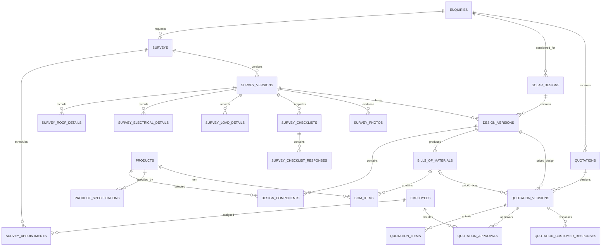

# Stage 2 — Survey, Solar Design & Quotations ER Design

Status: Proposed logical design for stakeholder review  
Date: 22 November 2026  
Dependencies: Geography, organization/access control, customer/CRM domains.

## 1. Purpose and scope

This document defines the data model for the technical assessment and commercial proposal stages: survey scheduling and evidence, survey revisions, solar system design, product catalogue, bill of materials (BOM), quotations, revisions, approvals and customer responses.

A survey, design and quotation are linked to an enquiry and, where available, a customer. The design must preserve the technical and commercial state that was used to prepare each quotation. Revisions must not silently overwrite previously shared or approved versions.

This is a logical design, not final SQL. No mock records or example product catalogues are included.

## 2. Core design principles

1. An enquiry may exist before a customer record. Survey/design/quotation records must be linkable to that enquiry.
2. A project is not assumed to exist before quotation acceptance and the agreed conversion point.
3. Survey appointments, survey executions, survey versions and survey evidence are distinct.
4. Corrections to submitted survey data create a new version; they do not erase the previously submitted version.
5. Design versions reference the survey version and product/specification versions used.
6. A BOM is a structured list of required items and quantities, not free-text alone.
7. Quotation versions are immutable once sent or approved; changes create a new version.
8. Approvals are explicit workflow records with actor, timestamp, decision and comments.
9. Product categories, manufacturers, models, units, checklist templates and commercial configuration are database-managed master data, not hardcoded frontend lists.
10. Engineering assumptions and statutory requirements must be validated by qualified personnel and current authority/provider requirements.

## 3. Survey domain

### 3.1 Survey records

**surveys**
- survey_id (PK)
- enquiry_id (FK → enquiries)
- customer_id (nullable FK → customers)
- installation_address_snapshot_id (nullable; address snapshot owned by survey)
- survey_reference (unique, generated)
- current_version_id (nullable FK → survey_versions)
- survey_status_id (FK → survey_statuses)
- created_at, created_by
- updated_at, updated_by

The enquiry is the required CRM anchor. customer_id is a convenience link where the enquiry has been converted; it must not be used to imply that every enquiry already has a customer.

**survey_appointments**
- survey_appointment_id (PK)
- survey_id (FK → surveys)
- scheduled_start_at
- scheduled_end_at
- appointment_status_id (FK → appointment_statuses)
- assigned_employee_id (FK → employees)
- assigned_by (FK → employees)
- customer_confirmation_status_id (nullable FK → confirmation_statuses)
- customer_contact_snapshot
- location_instructions (nullable)
- cancellation_reason (nullable)
- created_at, created_by

Appointments can be rescheduled. Preserve appointment history through status/audit events or a dedicated survey_appointment_history table. Do not overwrite the original scheduled date without retaining the change record.

**survey_versions**
- survey_version_id (PK)
- survey_id (FK → surveys)
- version_number
- version_status_id (FK → survey_version_statuses)
- surveyed_at
- submitted_at (nullable)
- submitted_by (nullable FK → employees)
- reviewed_at (nullable)
- reviewed_by (nullable FK → employees)
- review_notes (nullable)
- revision_reason (nullable)
- supersedes_version_id (nullable FK → survey_versions)
- created_at, created_by

Unique constraint: (survey_id, version_number). Submitted versions should be immutable except through a controlled correction/version workflow.

### 3.2 Survey findings

**survey_roof_details**
- survey_roof_detail_id (PK)
- survey_version_id (FK → survey_versions)
- roof_type_id (FK → roof_types)
- roof_area_value (nullable)
- roof_area_unit_id (nullable FK → measurement_units)
- usable_area_value (nullable)
- usable_area_unit_id (nullable FK → measurement_units)
- orientation (nullable)
- tilt_degrees (nullable)
- shading_assessment_id (nullable FK → shading_assessments)
- structural_observations (nullable)
- access_and_safety_notes (nullable)

**survey_electrical_details**
- survey_electrical_detail_id (PK)
- survey_version_id (FK → survey_versions)
- supply_phase_id (nullable FK → supply_phases)
- sanctioned_load_value (nullable)
- sanctioned_load_unit_id (nullable FK → measurement_units)
- service_connection_reference (nullable; access restricted where sensitive)
- meter_type_id (nullable FK → meter_types)
- distribution_board_notes (nullable)
- earthing_observations (nullable)
- electrical_safety_observations (nullable)

**survey_load_details**
- survey_load_detail_id (PK)
- survey_version_id (FK → survey_versions)
- appliance_or_load_name
- quantity (nullable)
- rated_power_value (nullable)
- rated_power_unit_id (nullable FK → measurement_units)
- usage_hours_per_day (nullable)
- usage_pattern_notes (nullable)
- diversity_or_assumption_notes (nullable)

Load entries are repeatable child records. Do not compress an entire load assessment into one unstructured field.

**survey_checklists**
- survey_checklist_id (PK)
- survey_version_id (FK → survey_versions)
- checklist_template_version_id (FK → checklist_template_versions)
- completion_status_id (FK → checklist_completion_statuses)
- completed_at (nullable)
- completed_by (nullable FK → employees)

**survey_checklist_responses**
- survey_checklist_response_id (PK)
- survey_checklist_id (FK → survey_checklists)
- checklist_item_id (FK → checklist_items)
- response_value
- response_notes (nullable)
- evidence_required
- responded_at
- responded_by (FK → employees)

Checklist templates and their versions are configurable records. Editing a template must not change the interpretation of already completed survey responses.

**survey_photos**
- survey_photo_id (PK)
- survey_version_id (FK → survey_versions)
- document_id (FK → documents)
- photo_category_id (FK → survey_photo_categories)
- captured_at (nullable)
- captured_by (nullable FK → employees)
- caption (nullable)
- location_metadata (nullable; only if justified and consented)
- review_status_id (FK → evidence_review_statuses)

Photo/file bytes live in private document storage. Store document metadata and access references in the database, not public file URLs.

## 4. Product catalogue and technical master data

### 4.1 Product catalogue

**product_categories**
- product_category_id (PK)
- parent_category_id (nullable self-FK)
- category_name
- category_code (unique)
- is_active
- created_at, created_by

**manufacturers**
- manufacturer_id (PK)
- manufacturer_name
- website (nullable)
- is_active

**products**
- product_id (PK)
- product_category_id (FK → product_categories)
- manufacturer_id (nullable FK → manufacturers)
- product_code (unique)
- product_name
- description (nullable)
- product_status_id (FK → product_statuses)
- created_at, created_by
- updated_at, updated_by

**product_specifications**
- product_specification_id (PK)
- product_id (FK → products)
- specification_version
- effective_from
- effective_to (nullable)
- specification_data (structured attributes)
- source_document_id (nullable FK → documents)
- verified_by (nullable FK → employees)
- verified_at (nullable)

Keep technical specifications versioned. A product may be deactivated for new designs while remaining referenced by historical BOMs and quotations.

**measurement_units** and **product_statuses** are database-managed master data. Use controlled unit identifiers and numeric precision appropriate to the measurement; do not encode units inside numeric strings.

### 4.2 Design-specific equipment and assumptions

**solar_designs**
- solar_design_id (PK)
- enquiry_id (FK → enquiries)
- survey_id (FK → surveys)
- design_reference (unique)
- current_version_id (nullable FK → design_versions)
- design_status_id (FK → design_statuses)
- created_at, created_by
- updated_at, updated_by

**design_versions**
- design_version_id (PK)
- solar_design_id (FK → solar_designs)
- version_number
- survey_version_id (FK → survey_versions)
- design_status_id (FK → design_statuses)
- proposed_capacity_value
- capacity_unit_id (FK → measurement_units)
- estimated_generation_value (nullable)
- generation_unit_id (nullable FK → measurement_units)
- performance_assumption_notes (nullable)
- design_assumptions (structured data)
- design_document_id (nullable FK → documents)
- prepared_by (FK → employees)
- prepared_at
- reviewed_by (nullable FK → employees)
- reviewed_at (nullable)
- revision_reason (nullable)
- supersedes_design_version_id (nullable FK → design_versions)

A design version must reference the exact survey version on which it was based. Changes in survey findings may require a new design version.

**design_components**
- design_component_id (PK)
- design_version_id (FK → design_versions)
- product_id (FK → products)
- product_specification_id (FK → product_specifications)
- component_role_id (FK → component_roles)
- quantity
- unit_id (FK → measurement_units)
- technical_notes (nullable)

The exact component roles and required equipment depend on the agency's approved engineering method and project types. Do not assume a fixed equipment list.

## 5. Bill of materials

**bills_of_materials**
- bom_id (PK)
- design_version_id (FK → design_versions)
- bom_reference (unique)
- bom_version
- bom_status_id (FK → bom_statuses)
- prepared_by (FK → employees)
- prepared_at
- approved_by (nullable FK → employees)
- approved_at (nullable)

**bom_items**
- bom_item_id (PK)
- bom_id (FK → bills_of_materials)
- product_id (FK → products)
- product_specification_id (nullable FK → product_specifications)
- item_description_snapshot
- quantity
- unit_id (FK → measurement_units)
- estimated_unit_cost (nullable)
- notes (nullable)

BOM item description and specification snapshots protect historical meaning if catalogue details later change. Enforce positive quantities and appropriate decimal precision. A BOM used by a quotation must be identifiable and version-stable.

## 6. Quotation and commercial approvals

### 6.1 Quotation header and versions

**quotations**
- quotation_id (PK)
- enquiry_id (FK → enquiries)
- customer_id (nullable FK → customers)
- quotation_reference (unique, generated)
- current_version_id (nullable FK → quotation_versions)
- quotation_status_id (FK → quotation_statuses)
- created_at, created_by
- updated_at, updated_by

**quotation_versions**
- quotation_version_id (PK)
- quotation_id (FK → quotations)
- version_number
- design_version_id (FK → design_versions)
- bom_id (nullable FK → bills_of_materials)
- version_status_id (FK → quotation_version_statuses)
- currency_id (FK → currencies)
- subtotal_amount
- discount_amount
- tax_amount
- total_amount
- validity_until (nullable)
- payment_terms_snapshot (nullable)
- delivery_terms_snapshot (nullable)
- exclusions_and_assumptions (nullable)
- prepared_by (FK → employees)
- prepared_at
- approved_at (nullable)
- sent_at (nullable)
- supersedes_version_id (nullable FK → quotation_versions)
- revision_reason (nullable)
- quotation_document_id (nullable FK → documents)

The currency and tax treatment must be explicitly recorded. Tax rates, applicability and invoice rules require finance/tax validation; do not hardcode assumed GST rates in the schema or UI. Monetary values use fixed precision, never floating-point storage.

### 6.2 Quotation line items

**quotation_items**
- quotation_item_id (PK)
- quotation_version_id (FK → quotation_versions)
- bom_item_id (nullable FK → bom_items)
- item_type_id (FK → quotation_item_types)
- product_id (nullable FK → products)
- item_description_snapshot
- quantity
- unit_id (FK → measurement_units)
- unit_price
- discount_amount
- tax_category_id (nullable FK → tax_categories)
- tax_rate_snapshot (nullable)
- line_subtotal
- line_tax_amount
- line_total
- display_order

Store calculation snapshots at version level so an old quotation remains reproducible after tax configuration, catalogue price or product description changes. All totals must be calculated and validated server-side using decimal arithmetic. Reconcile header totals against line totals in the same transaction.

**currencies**, **tax_categories** and **quotation_item_types** are master/configuration tables. Their values are managed by authorized users and reviewed by finance.

### 6.3 Approval workflow

**quotation_approvals**
- quotation_approval_id (PK)
- quotation_version_id (FK → quotation_versions)
- approval_stage_id (FK → approval_stages)
- approver_employee_id (FK → employees)
- decision_status_id (FK → approval_decision_statuses)
- requested_at
- decided_at (nullable)
- comments (nullable)
- delegated_from_employee_id (nullable FK → employees)

Approval rules and thresholds should be configurable only after the actual approval hierarchy is confirmed. A user must not approve their own quotation if the approved governance policy prohibits it. Preserve every decision; a rejected or superseded version remains in history.

### 6.4 Customer response

**quotation_customer_responses**
- quotation_customer_response_id (PK)
- quotation_version_id (FK → quotation_versions)
- response_status_id (FK → customer_response_statuses)
- responded_at
- response_channel_id (FK → communication_channels)
- response_contact_snapshot (nullable)
- response_notes (nullable)
- evidence_document_id (nullable FK → documents)
- recorded_by (nullable FK → employees)

Customer acceptance, rejection or request for revision must refer to a specific quotation version. A customer response is not itself a payment or project completion event.

## 7. Mermaid ER overview

## 8. Versioning and workflow rules

### Survey lifecycle
- Appointment scheduled → assigned → completed → submitted → reviewed/accepted or returned for correction.
- A correction after submission creates a new survey version with a reason and a link to the prior version.
- Photos, checklist responses and measurements belong to a specific survey version.
- Appointment rescheduling is separately auditable from survey findings.

### Design lifecycle
- Draft → technical review → approved or returned for revision.
- Every design version references a specific survey version and product specification version.
- If technical inputs change, create a new design version rather than mutating an approved design.
- Engineering review and sign-off requirements must be confirmed by the agency's qualified personnel.

### Quotation lifecycle
- Draft → internal approval → approved → sent → customer response (accepted/rejected/revision requested/expired).
- Revisions create a new quotation version and preserve the previous sent/approved version.
- Customer acceptance must reference the exact version accepted.
- Approval and customer acceptance are distinct events.
- Do not automatically create a project or record a payment solely because a quotation was sent or accepted; follow the separately approved project-conversion and finance workflows.

## 9. Integrity, security and API expectations

- Enforce unique references and unique (parent_id, version_number) constraints.
- Prevent editing immutable submitted/approved/sent versions through both API and database transaction controls.
- Enforce valid parent-child relationships: a design must use a survey belonging to the same enquiry; a quotation must use a design belonging to the same enquiry.
- Use transactions for version creation, approval decisions, quotation sending and customer response recording.
- Validate measurement units, non-negative quantities, monetary precision, arithmetic totals and required fields server-side.
- Store files privately; use document IDs and access-controlled download endpoints.
- Restrict survey photos, electrical details, customer records, design pricing and quotation approvals by permission and resource scope.
- APIs: appointment scheduling, survey submission/versioning, checklist responses, evidence upload metadata, product catalogue, design versioning, BOM, quotation drafting/revision, approval decisions and customer responses.
- Master-data APIs must read from PostgreSQL. Authorized administrators manage categories, manufacturers, products, units, roof types, meter/supply types, checklist templates, statuses, tax categories and approval stages through application screens.
- Never put product catalogue data, tax rates, approval thresholds or business dropdown lists in frontend constants.
- Audit actor, timestamp, reason and before/after values for important changes. Do not log private document contents or credentials.

## 10. Open stakeholder decisions

1. What survey checklist and evidence requirements are mandatory for each project type?
2. Which roof, electrical supply, meter and load attributes must be captured at launch?
3. Who is qualified and authorized to review/sign off surveys and designs?
4. What design calculations, generation assumptions and validation rules are approved?
5. Which manufacturers, product categories and technical specifications are needed initially?
6. Who maintains catalogue specifications and verifies manufacturer documentation?
7. Is BOM approval required before quotation preparation or only for certain project types?
8. What pricing, discount, tax, validity and payment-term rules are approved by finance?
9. What are the approval stages, monetary thresholds and separation-of-duties rules?
10. Which quotation channels and customer response evidence are accepted?
11. At what exact point does an accepted quotation become a project?
12. Which of these capabilities are required in the first release versus later phases?

## 11. Acceptance checklist

- [ ] Survey appointment and survey execution are distinct.
- [ ] Survey findings, checklist responses and photos are tied to a version.
- [ ] Submitted survey corrections preserve prior versions.
- [ ] Design versions reference the exact survey and product specification versions.
- [ ] Product catalogue and units are database-managed.
- [ ] BOM items preserve product/specification and description snapshots.
- [ ] Quotation versions preserve design, BOM, currency, tax and pricing snapshots.
- [ ] Approval decisions and customer responses refer to a specific quotation version.
- [ ] Server-side calculations reconcile quotation header and line totals.
- [ ] No hardcoded business master values or mock records are introduced.
- [ ] Private evidence documents are access-controlled.
- [ ] Engineering, finance, tax and approval assumptions are confirmed before production use.

## 12. Implementation note

Implement after the geography, organization/access-control and customer/CRM foundations. Confirm the survey methodology, engineering review, product catalogue ownership, finance rules and approval hierarchy before producing migrations. This document does not certify system sizing, electrical design, statutory compliance or tax treatment.
