# Platform Security Architecture — Authentication, Authorization, Privacy & Compliance

Status: Proposed architecture for stakeholder and security review  
Date: 22 November 2026  
Applies to: Internal web application, customer application, technician application, APIs, workers, PostgreSQL, Redis/queue, file storage and external integrations.

## 1. Purpose and security objectives

This document defines the platform-wide security architecture for GreenGrid Solar. It consolidates identity, authentication, employee group access, customer access, authorization, API security, privacy, secure development, infrastructure protection, incident response and compliance governance.

The goal is to ensure that every person and service can access only the functions and records required for its approved purpose, that sensitive actions are traceable, and that customer, employee, financial, technical and operational information is protected throughout its lifecycle.

This is a proposed design baseline, not a legal opinion, penetration-test report or certification. Applicable laws, regulatory requirements, contracts, data locations and provider capabilities must be verified with qualified stakeholders before production launch.

## 2. Security architecture principles

1. All clients communicate through authenticated application APIs; web and mobile clients never connect directly to PostgreSQL or Redis.
2. Authentication proves identity; authorization separately determines what that identity can do and which records it can access.
3. Employee groups organize staff and grant configurable permission sets; group names are not hardcoded roles.
4. Users may belong to multiple groups. Effective permissions are calculated from approved grants, explicit denials, resource scope and individual overrides.
5. Reporting relationships do not automatically grant broad access to employee, customer, finance or project data.
6. Customer accounts and employee accounts are distinct identity populations with separate onboarding and authorization policies.
7. Workers, schedulers and integrations use service identities with narrowly scoped permissions.
8. Sensitive actions require stronger verification, audit and sometimes approval.
9. Default access is denied; access is granted only by explicit policy.
10. Every authorization decision is enforced server-side, including background jobs, exports, file downloads and webhook-triggered operations.

## 3. Identity model and account lifecycle

### 3.1 Identity records

**identity_accounts**
- identity_account_id (PK)
- identity_reference (unique)
- identity_type_id (FK → identity_types)
- account_status_id (FK → account_statuses)
- authentication_source_id (FK → authentication_sources)
- created_at
- last_authenticated_at (nullable)
- disabled_at (nullable)
- disabled_by (nullable FK → employees)

**employee_identity_links**
- employee_identity_link_id (PK)
- identity_account_id (FK → identity_accounts)
- employee_id (FK → employees)
- linked_at
- verified_by (FK → employees)
- is_primary

**customer_identity_links**
- customer_identity_link_id (PK)
- identity_account_id (FK → identity_accounts)
- customer_id (FK → customers)
- customer_contact_id (nullable FK → customer_contacts)
- relationship_type_id (FK → customer_relationship_types)
- linked_at
- verified_at (nullable)
- is_primary

**service_identities**
- service_identity_id (PK)
- identity_account_id (FK → identity_accounts)
- service_name
- owning_component_id (FK → application_components)
- service_identity_status_id (FK → service_identity_statuses)
- created_at
- expires_at (nullable)
- last_used_at (nullable)

An identity account must not be assumed to represent a customer, contact or employee without a verified link. A customer may have multiple authorized contacts, and one contact's access must not automatically extend to every customer record.

### 3.2 Account lifecycle and invitations

**account_invitations**
- account_invitation_id (PK)
- invitation_reference (unique)
- identity_type_id (FK → identity_types)
- intended_employee_id (nullable FK → employees)
- intended_customer_id (nullable FK → customers)
- intended_customer_contact_id (nullable FK → customer_contacts)
- destination_endpoint_encrypted
- invitation_token_hash
- invitation_status_id (FK → invitation_statuses)
- invited_by (FK → employees)
- invited_at
- expires_at
- accepted_at (nullable)
- revoked_at (nullable)

**account_status_history**
- account_status_history_id (PK)
- identity_account_id (FK → identity_accounts)
- previous_status_id (nullable FK → account_statuses)
- new_status_id (FK → account_statuses)
- changed_at
- changed_by_type_id (FK → actor_types)
- changed_by_employee_id (nullable FK → employees)
- reason_code

Invitations must be single-use, high entropy, time-limited and stored as hashes. Staff should be provisioned through an authorized employee workflow. Customers should only be linked after identity/contact verification appropriate to the risk.

## 4. Authentication and session security

### 4.1 Authentication methods

**authentication_methods**
- authentication_method_id (PK)
- method_code (unique)
- method_name
- method_status_id (FK → authentication_method_statuses)
- assurance_level_id (FK → authentication_assurance_levels)

**identity_authenticators**
- identity_authenticator_id (PK)
- identity_account_id (FK → identity_accounts)
- authentication_method_id (FK → authentication_methods)
- credential_reference
- credential_status_id (FK → authenticator_statuses)
- enrolled_at
- last_used_at (nullable)
- revoked_at (nullable)

**authentication_events**
- authentication_event_id (PK)
- identity_account_id (nullable FK → identity_accounts)
- authentication_method_id (nullable FK → authentication_methods)
- authentication_result_id (FK → authentication_results)
- occurred_at
- source_application_id (FK → application_clients)
- source_ip_reference (nullable)
- device_reference (nullable)
- failure_reason_id (nullable FK → authentication_failure_reasons)
- correlation_id

Authentication design should use a vetted identity library/provider. Passwords, if supported, must be salted and hashed with a modern password-hashing algorithm. Never store recoverable plaintext passwords. Support secure password reset, credential revocation, login throttling and suspicious-login detection.

Multi-factor authentication should be required for privileged administrators and considered for finance, exports, credential management and other sensitive operations. Customer authentication friction should be proportionate to the data and action risk.

### 4.2 Sessions, refresh tokens and devices

**user_sessions**
- user_session_id (PK)
- identity_account_id (FK → identity_accounts)
- application_client_id (FK → application_clients)
- session_reference_hash
- session_status_id (FK → session_statuses)
- created_at
- last_activity_at
- expires_at
- revoked_at (nullable)
- revocation_reason_id (nullable FK → session_revocation_reasons)

**refresh_token_families**
- refresh_token_family_id (PK)
- identity_account_id (FK → identity_accounts)
- family_reference_hash
- family_status_id (FK → refresh_token_family_statuses)
- created_at
- expires_at
- revoked_at (nullable)

**trusted_devices**
- trusted_device_id (PK)
- identity_account_id (FK → identity_accounts)
- device_reference_hash
- platform_id (FK → mobile_platforms)
- device_label (nullable)
- first_seen_at
- last_seen_at
- device_status_id (FK → trusted_device_statuses)
- revoked_at (nullable)

Use secure, HTTP-only, SameSite cookies for browser sessions where appropriate. Mobile token storage must use platform secure storage. Rotate refresh tokens, detect reuse and revoke affected token families. Do not store bearer tokens in local storage, URLs, logs or analytics.

### 4.3 Password recovery and MFA

**account_recovery_requests**
- account_recovery_request_id (PK)
- identity_account_id (FK → identity_accounts)
- recovery_method_id (FK → recovery_methods)
- token_hash
- request_status_id (FK → recovery_request_statuses)
- requested_at
- expires_at
- completed_at (nullable)
- source_reference

**multi_factor_authenticators**
- multi_factor_authenticator_id (PK)
- identity_account_id (FK → identity_accounts)
- factor_type_id (FK → multi_factor_factor_types)
- factor_reference_encrypted
- factor_status_id (FK → multi_factor_factor_statuses)
- enrolled_at
- verified_at (nullable)
- revoked_at (nullable)

**security_recovery_codes**
- security_recovery_code_id (PK)
- identity_account_id (FK → identity_accounts)
- code_hash
- created_at
- used_at (nullable)

Recovery flows must not disclose whether an account exists. Recovery codes are single-use and stored as hashes. Support secure factor replacement and notification of sensitive account changes.

## 5. Authorization model: groups, permissions and resource scope

### 5.1 Configurable employee groups

The organization design defines employee groups and group membership. This security model uses those records and does not create a second, conflicting role system.

**permission_modules**
- permission_module_id (PK)
- module_code (unique)
- module_name
- description
- is_active

**permissions**
- permission_id (PK)
- permission_key (unique)
- permission_name
- permission_module_id (FK → permission_modules)
- action_type_id (FK → permission_action_types)
- description
- is_sensitive
- is_active

**permission_sets**
- permission_set_id (PK)
- permission_set_name
- description
- permission_set_status_id (FK → permission_set_statuses)
- created_at
- created_by (FK → employees)

**permission_set_items**
- permission_set_item_id (PK)
- permission_set_id (FK → permission_sets)
- permission_id (FK → permissions)
- grant_effect_id (FK → permission_effects)

**employee_group_permission_sets**
- employee_group_permission_set_id (PK)
- group_id (FK → employee_groups)
- permission_set_id (FK → permission_sets)
- scope_type_id (FK → permission_scope_types)
- scope_reference (nullable)
- grant_effect_id (FK → permission_effects)
- effective_from
- effective_to (nullable)
- granted_by (FK → employees)

**employee_permission_overrides**
- employee_permission_override_id (PK)
- employee_id (FK → employees)
- permission_id (FK → permissions)
- scope_type_id (FK → permission_scope_types)
- scope_reference (nullable)
- grant_effect_id (FK → permission_effects)
- reason
- effective_from
- effective_to (nullable)
- approved_by (nullable FK → employees)
- created_by (FK → employees)

**authorization_decision_logs**
- authorization_decision_log_id (PK)
- identity_account_id (FK → identity_accounts)
- permission_id (FK → permissions)
- resource_type_id (FK → authorization_resource_types)
- resource_reference
- decision_id (FK → authorization_decisions)
- decision_reason_id (FK → authorization_decision_reasons)
- evaluated_at
- correlation_id

Users can belong to multiple groups. Permissions are separate from group labels. Effective access is computed from active memberships, permission-set grants, explicit denies, individual overrides and resource scope. Canonical scope keys are own, assigned, team, related, location and company only. Valid allows are unioned within their own scopes; any matching deny blocks the affected permission/records; individual allow never overrides a matching deny. Unknown or ambiguous policy results fail closed. Apply scope before list/detail/search/count/export/aggregate/files/realtime/background jobs.

Individual overrides require reason, expiry and approval rules. A group membership must not automatically grant access to all records in the company unless that scope is explicitly approved.

### 5.2 Resource scope and relationship-based access

**permission_scope_types** must use only these canonical employee scopes: own, assigned, team, related, location and company. The meanings and predicates are defined in the linked decision register. Do not store branch, all, group or resource as scope keys. Examples of approved related-record access include:
- own records
- assigned records
- team/group records
- branch/location records
- company-wide records
- explicitly linked customer/project/site records

Resource scope must be evaluated on the server using current relationships and ownership. Avoid trusting client-supplied group IDs, employee IDs, customer IDs or project IDs. For customer accounts, scope must be derived from verified customer/contact links and authorized relationship rules.

**resource_access_relationships**
- resource_access_relationship_id (PK)
- identity_account_id (FK → identity_accounts)
- resource_type_id (FK → authorization_resource_types)
- resource_reference
- relationship_type_id (FK → resource_relationship_types)
- valid_from
- valid_to (nullable)
- verified_by (nullable FK → employees)

This supports explicit customer contact, project stakeholder and assigned technician relationships without relying on frontend filtering.

## 6. API security and application boundaries

**application_clients**
- application_client_id (PK)
- client_code (unique)
- client_name
- client_type_id (FK → application_client_types)
- client_status_id (FK → application_client_statuses)
- environment_id (FK → integration_environments)
- created_at

**api_security_policies**
- api_security_policy_id (PK)
- policy_name
- authentication_requirement_id (FK → api_authentication_requirements)
- rate_limit_policy_id (nullable FK → api_rate_limit_policies)
- request_validation_profile
- policy_status_id (FK → api_security_policy_statuses)

**api_endpoint_permissions**
- api_endpoint_permission_id (PK)
- application_client_id (FK → application_clients)
- endpoint_code
- http_method
- permission_id (FK → permissions)
- api_security_policy_id (FK → api_security_policies)
- is_active

Every API endpoint must define authentication, permission, resource scope, input validation, rate limiting and audit expectations. Unknown endpoints and unconfigured permission mappings must deny access.

Use allowlisted CORS origins, CSRF protection for cookie-authenticated browser requests, strict security headers, request size limits, schema validation and safe error responses. Do not rely on hiding UI buttons as an authorization control.

## 7. Data classification and privacy controls

### 7.1 Data classification

**data_classifications**
- data_classification_id (PK)
- classification_code (unique)
- classification_name
- handling_policy_reference
- is_active

**data_field_policies**
- data_field_policy_id (PK)
- entity_type_id (FK → audited_entity_types)
- field_code
- data_classification_id (FK → data_classifications)
- encryption_required
- masking_policy_reference
- export_allowed
- retention_policy_id (nullable FK → retention_policies)

Classify data at field/category level. Examples include public business information, internal operational data, personal contact information, financial records, identity evidence, authentication secrets and sensitive infrastructure configuration. The final classification taxonomy must be agreed with the organization.

### 7.2 Privacy purpose and data processing

**data_processing_activities** and **data_subject_requests** are defined in the document and data governance ER design. Reuse those entities rather than creating duplicate request registers.

Every personal-data collection should have a documented purpose, source, access scope, retention rule, sharing recipients and deletion/rights handling. Collect only fields necessary for a documented business purpose. Avoid copying customer identity documents into unrelated modules.

**privacy_notice_versions**
- privacy_notice_version_id (PK)
- notice_code
- locale_id (FK → locales)
- version_number
- notice_content_reference
- effective_from
- effective_to (nullable)
- approved_by (nullable FK → employees)

**privacy_notice_acknowledgements**
- privacy_notice_acknowledgement_id (PK)
- identity_account_id (FK → identity_accounts)
- privacy_notice_version_id (FK → privacy_notice_versions)
- acknowledged_at
- source_application_id (FK → application_clients)
- evidence_reference

Acknowledgement of a privacy notice is not automatically consent for every optional purpose. Consent, where required, must be recorded separately in the communication consent and data governance domains.

## 8. Encryption, secrets and key management

**cryptographic_key_references**
- cryptographic_key_reference_id (PK)
- key_purpose_id (FK → cryptographic_key_purposes)
- key_manager_reference
- key_version
- key_status_id (FK → cryptographic_key_statuses)
- created_at
- activated_at (nullable)
- retired_at (nullable)
- rotation_due_at (nullable)

Actual key material must remain inside a managed key service or secure secret manager. Database records contain references and lifecycle metadata only.

Requirements:
- TLS for all external and internal network paths where supported.
- Encryption at rest for PostgreSQL, backups, object storage, devices and secrets.
- Field-level encryption for highly sensitive values where justified.
- Separate keys by environment and purpose.
- Rotation, revocation, recovery and access review for keys.
- No keys or secrets in source control, mobile bundles, logs or job payloads.
- Tested recovery procedures for key loss and encrypted backup restoration.

## 9. Audit, security events and detection

Reuse the append-only audit event model in the document governance design. Security-specific events should include authentication success/failure, password/MFA changes, session revocation, invitation acceptance, permission/group changes, access denials, export requests, file sharing, secret reference changes, administrator actions and suspicious API behavior.

**security_events**
- security_event_id (PK)
- event_type_id (FK → security_event_types)
- severity_id (FK → security_event_severities)
- identity_account_id (nullable FK → identity_accounts)
- application_component_id (FK → application_components)
- occurred_at
- source_reference
- correlation_id
- event_details_reference
- triage_status_id (FK → security_event_triage_statuses)
- reviewed_by (nullable FK → employees)
- reviewed_at (nullable)

**security_alert_rules**
- security_alert_rule_id (PK)
- rule_code (unique)
- rule_name
- detection_rule_reference
- severity_id (FK → security_event_severities)
- alert_status_id (FK → security_alert_rule_statuses)
- created_at
- created_by (FK → employees)

**security_alerts**
- security_alert_id (PK)
- security_alert_rule_id (FK → security_alert_rules)
- first_detected_at
- last_detected_at
- alert_status_id (FK → security_alert_statuses)
- assigned_to (nullable FK → employees)
- acknowledged_at (nullable)
- resolved_at (nullable)
- resolution_reference (nullable)

Security logs must be protected from unauthorized modification and access. Keep secrets and unnecessary personal content out of event payloads. Forward high-volume telemetry to a dedicated monitoring/security platform where appropriate.

## 10. Secure file, notification and export access

- File access must re-check identity, permission, customer/project scope and document sensitivity before each download or preview.
- Notifications should reveal only minimal information and link to authenticated resources.
- Push payloads and SMS previews must not include sensitive financial, identity or technical details.
- Export generation must run as a controlled job, re-check authorization and produce time-limited encrypted output.
- External share links must be expiring, revocable and permission-limited.
- Internal comments and staff notes must never leak into customer views.
- Customer account linking and contact changes require verification and audit.

## 11. Infrastructure and network security

Production architecture should separate public ingress, application services, workers, data stores, storage and administration surfaces.

Recommended controls:
- Expose only required HTTPS ingress; PostgreSQL, Redis and worker management ports remain private.
- Use private networking and firewall allowlists between services.
- Separate production and non-production environments and data.
- Restrict SSH/admin access; use key-based access, MFA and audited administration.
- Patch operating systems, containers, runtimes and dependencies.
- Use non-root containers, minimal images, read-only filesystems where practical and resource limits.
- Protect CI/CD secrets and require reviewed changes for production deployment.
- Back up databases and files, encrypt backups and test restoration.
- Monitor CPU, memory, disk, database connections, queue depth and certificate expiry.
- Define recovery objectives and incident escalation before launch.

## 12. Secure development lifecycle

Required engineering practices:
- Threat modeling for authentication, customer portal, payments, file storage, external integrations and admin features.
- Code review and protected main branch.
- Dependency and container vulnerability scanning.
- Static analysis and secret scanning in CI.
- API schema and authorization tests.
- Negative tests for cross-customer and cross-group access.
- Automated tests for invitation expiry, token reuse, revoked sessions and permission changes.
- File upload malware/format validation tests.
- Webhook signature, replay and idempotency tests.
- Database migration review and backup/restore checks.
- Security regression testing before releases.
- Independent penetration testing before public launch and after major security changes.

Do not claim a security certification or compliance status unless independently assessed and evidenced.

## 13. Incident response and breach handling

**security_incidents**
- security_incident_id (PK)
- incident_reference (unique)
- incident_type_id (FK → security_incident_types)
- severity_id (FK → security_event_severities)
- incident_status_id (FK → security_incident_statuses)
- detected_at
- declared_at (nullable)
- incident_commander_employee_id (nullable FK → employees)
- affected_systems_reference
- impact_assessment_reference
- contained_at (nullable)
- resolved_at (nullable)
- post_incident_review_due_at (nullable)

**security_incident_actions**
- security_incident_action_id (PK)
- security_incident_id (FK → security_incidents)
- action_type_id (FK → security_incident_action_types)
- action_description
- assigned_to (nullable FK → employees)
- action_status_id (FK → security_incident_action_statuses)
- due_at (nullable)
- completed_at (nullable)
- evidence_reference (nullable)

Incident playbooks should cover credential compromise, unauthorized customer data access, ransomware/malware, lost technician device, exposed storage, provider webhook compromise, accidental bulk export and service outage. Include containment, credential rotation, evidence preservation, scope assessment, recovery, customer/regulator communication and post-incident review.

Applicable breach notification deadlines and authority/customer notification duties must be verified for the laws and rules in force at launch. Do not hardcode legal deadlines from an unverified assumption.

## 14. Compliance and governance checklist

The organization should obtain qualified review of:
- Indian Digital Personal Data Protection Act and rules/commencement applicable at launch.
- Information Technology Act and applicable rules, including intermediary obligations only if the platform's actual service model triggers them.
- CERT-In directions and incident/logging obligations where applicable.
- Consumer protection, electronic records, e-signature and contract requirements.
- Telecom, SMS sender/template registration and messaging-provider requirements where applicable.
- Payment data and financial record handling obligations relevant to the actual payment workflow.
- Employment, access monitoring and employee privacy expectations.
- Vendor/subprocessor contracts, data processing terms, data location and cross-border transfers.
- Retention and deletion obligations for accounting, tax, warranty, contract and government application evidence.

Maintain an applicability register with owner, evidence, review date and verification status. Do not assume every law applies identically to every module or that technical controls alone establish compliance.

## 15. Mermaid ER overview

```mermaid
erDiagram
    IDENTITY_ACCOUNTS ||--o{ EMPLOYEE_IDENTITY_LINKS : employee
    IDENTITY_ACCOUNTS ||--o{ CUSTOMER_IDENTITY_LINKS : customer
    IDENTITY_ACCOUNTS ||--o{ IDENTITY_AUTHENTICATORS : authenticators
    IDENTITY_ACCOUNTS ||--o{ USER_SESSIONS : sessions
    IDENTITY_ACCOUNTS ||--o{ ACCOUNT_INVITATIONS : invited
    IDENTITY_ACCOUNTS ||--o{ AUTHENTICATION_EVENTS : authenticates
    IDENTITY_ACCOUNTS ||--o{ TRUSTED_DEVICES : devices
    EMPLOYEE_GROUPS ||--o{ EMPLOYEE_GROUP_PERMISSION_SETS : grants
    PERMISSION_SETS ||--o{ PERMISSION_SET_ITEMS : contains
    PERMISSIONS ||--o{ PERMISSION_SET_ITEMS : assigned
    EMPLOYEES ||--o{ EMPLOYEE_PERMISSION_OVERRIDES : overrides
    IDENTITY_ACCOUNTS ||--o{ AUTHORIZATION_DECISION_LOGS : evaluated
    APPLICATION_CLIENTS ||--o{ API_ENDPOINT_PERMISSIONS : maps
    PERMISSIONS ||--o{ API_ENDPOINT_PERMISSIONS : protects
    IDENTITY_ACCOUNTS ||--o{ PRIVACY_NOTICE_ACKNOWLEDGEMENTS : acknowledges
    PRIVACY_NOTICE_VERSIONS ||--o{ PRIVACY_NOTICE_ACKNOWLEDGEMENTS : acknowledged
    IDENTITY_ACCOUNTS ||--o{ SECURITY_EVENTS : triggers
    SECURITY_ALERT_RULES ||--o{ SECURITY_ALERTS : detects
    SECURITY_INCIDENTS ||--o{ SECURITY_INCIDENT_ACTIONS : actions
    CRYPTOGRAPHIC_KEY_REFERENCES }o--|| APPLICATION_COMPONENTS : used_by
```

## 16. Open stakeholder and security decisions

1. Will employee login use an existing company identity provider, local accounts or a hybrid?
2. Will customers use password, OTP, passkey or another verified authentication method?
3. Is MFA mandatory for all employees or only privileged/sensitive access?
4. Who approves employee group membership and permission-set changes?
5. Which permissions and resource scopes are needed by each department?
6. Which actions require dual approval or step-up authentication?
7. How are customer contacts and ownership/representative relationships verified?
8. Which privacy notice versions, purposes and consent records are required?
9. What data classifications and retention schedules apply to each record type?
10. Which key/secret manager and hosting region are acceptable?
11. What are the approved session lifetimes and idle timeouts?
12. What are the incident response owners and escalation channels?
13. Which security logs must be retained, and for how long?
14. What are the backup, recovery and availability objectives?
15. Which external penetration test and security review are required before launch?

## 17. Acceptance checklist

- [ ] Authentication and authorization are separate controls.
- [ ] Employee groups are configurable and can be combined.
- [ ] Permission sets are separate from group names.
- [ ] Explicit deny and resource scope are enforced server-side.
- [ ] Customer, employee and service identities are separated and linked only after verification.
- [ ] Sessions and refresh tokens rotate, expire and can be revoked.
- [ ] MFA is supported for privileged access.
- [ ] API endpoints have explicit authentication, permission and validation rules.
- [ ] Secrets and cryptographic keys remain outside Git and plaintext database fields.
- [ ] Sensitive file, notification and export actions re-check authorization.
- [ ] Audit and security events are protected and sanitized.
- [ ] Infrastructure data stores are not publicly exposed.
- [ ] Secure development checks run before release.
- [ ] Incident response and breach applicability are reviewed.
- [ ] Legal/compliance applicability is verified before production.

## 18. Implementation sequence

1. Define identity populations and onboarding/invitation flows.
2. Implement authentication, session management and secure recovery.
3. Implement group-based permission sets, explicit deny and resource scope.
4. Add customer identity linking and verification.
5. Secure API boundaries, file access, notifications and exports.
6. Add audit/security events, MFA and privileged-action approvals.
7. Harden infrastructure, secrets, backups and CI/CD.
8. Run threat modeling, authorization regression tests and independent penetration testing.
9. Complete legal applicability, privacy notice and incident response review before public launch.
